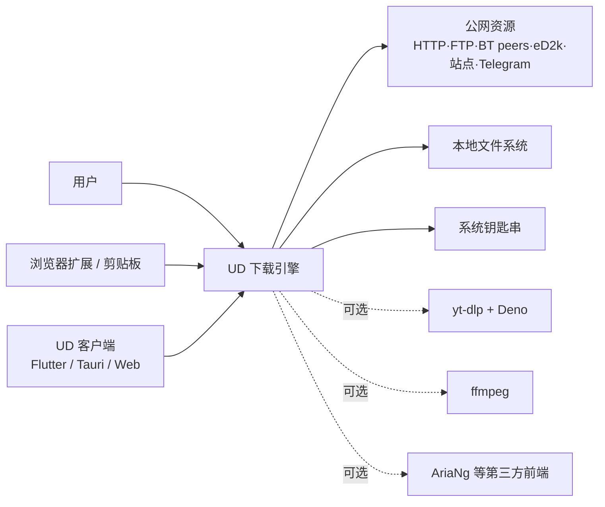
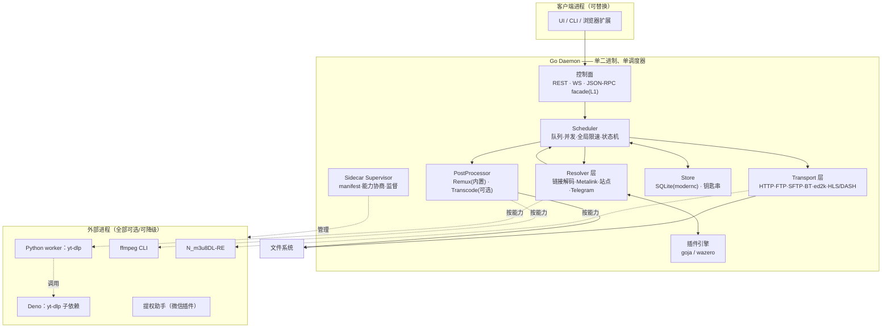
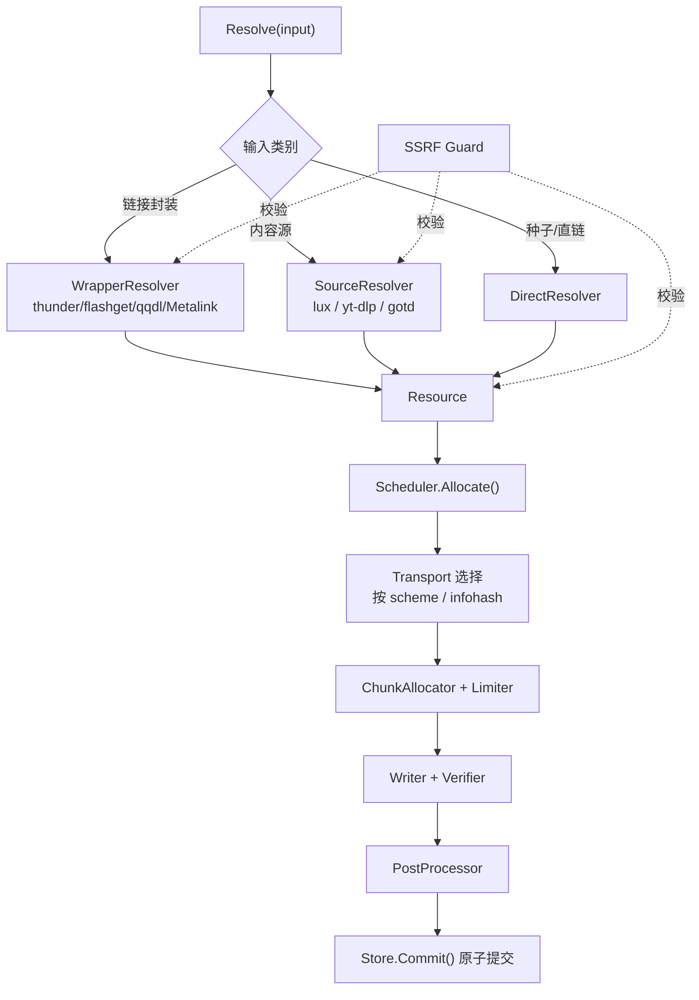
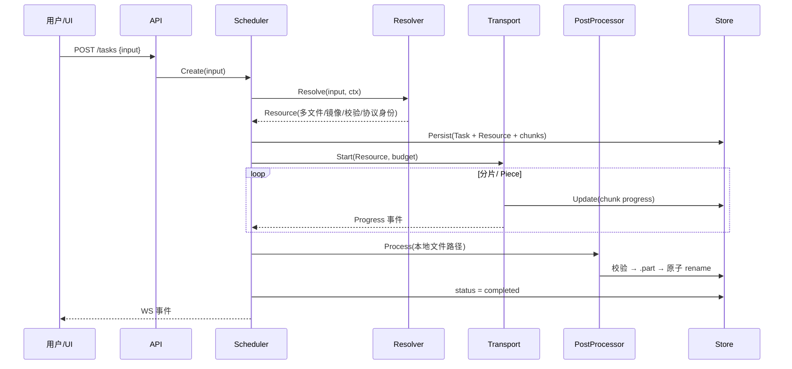

# 04 架构设计说明书（SAD）

> 文档编号：UD-DOC-04 ｜ 版本：v0.2 ｜ 状态：草案（P0 骨架已落地，待评审） ｜ 日期：2026-11-08 ｜ 上游：`03`、`adr/`

> **v0.2 实现校准**：本文的层次划分、单调度器与统一流水线约束在 P0 代码中均被遵守，并由 `tools/check_arch.py` 静态守卫。P0 只装配了 HTTP(S) 直链这一条 Resolver/Transport 组合；其余引擎仍为接口占位。实现与范围声明见 [ADR-0020](adr/ADR-0020-P0实现基线与范围声明.md)，落地清单见 `14` §9。

## 1. 架构目标与约束

| 目标 | 说明 | 对应约束 |
|---|---|---|
| 统一性 | 任意来源都表现为同一种 Task，共享队列/限速/进度/断点 | 核心原则 P1、P2 |
| 可分发性 | 纯 Go 单二进制、`CGO_ENABLED=0`、跨平台含移动端 | ADR-0001、C-01 |
| 可演进 | 新增站点 / 协议只是新增插件实现，不改核心 | P1、NFR-MNT-01 |
| 可降级 | 外部能力缺失不影响主流程 | ADR-0008 |
| 合规 | 传输路径零 GPL；能力边界清晰 | ADR-0003、C-03 |

**不可协商的架构约束**：单调度器（C-02）、无第二个任务生命周期、外部进程不得进入传输热路径、移动端不得依赖派生子进程。

## 2. 五条架构原则

| 编号 | 原则 | 违反后果 |
|---|---|---|
| P1 | **三类输入归一**：传输协议 / 链接封装 / 内容源解析器分别落到 `Resolver` 或 `Transport`，不得混称 | 按协议逐个造轮子，项目失控 |
| P2 | **单调度器**：只有 Go 核心拥有 Task 生命周期、队列、限速、文件布局 | 双调度器：限速相加、并发两套上限、状态双真值源 |
| P3 | **纯 Go 内核**：传输全在进程内；sidecar 只做「解析/后处理/提权」 | 移动端不可达、静态编译失效 |
| P4 | **一次建模**：`Resource` 在 P0 一次性覆盖多文件与协议身份 | 后期改表改接口全面返工 |
| P5 | **可降级优先**：任何可选能力都是插件，缺失即标记不可用 | 单点外部依赖拖垮全部下载 |

## 3. C4 视图

### 3.1 L1 系统上下文

### 3.2 L2 容器视图

> 关键：**sidecar 中没有一个位于传输主路径**。`Python worker` 只吐 JSON，`ffmpeg` 只读本地文件，`Deno` 只是 yt-dlp 的 JS 运行时。

### 3.3 L3 核心组件视图

## 4. 统一流水线

流水线带来的复用：队列、限速、断点续传、进度、重试、去重**只实现一次**；新增一个网站 = 新增一个 `Resolver` 插件；新增一个协议 = 新增一个 `Transport` 后端。

## 5. 单调度器论证

### 5.1 双调度器反模式（已否决）

若让 `aria2c` 承担任一实际传输（典型提案：HTTP 自研 + BT 外包），会同时出现两套：

| 冲突点 | 后果 |
|---|---|
| 全局限速 | 两边各读各的配置，2 + 2 = 4MB/s |
| 并发上限 | 两套独立计数，实际连接数翻倍 |
| 状态真值源 | 自有 SQLite ↔ `.aria2` 控制文件 + `aria2.session` |
| 文件布局 | 落盘目录、临时文件、原子提交策略不一致 |
| 进度/取消 | 需按 GID 反向映射，崩溃后重建任务 |

因此 **「全自研」与「全交给 aria2」都是自洽方案，唯独「混用」必须避免**（ADR-0002）。本项目选全自研，理由见 §5.2。

### 5.2 为什么外包 BT 不划算

| 维度 | 结论 |
|---|---|
| 可观测性 | RPC 黑盒：只有 `tellStatus(hex bitfield)` / `getFiles` / `getPeers` + 6 类通知，无分片优先级、无 `io.Reader`、无存储注入 |
| 协议深度 | 上游 aria2 1.37.0 无 uTP(BEP29)、BT v2(BEP52)、Merkle、打洞、WebTorrent、智能封禁 |
| 流式读取 | 拿不到边下边播能力；`anacrolix/torrent` 的 `File.NewReader()` 可直接喂给自有存储/解密器 |
| 移动端 | iOS 禁止派生子进程、Android API 29+ W^X；外包即意味着 iOS 版无 BT |
| 许可证 | GPL-2.0；核心卖点依赖它会显著抬升分发义务与法务风险 |
| 运维 | 6800 端口、rpc-secret、崩溃后按 GID 重建、每平台一个二进制 |

### 5.3 全局限流的唯一权威

`Limiter` 是进程内唯一令牌桶。所有 Transport 每次申请分片预算都向它取号；如未来启用 BYO aria2 适配器，由核心把预算通过 `changeOption` 下发，禁止适配器自读配置。

## 6. 进程模型与边界

| 层 | 进程 | 说明 |
|---|---|---|
| 传输 | **核心内** | HTTP/BT/ed2k/FTP/SFTP/HLS 全为 Go 库，零 sidecar |
| 内容解析 | 核心内 + 可选 | lux/gotd 在核心；yt-dlp 在 Python worker；Deno 为其子依赖 |
| 后处理 | 核心内 + 可选 | Remux 纯 Go；Transcode 为桌面端 exec 插件 |
| 提权 | 可选隔离 | 仅微信插件的 CA 安装/系统代理修改 |

**零 sidecar 基线**：仅传输协议（含 BT/ed2k/FTP/SFTP/Metalink）+ Telegram + 中文视频站子集 + HLS/DASH remux = 纯 Go 单二进制，桌面与移动端均可达。
**全功能版必需 sidecar**：不做 YouTube = 0；做 YouTube = 2（yt-dlp、Deno）。可选：ffmpeg、N_m3u8DL-RE、提权助手。

> 概念澄清：**消除进程 ≠ 消除依赖**。用 cgo 内嵌 CPython 或链接 `libav*` 可让进程数变 0，但外来运行时仍在，且静态编译与 iOS/Android 全废。优化目标是「可分发性 + 依赖可替换性」，不是进程数。

## 7. 部署视图

| 形态 | 说明 | 差异 |
|---|---|---|
| 桌面 | daemon 常驻 + UI 客户端，REST/WS 本机回环 | 可启用全部可选 sidecar |
| 移动 | 核心以库形式链接进 App（不派生子进程），UI 同进程 | 禁用 ffmpeg / 提权助手 / yt-dlp；Remux 内置 |
| Headless / NAS | 单二进制 + CLI + 配置文件 + 可选容器 | 可启用 L1 aria2 RPC facade 接 AriaNg |
| 插件分发 | 微信插件单独分发、默认不安装 | 权限与合规物理隔离 |

## 8. 质量属性场景与战术

| 质量属性 | 场景 | 战术 |
|---|---|---|
| 性能 | 1000 任务并发、单任务 16 连接 | goroutine 分片模型、单一令牌桶、零热路径外部进程、写盘缓冲 |
| 可靠性 | 进程 kill -9 后重启 | SQLite WAL + 分片表 + 启动校验；`.part` + 原子 rename；幂等状态迁移 |
| 可靠性 | sidecar 段错误 | 进程隔离 + 监督器重启 + 能力标记降级 |
| 安全 | 恶意 Metalink 指向 `169.254.169.254` | SSRF Guard（DNS 解析后校验、重定向逐跳校验、私网/回环/链路本地封禁、端口白名单、XML/镜像数量上限） |
| 安全 | 站点规则脚本窃取凭据 | 按任务最小凭据传递、goja 无网络能力、可选 WASM 硬隔离 |
| 可修改性 | 新站点规则每周失效 | Resolver 插件 + 规则包独立热更新通道 |
| 可移植性 | iOS/Android 需要 BT | 纯 Go 库进主二进制，禁止 exec / cgo |
| 合规性 | 商用闭源分发 | 传输层零 GPL；LGPL 仅以 exec 形态 arm's-length 使用；SBOM + buildconf 溯源 |

## 9. 架构风险与缓解

| 风险 | 影响 | 缓解 | 详见 |
|---|---|---|---|
| `Resource` 建模不全 | 全局返工 | P0 一次性纳入多文件 + 协议身份字段 | ADR-0013 / `06` |
| `goed2k` 互操作未充分回归 | P3 功能不可用 | 自建 eD2k 互操作套件，必要时 fork | `16` / `12` |
| 站点规则长期维护 | 功能持续退化 | 双层策略：进程内 lux + yt-dlp 兜底，规则独立通道 | ADR-0010 |
| ffmpeg 二进制矩阵 | 桌面分发复杂 | 降级为可选插件，移动端禁用 | ADR-0011 / `09` |
| 外部依赖回潮引入第二调度器 | 架构腐化 | 代码评审检查表 + 架构组否决权 | `15` |

## 10. ADR 对照

| 架构决策点 | ADR |
|---|---|
| 语言与单二进制 | ADR-0001 |
| 流水线与单调度器 | ADR-0002 |
| 移除 aria2 二进制 | ADR-0003 / ADR-0019 |
| BT / ed2k / Metalink / 迅雷选型 | ADR-0004 / 0005 / 0006 / 0007 |
| sidecar 边界 | ADR-0008 |
| 内容源纯 Go 化与 ffmpeg | ADR-0009 / 0010 / 0011 / 0012 |
| 数据模型与插件 | ADR-0013 / 0014 / 0015 / 0016 |
| 身份与合规 | ADR-0017 / 0018 |
| P0 实现基线与范围声明 | **ADR-0020** |

## 11. P0 落地映射

| 本文约束 | P0 代码 | 保障机制 |
|---|---|---|
| 统一流水线 `Resolver → Resource → Transport → PostProcessor` | `resolve/direct.go` → `core.Resource` → `transport/http` → `postproc` | `TestFullPipelineSingleFile` |
| 单调度器：队列/并发/限速/进度/状态迁移只在核心一次实现 | `internal/scheduler/scheduler.go` | `check_arch.py` 守卫 4；`TestLimiterSingleAuthority` |
| `Limiter` 是进程内唯一令牌桶 | `internal/scheduler/limiter.go` | `config.Manager` 变更回调是唯一配置入口 |
| SQLite 为状态唯一真值源 | `internal/store/`（DDL v1 + `chunks`） | 崩溃恢复只信 `chunks` + `.part` 实际字节 |
| daemon + 可替换 UI | `internal/app/daemon.go`、嵌入式最小 UI | ADR-0016；随机端口 + 本地发现文件 |
| 零 sidecar / 零 cgo / 零 GPL | `go.mod` 仅 3 个直接依赖 | `check_arch.py` 守卫 2/5；`make build` 六平台 |
