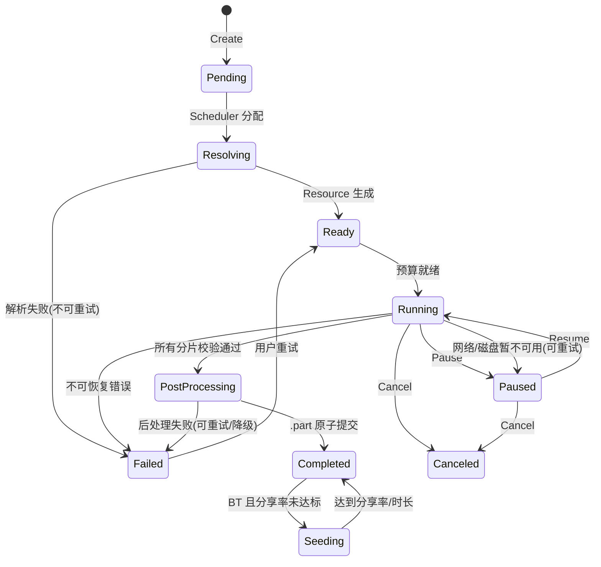

# 05 详细设计说明书（LLD）

> 文档编号：UD-DOC-05 ｜ 版本：v0.2 ｜ 状态：草案（P0 实现基线已落地） ｜ 日期：2026-11-08 ｜ 上游：`04`、`06`、`07`

本文定义 P0 必须钉死的代码级契约。**`Resource` 结构、`PostProcessor` 契约、状态机是三个不可延后的设计点**（ADR-0012 / ADR-0013）。

> **v0.2 实现校准（2026-11-08）**：P0 编码完成后按实际代码修订 §2 接口与 §4 状态机，并把 §12 检查表换成可验证的落地证据。三处规范修正：
> ① `ResolveContext.Guard` 原写作 `*security.SSRFGuard`，会使 `core` 反向依赖 `internal/security`，违反 §1 依赖方向，改为 `core` 自有 `URLGuard` 接口；
> ② `ChunkWriter` 原缺 `Next()` / `Release()`，导致 Transport 自行推算分片边界，与「`chunks` 表为唯一真值源」冲突，已补齐；
> ③ 状态机原图只画了 `Running/Paused → Canceled`，而 §4 表格写「任意 → Canceled」，实现按表格取「任意非终态可取消」，此处显式写明。
> 代码位置见 [ADR-0020](adr/ADR-0020-P0实现基线与范围声明.md) 与 `internal/core/interfaces.go`、`internal/core/task.go`。

## 1. 仓库与包结构

```
.
├── cmd/
│   ├── udd/                 # daemon 主程序
│   └── udctl/               # CLI
├── internal/
│   ├── core/                # Task / Resource / 状态机 / 事件（不依赖任何具体实现）
│   ├── resolve/             # Resolver 注册与各实现
│   │   ├── wrapper/         # thunder / flashget / qqdl / metalink
│   │   └── source/          # lux / ytdlp / telegram / wechat(plug)
│   ├── transport/           # Transport 注册与各实现
│   │   ├── http/  ftp/  sftp/  torrent/  ed2k/  hlsdash/
│   ├── scheduler/           # 唯一调度器：队列、并发、Limiter、重试
│   ├── postproc/            # Remux(内置) / Transcode(可选)
│   ├── store/               # SQLite(modernc) + migration + keychain 接口
│   ├── plugin/              # goja / wazero 运行时与能力裁剪
│   ├── sidecar/             # manifest / supervisor / jsonrpc / capability
│   ├── api/                 # REST / WS / CLI 适配 / jsonrpc facade(L1)
│   └── security/            # SSRF Guard / 凭据脱敏 / 路径校验
├── pkg/                     # 可对外复用的公共类型（谨慎开放）
├── docs/  tools/  test/
└── go.mod
```

**依赖方向**：`core` 只定义接口与类型，不 import 任何 `transport/*`；`transport`/`resolve`/`postproc` 依赖 `core`；`scheduler` 编排它们；`api` 只依赖 `scheduler` 与 `core`。禁止反向依赖与跨实现直连。由 `tools/check_arch.py` 守卫 1 静态校验（CI 门禁）。

**P0 实际落地范围**：上表是目标结构，P0 只实现了 `cmd/{udd,udctl}` 与 `internal/{core,config,security,store,resolve,transport/http,postproc,scheduler,api,app,version}`。`transport/{ftp,sftp,torrent,ed2k,hlsdash}`、`resolve/{wrapper,source}`、`plugin/`、`sidecar/`、`pkg/` 尚未创建——它们是 P1+ 交付，P0 不引入空壳占位包以免伪装成已实现能力。

## 2. 核心接口（Go）

```go
// ---- core ----
// URLGuard 由 core 定义，实现在 internal/security。core 不得 import
// 任何实现包（§1 依赖方向 / ADR-0020）。
type URLGuard interface {
    Check(ctx context.Context, raw string) error
    DialContext(ctx context.Context, network, addr string) (net.Conn, error)
    MaxRedirects() int
}

type ResolveContext struct {
    Ctx        context.Context
    Credential CredentialRef // 只传引用，不传明文
    Options    map[string]any
    Guard      URLGuard
}

type Resolver interface {
    Name() string
    Match(in Input) bool
    Resolve(ctx ResolveContext, in Input) (*Resource, error)
}

type Transport interface {
    Name() string
    Supports(r *Resource) bool
    // Run 只负责「把字节交给 Writer」，不管理队列/限速/状态迁移；
    // 预算由 Scheduler 通过 Budget 注入。
    Run(ctx context.Context, r *Resource, w ChunkWriter, b Budget) error
    Probe(ctx context.Context, r *Resource) (*ProbeResult, error)
}

type PostProcessor interface {
    Name() string
    // 输入必须是本地文件路径；禁止传入 URL / io.Reader / 网络流。
    Process(ctx context.Context, in LocalFiles, out OutputSpec) (*ProcessResult, error)
}

// Next/Release 让 SQLite chunks 表成为分片唯一真值源：Transport 只领取
// 与归还，不自行推算分片边界、不自行决定重试次数。
type ChunkWriter interface {
    Next(ctx context.Context) (Chunk, bool, error)
    WriteChunk(ctx context.Context, c Chunk, p []byte) error
    Verified(ctx context.Context, c Chunk, sum Hash) error
    Release(ctx context.Context, c Chunk, err error) error
}
```

`Release` 的 `err` 决定归还语义：取消类错误（`context.Canceled` / `DeadlineExceeded`）与可重试错误回 `pending`，不可重试且已达最大次数才落 `failed`；`failed` 只能由用户显式 `Resume` 或崩溃恢复重置，`Transport` 不得静默自动重试。

```go
// ---- scheduler ----
type Scheduler interface {
    Create(ctx context.Context, in Input, opt TaskOptions) (TaskID, error)
    Pause(ctx context.Context, id TaskID) error
    Resume(ctx context.Context, id TaskID) error
    Cancel(ctx context.Context, id TaskID) error
    SetOption(ctx context.Context, id TaskID, opt TaskOptions) error
}

type Limiter interface {
    // 全局唯一权威：所有 Transport 与可选适配器都必须向此处申请预算
    Acquire(ctx context.Context, scope Scope, n int64) (Budget, error)
    SetGlobal(rate BytesPerSec)
}
```

## 3. `Resource` 结构（P0 一次性定死）

```go
type Resource struct {
    ID          string            `json:"id"`
    Kind        ResourceKind      `json:"kind"`      // single | multi | stream | torrent | ed2k
    Engine      Engine            `json:"engine"`    // go（默认）| byo_adapter（可选任务级路由）
    Files       []ResourceFile    `json:"files"`     // 原生支持多文件输出（BT/种子、Metalink）
    Mirrors     []Mirror          `json:"mirrors"`   // 多源，含优先级/区域/失败率
    Checksum    *Checksum         `json:"checksum"`  // 整文件 + 分块 hash 列表
    Headers     map[string]string `json:"headers"`   // 按任务隔离，不共享
    Credential  CredentialRef     `json:"cred_ref"`  // 引用系统钥匙串，禁止内联明文
    Identity    ProtocolIdentity  `json:"identity"`  // ★ 协议身份（见下）
    PostProcess []ProcessSpec     `json:"post_process"`
    Limits      TaskLimits        `json:"limits"`
}

type ResourceFile struct {
    Index   int    `json:"index"`
    Path    string `json:"path"`     // 相对路径，必须经 PathGuard 校验（禁止穿越）
    Size    int64  `json:"size"`
    Offset  int64  `json:"offset"`
    Selected bool  `json:"selected"` // BT 选择下载
}

type ProtocolIdentity struct {
    // BitTorrent
    InfoHashV1  string   `json:"infohash_v1,omitempty"`
    InfoHashV2  string   `json:"btmh,omitempty"`          // v2 / hybrid
    Private     bool     `json:"private,omitempty"`       // BEP 27
    Trackers    [][]string `json:"trackers,omitempty"`   // 分层 tier
    PasskeyRef  string   `json:"passkey_ref,omitempty"`  // 引用，不存明文、不进日志
    PeerID      string   `json:"peer_id,omitempty"`      // 诚实身份，默认 -GT0001-
    TorrentMeta []byte   `json:"-"`                      // 原始 metainfo，不序列化
    // eD2k
    ED2KFileHash string  `json:"ed2k_file_hash,omitempty"`
    AICHRoot     string  `json:"aich_root,omitempty"`
    UserHash     string  `json:"user_hash,omitempty"`
    IdentKeyRef  string  `json:"ident_key_ref,omitempty"` // 持久 RSA 身份，0600
    CreditsRef   string  `json:"credits_ref,omitempty"`   // clients.met 积分
    // 流媒体
    VariantID   string   `json:"variant_id,omitempty"`
    IsAdaptive  bool     `json:"is_adaptive,omitempty"`
}
```

> **设计理由**：若 P0 只按 `URL + Header + Size` 建模，后续加 private flag、v2 双 infohash、passkey、eD2k UserHash / RSA 身份 / 积分时会被迫改表改接口；`getFiles` 等 aria2 RPC 映射也要求 `Files` 原生多文件。完整字段字典见 `06`。

## 4. Task 状态机



| 迁移 | 触发 | 持久化动作 |
|---|---|---|
| Create → Pending | API/CLI | 插入 `tasks`，事务内写 `resources` |
| Resolving → Ready | Resolver 成功 | 写 `files` / `mirrors` / `chunks` 初始分片 |
| Running → Paused | 用户 / 重试退避 | 刷 `chunks` 进度、释放预算 |
| PostProcessing → Completed | `.part` rename 成功 | 单事务更新状态 + 清理临时记录 |
| 任意 → Canceled | 用户取消 | 取消 context 树、杀子进程组、清理 `.part` |

**不变式**：① 状态迁移只能由 Scheduler 发起；② 任何状态写入必须与分片进度在同一事务；③ 崩溃恢复只信任 `chunks` 表 + 实际文件校验结果，不信任内存态。

**取消规则（v0.2 明确）**：`Cancel` 允许从**任意非终态**（`Pending / Resolving / Ready / Running / Paused / PostProcessing / Failed`）进入 `Canceled`；终态 `Completed / Canceled / Seeding` 不可再迁移。上图只绘制了主路径，完整迁移表以 `internal/core/task.go` 的 `transitions` 与 `internal/core/state_test.go` 为准。取消时 Scheduler 取消该任务的 context 树，`chunkWriter.Release` 把在途分片一律回 `pending`，避免「暂停/退出 → 永久 failed → 无法恢复」。

## 5. 分片、断点与校验

- `Chunk{ID, FileIndex, Start, End, State, Attempt, Hash, MirrorIndex}`；BT 的 Piece 映射为同表记录，`ChunkWriter` 统一接口。
- 分配策略：固定大小分片 + 末尾对齐；慢启动（初始 1 连接，按吞吐逐步增至 `maxConnections`）；长尾分片可被空闲连接「窃取」以避免拖尾。
- 续传：HTTP 用 `Range`，FTP 用 `RetrFrom(offset)`，SFTP 用偏移读，BT 由库自身 resume，ed2k 由 AICH 分块校验。
- 校验失败：只重下该分片并降该镜像权重，连续失败切换镜像，达到上限才判任务失败。
- 落盘：`预分配（可选）→ 写 .part → fsync 策略可配 → 全片校验 → 原子 rename`。

## 6. 全局限流与并发

- 单进程令牌桶，按 `global / per-task / per-host / per-transport` 分层取号；上传与下载分别计账。
- 并发信号量分两级：全局任务并发、单任务连接数；BT 分片哈希与后处理竞争 CPU，另设 CPU 信号量。
- 取消：`context.WithCancel` 树向下传递；子进程 Unix `Setpgid: true` 杀进程组、Windows `taskkill /T /F`。
- 若启用 BYO 适配器，预算由核心分配后下发，禁止其自读配置（§5.3 of `04`）。

## 7. 错误模型

```go
type ErrorKind int
const (
    KindPermanent ErrorKind = iota // 404、格式错误、凭据无效 → 不重试
    KindTransient                  // 超时、连接重置、5xx、FLOOD_WAIT → 退避重试
    KindCapability                 // sidecar 缺失/版本过低 → 降级并标记能力
    KindSecurity                   // SSRF、路径穿越、校验和不匹配 → 立即失败并告警
)
```

统一错误码见 `07` §6；退避 `min(base * 2^n, cap) + jitter`；`FLOOD_WAIT` 使用服务端给定秒数。

## 8. 事件与可观测性

`Event{TaskID, Type, Timestamp, Payload}` 经内存总线广播到 WebSocket、日志与指标；事件类型与 WS 推送格式见 `07` §4。日志强制脱敏 `Authorization / Cookie / passkey / session`；指标包含吞吐、连接数、分片重试率、sidecar 健康度。

## 9. `PostProcessor` 契约（P0 必须定死）

| 规则 | 说明 |
|---|---|
| 输入 | **只能传本地文件路径**；禁止 URL / `io.Reader` / 网络流。防止 ffmpeg `-i URL` 自己拉流，绕开进度、限速、断点与 Cookie 管理 |
| 输出 | 写 `<target>.part`，成功后由核心 `rename` 原子提交；失败保留原输入以便重试 |
| 实现分层 | `Remux`（纯 Go，默认内置，零依赖）/ `Transcode`（ffmpeg，桌面可选插件） |
| 移动端 | 默认禁用 Transcode，Remux 顶上 |
| 资源 | 预检可用空间（输入+输出约 2×），`-threads N` + 全局并发信号量 + 内存上限 |
| 可观测 | ffmpeg 用 `-progress pipe:1 -nostats` 的 key=value；同时读 stdout 与 stderr 防管道死锁；`-nostdin -y` |
| 取消 | 杀整个进程组/进程树，避免残留进程继续写文件 |

`Remux` 内部步骤：TS 解封装（PAT/PMT/PES）→ H.264 Annex B→AVCC（SPS/PPS 写 `avcC`）、ADTS AAC→MP4 sample → **PTS/DTS 重基准**（跨分片、`EXT-X-DISCONTINUITY`、分离音轨对齐）→ 写 `moov(stts/stsc/stco)` + faststart。fMP4/CMAF 可用 `mp4ff` 直接处理。

## 10. 插件与 Resolver 注册

`resolve.Register(resolver)` / `transport.Register(transport)`，按 `Match()` 优先级排序，首个命中者执行；内置实现优先于插件，插件不得覆盖 `thunder` 解码等安全敏感实现。SSRF Guard 在 `Resolve()` 出口统一校验所有产出 URL（含重定向逐跳）。详见 `08`。

## 11. 关键时序（创建任务）

```
API.Create → core.Task(Pending) → Store.Tx 持久化
  → Scheduler.Enqueue → Resolver.Resolve（含 SSRF Guard）
  → Resource → Store.Tx(files/mirrors/chunks) → 状态 Ready
  → Limiter.Acquire → Transport.Run(ChunkWriter, Budget)
  → 分片完成/校验 → PostProcessor.Process(本地路径) → Store 原子提交
  → Event(completed) → WS 推送
```

## 12. P0 交付检查表（2026-11-08 已验收）

| 检查项 | 状态 | 证据 |
|---|---|---|
| `Resource` 含 `Files[]` 与 `ProtocolIdentity` 全字段，且有 JSON 往返测试 | ✅ | `internal/core/types.go`；`internal/core/resource_test.go`（含 `TorrentMeta` 不序列化断言） |
| `PostProcessor` 签名只收本地路径，且有静态检查防止被改成 URL | ✅ | `internal/core/interfaces.go`；`internal/postproc/postproc_test.go`；`tools/check_arch.py` 守卫 3 |
| `Limiter` 为唯一实现，代码中不存在第二处速率配置读取 | ✅ | `internal/scheduler/limiter.go`；`tools/check_arch.py` 守卫 4；`internal/scheduler/limiter_test.go` |
| Task 状态机迁移表与 `06` 表结构一致，kill -9 恢复用例通过 | ✅ | `internal/core/task.go`；`internal/store/recover.go`；`internal/scheduler/scheduler_test.go:TestCrashRecoveryReusesChunks` |
| `CGO_ENABLED=0 go build ./...` 通过 | ✅ | `make build` 六平台矩阵（`darwin/linux/windows × amd64/arm64`），全绿 |
| 所有外部能力以接口占位，P0 不引入任何 sidecar 框架实现 | ✅ | `go.mod` 仅 3 个直接依赖；无 `os/exec`、无 `import "C"`（守卫 2 / 5） |

附加门禁：`go test ./... -count=1`、`go test -race` 关键包、`go vet ./...`、`gofmt`、`python3 tools/check_arch.py`、`python3 tools/build_docs.py --check` 均通过；端到端冒烟见 [CHANGELOG.md](../CHANGELOG.md) `0.1.0` 的 Fixed 段。
