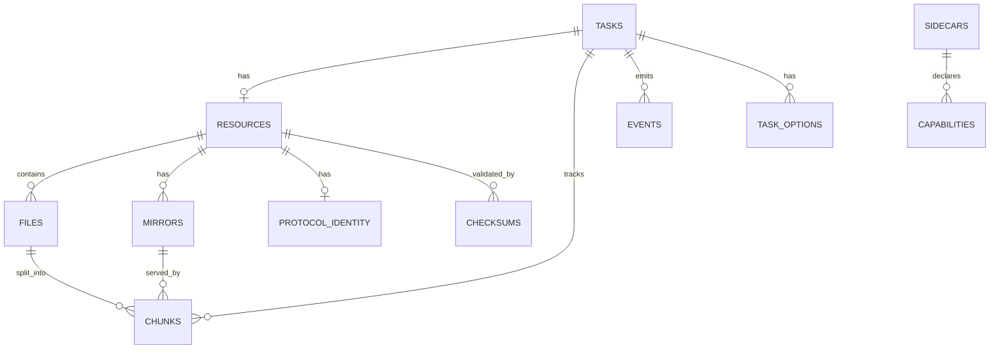

# 06 数据模型与存储设计

> 文档编号：UD-DOC-06 ｜ 版本：v0.2 ｜ 状态：草案（DDL v1 已落地） ｜ 日期：2026-11-08 ｜ 上游：`05` ｜ 相关：ADR-0013、ADR-0015、ADR-0020

> **v0.2 实现校准**：DDL v1 的 11 张表已在 `internal/store/migrations/001_init.sql` 全量落地，`app_meta.schema_version = 1`。补充 §6 的「请求头落库」规则与 §10 的位图编码规范（此前未定义字节数，导致实现与测试口径不一致）。P0 凭据存储为进程内参考实现，OS 钥匙串适配器仍属 P1，见 [ADR-0020](adr/ADR-0020-P0实现基线与范围声明.md)。

## 1. 存储选型

| 项 | 选择 | 理由 |
|---|---|---|
| 主存储 | SQLite（`modernc.org/sqlite`，纯 Go，无 cgo） | 事务、WAL、单文件、移动端可用、保持 `CGO_ENABLED=0` |
| 凭据 | 系统钥匙串（Keychain / Credential Manager / libsecret） | 不入库、不进日志；DB 只存 `credential_ref` |
| 二进制内容 | 文件系统 `.part` + 原子 rename | 不把大文件塞进 DB |
| 会话/积分 | 文件（Telegram session、eD2k RSA PEM 0600、`clients.met`） | 与库的事务边界无关，单独备份 |

## 2. ER 图



## 3. 表结构（DDL 基线 v1）

```sql
PRAGMA journal_mode = WAL;
PRAGMA foreign_keys = ON;
PRAGMA busy_timeout = 5000;

CREATE TABLE app_meta (
    key TEXT PRIMARY KEY,
    value TEXT NOT NULL
); -- schema_version, created_at, build_id

CREATE TABLE tasks (
    id            TEXT PRIMARY KEY,          -- ULID
    state         TEXT NOT NULL,             -- 见 05 §4 状态机
    input         TEXT NOT NULL,             -- 原始输入（脱敏后）
    input_kind    TEXT NOT NULL,             -- url|magnet|torrent|metalink|thunder|site|telegram|ed2k
    resource_id   TEXT,
    priority      INTEGER NOT NULL DEFAULT 0,
    error_kind    TEXT,
    error_message TEXT,
    bytes_done    INTEGER NOT NULL DEFAULT 0,
    bytes_total   INTEGER NOT NULL DEFAULT 0,
    bytes_uploaded INTEGER NOT NULL DEFAULT 0,  -- announce 统计唯一取数源
    created_at    INTEGER NOT NULL,
    updated_at    INTEGER NOT NULL,
    completed_at  INTEGER
);
CREATE INDEX idx_tasks_state_priority ON tasks(state, priority DESC, created_at);

CREATE TABLE resources (
    id         TEXT PRIMARY KEY,
    task_id    TEXT NOT NULL REFERENCES tasks(id) ON DELETE CASCADE,
    kind       TEXT NOT NULL,                -- single|multi|stream|torrent|ed2k
    engine     TEXT NOT NULL DEFAULT 'go',  -- go|byo_adapter（任务级路由）
    options    TEXT NOT NULL DEFAULT '{}',  -- JSON: limits/post_process
    headers    TEXT NOT NULL DEFAULT '{}',  -- 按任务隔离，值已脱敏检查
    cred_ref   TEXT                        -- 钥匙串引用，禁止明文
);

CREATE TABLE files (
    id         INTEGER PRIMARY KEY AUTOINCREMENT,
    resource_id TEXT NOT NULL REFERENCES resources(id) ON DELETE CASCADE,
    idx        INTEGER NOT NULL,
    rel_path   TEXT NOT NULL,               -- 经 PathGuard 校验，禁止 .. / 绝对路径
    size       INTEGER NOT NULL DEFAULT 0,
    selected   INTEGER NOT NULL DEFAULT 1,
    final_path TEXT,
    UNIQUE(resource_id, idx)
);

CREATE TABLE mirrors (
    id          INTEGER PRIMARY KEY AUTOINCREMENT,
    resource_id TEXT NOT NULL REFERENCES resources(id) ON DELETE CASCADE,
    url         TEXT NOT NULL,              -- 已过 SSRF Guard（含重定向终态）
    priority    INTEGER NOT NULL DEFAULT 0,
    geo         TEXT,
    weight      REAL NOT NULL DEFAULT 1.0, -- 失败率动态调整
    failures    INTEGER NOT NULL DEFAULT 0
);

CREATE TABLE protocol_identity (
    resource_id   TEXT PRIMARY KEY REFERENCES resources(id) ON DELETE CASCADE,
    infohash_v1   TEXT,
    btmh_v2       TEXT,
    private_flag  INTEGER NOT NULL DEFAULT 0,
    trackers_json TEXT,                    -- [[tier1...],[tier2...]]
    passkey_ref   TEXT,                    -- 引用；明文绝不落库
    peer_id       TEXT,
    ed2k_hash     TEXT,
    aich_root     TEXT,
    user_hash     TEXT,
    ident_key_ref TEXT,
    credits_ref   TEXT,
    variant_id    TEXT,
    is_adaptive   INTEGER NOT NULL DEFAULT 0
);

CREATE TABLE checksums (
    id          INTEGER PRIMARY KEY AUTOINCREMENT,
    resource_id TEXT NOT NULL REFERENCES resources(id) ON DELETE CASCADE,
    file_idx    INTEGER NOT NULL DEFAULT 0,
    algo        TEXT NOT NULL,             -- sha256|sha1|md5|piece-sha1
    scope       TEXT NOT NULL,             -- whole|piece
    chunk_index INTEGER,
    value       TEXT NOT NULL
);
CREATE INDEX idx_checksums_lookup ON checksums(resource_id, scope, chunk_index);

CREATE TABLE chunks (
    id           INTEGER PRIMARY KEY AUTOINCREMENT,
    task_id      TEXT NOT NULL REFERENCES tasks(id) ON DELETE CASCADE,
    file_idx     INTEGER NOT NULL DEFAULT 0,
    idx          INTEGER NOT NULL,          -- 分片序号 / BT piece index
    start        INTEGER NOT NULL,
    length       INTEGER NOT NULL,
    state        TEXT NOT NULL,             -- pending|assigned|done|verified|failed
    attempt      INTEGER NOT NULL DEFAULT 0,
    mirror_id    INTEGER,
    hash_ok      INTEGER NOT NULL DEFAULT 0,
    updated_at   INTEGER NOT NULL,
    UNIQUE(task_id, file_idx, idx)
);
CREATE INDEX idx_chunks_pending ON chunks(task_id, state);

CREATE TABLE task_options (
    task_id TEXT NOT NULL REFERENCES tasks(id) ON DELETE CASCADE,
    key     TEXT NOT NULL,
    value   TEXT NOT NULL,
    PRIMARY KEY(task_id, key)
);

CREATE TABLE events (
    id      INTEGER PRIMARY KEY AUTOINCREMENT,
    task_id TEXT,
    type    TEXT NOT NULL,
    payload TEXT NOT NULL,
    ts      INTEGER NOT NULL
);
CREATE INDEX idx_events_ts ON events(ts);

CREATE TABLE sidecars (
    name         TEXT PRIMARY KEY,
    version      TEXT,
    min_version  TEXT,
    license      TEXT,
    sha256       TEXT,
    source_url   TEXT,
    buildconf    TEXT,
    status       TEXT NOT NULL DEFAULT 'absent', -- absent|ready|degraded|failed
    capabilities TEXT NOT NULL DEFAULT '[]'
);
```

## 4. `Resource` JSON 示例

### 4.1 单文件 HTTP（含多镜像 + 分块校验）
```json
{
  "id": "01J...", "kind": "single", "engine": "go",
  "files": [{ "index": 0, "path": "ubuntu.iso", "size": 2147483648, "selected": true }],
  "mirrors": [
    { "url": "https://mirror.a/ubuntu.iso", "priority": 1 },
    { "url": "https://mirror.b/ubuntu.iso", "priority": 2 }
  ],
  "checksum": { "algo": "sha256", "whole": "9f86...", "pieces": ["..."] },
  "cred_ref": "keychain://ud/cred/2f1c",
  "identity": {}
}
```

### 4.2 BT 多文件（含 private flag 与双 infohash）
```json
{
  "id": "01J...", "kind": "torrent", "engine": "go",
  "files": [
    { "index": 0, "path": "Series/S01E01.mkv", "size": 1073741824, "selected": true },
    { "index": 1, "path": "Series/S01E02.mkv", "size": 1073741824, "selected": false }
  ],
  "identity": {
    "infohash_v1": "A1B2...", "btmh": "C3D4...", "private": true,
    "trackers": [["https://tracker.example/announce/<passkey_ref>"]],
    "passkey_ref": "keychain://ud/passkey/8a",
    "peer_id": "-GT0001-"
  }
}
```

### 4.3 eD2k
```json
{
  "id": "01J...", "kind": "ed2k", "engine": "go",
  "files": [{ "index": 0, "path": "old-archive.rar", "size": 734003200, "selected": true }],
  "identity": {
    "ed2k_file_hash": "31D6...", "aich_root": "FE...",
    "user_hash": "9C...", "ident_key_ref": "file://~/.local/share/ud/ed2k/ident.pem",
    "credits_ref": "file://~/.local/share/ud/ed2k/clients.met"
  }
}
```

### 4.4 自适应流（分离流）
```json
{
  "id": "01J...", "kind": "stream", "engine": "go",
  "files": [
    { "index": 0, "path": "video.mp4", "selected": true },
    { "index": 1, "path": "audio.m4a", "selected": true }
  ],
  "identity": { "variant_id": "1080p", "is_adaptive": true },
  "post_process": [{ "type": "remux", "target": "output.mp4" }]
}
```

> 字段字典与 `05` §3 的 Go 结构一一对应；任何字段增删必须同步 `05`、`07` 的示例与 `12` 的回归用例。

## 5. 状态持久化与崩溃恢复

1. 启动时读 `app_meta.schema_version`，执行顺序迁移。
2. 找出 `state IN ('Resolving','Running','PostProcessing','Seeding')` 的任务 → 置为 `Paused`。
3. 对每个 `chunks.state IN ('done','verified','assigned')` 的分片，读实际 `.part` 文件对应区间并校验哈希；通过则保留，否则回 `pending`。
4. `assigned` 一律回 `pending`（无内存态可信任）。
5. 存在 `.part` 且缺最终文件 → 进入 `PostProcessing` 重新提交。
6. 重新入队，按优先级恢复。

**事务边界**：`状态迁移 + 分片进度更新` 必须在同一事务；`完成提交` 与 `最终路径写入` 在同一事务。`PRAGMA synchronous = NORMAL`（WAL 下兼顾性能与一致性）。

## 6. 敏感数据与脱敏

| 数据 | 存放 | 规则 |
|---|---|---|
| Cookie / Authorization | 钥匙串 | DB 仅 `cred_ref`；日志输出前经 `security.Redact` |
| PT passkey | 钥匙串 | 不进日志、不进事件、不跨任务同步；announce URL 拼接发生在内存 |
| Telegram session | 文件 0600 | 加密存储，路径不入库明文 |
| eD2k RSA 私钥 | 文件 0600 | 必须持久化，否则重启换身份、积分归零 |
| 原始输入 URL | `tasks.input` | 入库前剔除 query 中的 token/passkey（`security.RedactURL`） |
| 请求头 `Authorization` / `Cookie` / `X-Api-Key` | **不落库** | `security.StripSensitiveHeaders` 在 `saveOptions` 与 `SaveResource` 两处强制剥离；API 的 `POST /tasks`、`POST /tasks/batch`、`PATCH /tasks/{id}` 直接拒绝内联凭据头，要求改用 `credentialRef` |
| 非敏感请求头（`Referer` 等） | `task_options.value` / `resources.headers`（JSON） | 可持久化，重启后仍可复现；不含任何凭据 |

> **为什么是「剥离」而非「掩码」**：`***` 在日志里是安全的，但写进 DB 后重启会被 Scheduler 当成真实 header 回放，导致鉴权静默失败。P0 因此丢弃敏感头，只保留 `credentialRef`；Scheduler 在每次请求前由 `CredentialStore` 取出明文注入内存中的 `Resource.Headers`，该内存副本绝不回写 DB。

## 7. 索引、并发与容量

- 单个写连接 + 多个读连接；所有写走 Scheduler 串行化入口，避免 `SQLITE_BUSY`。
- `chunks` 是高频写表：进度批量刷盘（默认 500ms 或 4MB 聚合），不每片一事务。
- `events` 保留策略可配（默认 7 天 / 10 万条），定期清理。
- 1000 任务 × 平均 200 分片 ≈ 20 万行，属 SQLite 舒适区；分片大小默认 4MB 可调。

## 8. 迁移策略

- `app_meta.schema_version` 单调递增；迁移脚本 `store/migrations/NNN_*.sql` 幂等、只增不改名。
- 升级前自动备份 DB；不兼容变更需提供 `udctl migrate --from N`。
- 降级只允许回到有显式回滚脚本的版本，否则拒绝启动并提示。
- `resources.options` / `headers` 为 JSON，新增字段向后兼容；`protocol_identity` 用可空列扩展，避免改主键。

## 9. 备份与恢复

`udctl backup` 在 WAL checkpoint 后复制单文件 DB + 钥匙串引用清单；恢复时校验 `schema_version`、重建 `assigned` 分片、逐片校验 `.part`。凭据本身需由用户从钥匙串单独导出。

## 10. 分片位图编码与 P0 实现基线

**位图编码（v0.2 补充）**：`bitfield` 由 `chunks` 表生成，字节数为 `ceil(numPieces / 8)`，高位在前（第 `i` 片对应第 `i/8` 字节的 `0x80 >> (i%8)` 位），输出小写 hex。`done` 与 `verified` 都置位；`verified` 计数单独返回。例如 3 片、首片完成 → 1 字节 `80`（不是 2 字节 `8000`）。规则由 `internal/store/chunks.go:Bitfield` 与 `internal/store/store_test.go:TestChunksAndBitfield` 固定。

**P0 实现基线**：

| 本文条款 | P0 代码 | 验证 |
|---|---|---|
| §3 DDL v1（11 张表） | `internal/store/migrations/001_init.sql` | `TestSchemaAndIdempotentMigration` |
| §4 `Resource` 全字段规范化存取 | `internal/store/resources.go` | `TestResourcePersistenceRoundTrip` |
| §5 事务边界与崩溃恢复 | `internal/store/recover.go`、`tasks.go:Commit` | `TestCrashRecoveryResetsAndVerifies` |
| §6 敏感数据不落库 | `internal/security/redact.go`、`store/{tasks,resources}.go` | `TestSensitiveHeadersNeverPersisted` |
| §8 迁移幂等 | `Open()` 内嵌执行 `CREATE TABLE IF NOT EXISTS` | 重复 `Open` 同一文件 |
| §9 备份 | `VACUUM INTO` | `internal/store/store_test.go` |

**P0 偏差（须在 ADR-0020 范围内理解）**：`task_options` / `resources.headers` 目前未按 §7 做 500ms 批量聚合，而是每片与分片状态在同一事务提交——这是为了保证 §5「状态迁移 + 分片进度同事务」不变式，吞吐优化留到 P1；`events` 的 7 天保留清理策略尚未实现。
