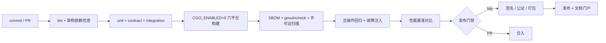

# 13 构建、发布与运维

> 文档编号：UD-DOC-13 ｜ 版本：v0.10 ｜ 状态：草案（P0 评审门禁已接入 CI；P1 WBS 10 插件配置、WBS 11 互操作套件已落地） ｜ 日期：2026-11-14 ｜ 相关：`09`、`10`、`11`、`12`、`17`

> **v0.10 说明**（2026-11-14，代码↔文档一致性校准，不改变 CI 步骤与任何结论）：
> §4 追加已核验的 CI 结论——`679a26e` run `43402970475` 与 `c3fbc70`
> run `43567640194` 均 `quality: success`；一次被取代的 API 推送尝试
> run `43566313113` 为 `failure`（`actions/checkout` 无法完整拉取 API 生成的
> commit，报 `Found 4 documents` / `253 error(s)`；已由真实 git 对象 `c3fbc70`
> 经 SSH 读写 deploy key 重推取代），**非偶发 flake、非质量门禁回归**，
> 如实登记不隐藏。门户生成器 `tools/build_docs.py` 把硬编码
> `文档体系 v0.4` 徽章改为从 `docs/README.md` 版本头动态读取，并把导航契约
> 注释改为 ADR 自动发现口径（实际 21 份）。v0.8 / v0.9 的原文与数值不改写。
> 门禁包 **16**、链接模块 **90**、`make gates-strict` **6 PASS / 0 WARN / 0 FAIL**、
> L4 **0/14**、`release_gate_met=false` 均不变；CI 仍按
> `lint → test → build → gates-strict → interop → docs --check` 执行。
>
> **v0.9 说明**（2026-11-13，序 6 阻塞定档，不改变 CI 步骤）：§3 / §12 新增
> `make l4-preflight` / `l4-preflight-check` / `l4-run` 三个**仅实验室、不接入 CI** 的目标；
> §7 校准 `bt.*` 配置键「P0/P1 当前仍只解析不生效」。同轮修正
> `tools/build_docs.py` 门户首页的过期横幅（原写「ADR 0001–0020 仍全部
> `Proposed`、P0 尚未评审」，与 ADR 索引矛盾），改为按 ADR 头部动态汇总
> （当前 **20 `Accepted` / 1 待评审**）；`--check` 仍校验 42 篇 / 0 断链。
> 阻塞性质见 `12` §3.1.2 与 [ADR-0021](adr/ADR-0021-L4门禁与P2P礼仪范围冲突裁决提案.md)
> （`Proposed`，未生效）。门禁包 **16**、链接模块 **90**、`make gates-strict`
> **6 PASS / 0 WARN / 0 FAIL** 不变；CI 仍按 `lint → test → build → gates-strict →
> interop → docs --check` 执行，未放宽任何步骤。
>
> **v0.8 说明**（2026-11-13，CI 缺陷修复）：`9530c35` 的 CI run `43393512271` 在
> `make gates-strict` → **cover** 步骤出现偶发 `SQLITE_BUSY`，当时
> **5 PASS / 0 WARN / 1 FAIL**（本机同条件 6 PASS）。修复位于
> `internal/store.withTx`（有界 BUSY 重放 + 4 条回归用例），**不改 CI 步骤、
> 不放宽 `--strict`、不靠重跑蒙混**：CI 仍按 `lint → test → build → gates-strict →
> interop → docs --check` 执行，任何 FAIL 都使 `quality` 失败。代码变更后已先
> `make build` 再跑 `make gates-strict`（§12 SBOM 二进制一致性守卫），本机恢复
> **6 PASS / 0 WARN / 0 FAIL**、`go test -race ./...` 全绿。门禁包 **16**、链接模块 **90** 不变；
> CI 复跑 run `43399289527` 结论为 `quality: success`。
>
> **v0.7 说明**（2026-11-13）：§3 / §12 新增两个**仅本机、不接入 CI** 的目标：
> `make interop-external`（真实 aria2-next / libtorrent 外部引擎，产出
> `dist/interop_external.json` 补充证据）与 `make perf`（1GiB 回环参考基准，
> 产出 `dist/perf.json`，固定 `nfr_perf_01.met=false`）。CI 仍只跑 `make interop`
> 与 `make gates-strict`，不得把外部引擎缺失或回环吞吐值伪装成 L4 / NFR 达标。
> 代码变更后仍须先 `make build` 再跑 `make gates-strict`（SBOM 二进制一致性守卫），
> 本轮已按此顺序执行；链接模块仍 90，门禁包仍 16。
>
> **工具链修订（2026-11-11，v0.6 内一并记录）**：`govulncheck` 漏洞库新增
> `GO-2026-6859`（Go 1.27.3 的 `net/http` 可达漏洞），`go.mod` 的 `go` 指令与
> `.github/workflows/ci.yml` 的 `go-version` 由 **1.27.3 升至 1.27.4**，§1 / §12 同步，
> 复扫 `No vulnerabilities found`。**依赖模块图未变**（仍 90 个链接模块），
> 但代码变更后必须重新 `make build` 再跑 `make gates-strict`（§12 的 SBOM
> 二进制一致性守卫）。`17` 与 ADR-0020 中的 1.27.3 为 P0 评审时点证据，保留不改。
>
> **v0.6 说明**（2026-11-11）：P1 WBS 11 互操作套件 v1 落地，§3 / §12 把 `make interop`
> 从「P1 占位」改为真实入口并新增 `make interop-gate`，补齐 `dist/interop.json` /
> `dist/INTEROP.md` 证据链与 CI 步骤、artifact 清单；§12「已知差异」补 L4 外部矩阵与
> NFR-PERF-01 仍未执行。当前 **16 个门禁包、90 个链接模块**（WBS 11 零新增依赖），
> `make gates-strict` 6 PASS / 0 WARN / 0 FAIL。**CI 只跑 `make interop`（本地回环子集），
> 不代表 L4 发布门禁通过**。
>
> **v0.5 说明**（2026-11-10）：P1 WBS 10 落地插件规则通道，§7 补 `plugins.dir` /
> `trustedKeys` / `insecure` / `reloadInterval` 与对应 `UD_*` 环境变量，并写明
> fail-closed 与本地开发例外。**WBS 10 时点**为 15 个门禁包、90 个链接模块
> （当前态口径见 `docs/README` §三）。
>
> **v0.4 说明**（2026-11-10，仅文档口径校准）：§12 的 CI 步骤名由 `make gates`
> 校正为实际执行的 `make gates-strict`，`make sbom` 行补上 WBS 9 新增的
> 「二进制与 `go.mod` 版本一致性」守卫；门禁包数由 P0 时点的 10 个校准为 **13 个**
> （新增 `transport/ftp`、`transport/sftp`、`transport/tputil`），链接模块 16 个，
> `make gates-strict` 6 PASS / 0 WARN。`17` 与 ADR-0020 中的 10 / 12 / 5 PASS 属于
> 已签署的 P0 评审时点快照，保留不改；当前态唯一速查见 `docs/README` §三。
>
> **v0.3 说明**：`make sbom` 从「最小版」升级为 CycloneDX 1.6（基于实际链接模块图），新增 `make gates`（覆盖率 / SBOM / 许可证 / `govulncheck` / 吞吐基准 / 回滚演练）并接入 CI；`make cover` / `make sbom` / `make licenses` / `make vuln` / `make bench` / `make rollback-drill` 等单项可独立复跑。Go 版本因 `GO-2026-6809` 由 `1.27.2` 升为 **`1.27.3`**（`go.mod`、`ci.yml`、本文 §1/§12 同步）。由于 `GOTOOLCHAIN=auto` 需要校验工具链模块，Makefile 项目级设 `GOSUMDB=sum.golang.org`；不改用户全局 Go 配置。
>
> **v0.2 说明**：§1–§4 描述目标发布流水线；P0 已实现其中的 `lint / lint-arch / test / build / docs / sbom` 与 PR 级检查，签名/公证/打包/发布/互操作/性能全套仍是发布阶段目标。实际差异见 §12。

## 1. 构建基线

| 项 | 规定 |
|---|---|
| Go 版本 | **Go 1.27.4**（写入 `go.mod` 的 `go` 指令与 CI）；因标准库 `GO-2026-6809` 从 1.27.2 升 1.27.3，又因 `GO-2026-6859`（`net/http` HTTP/1 `MaxBytesReader` header race）于 2026-11-11 升 **1.27.4**。开发者机器若仍是旧版，`GOTOOLCHAIN=auto` 会自动下载 1.27.4，此时需要可用的 checksum DB（`GOSUMDB=off` 会导致工具链校验失败） |
| 关键标志 | **所有传输构建 `CGO_ENABLED=0`**；`-trimpath`；`-ldflags "-s -w -X main.version=... -X main.buildID=..."` |
| 依赖 | `go mod vendor` 可选；`go mod verify` 必跑；禁止 `replace` 指向本地路径入库 |
| 可复现 | 同 commit + 同工具链产出一致二进制；构建镜像固定 digest |
| 校验 | `go version -m <bin>` 输出与 SBOM 一致 |

## 2. 交叉编译矩阵

| 目标 | GOOS/GOARCH | cgo | 备注 |
|---|---|---|---|
| Windows x64 / arm64 | `windows/amd64`、`windows/arm64` | 0 | 签名（EV/标准代码签名）避免 SmartScreen |
| macOS x64 / arm64 | `darwin/amd64`、`darwin/arm64` | 0 | 需签名 + **公证**；helper 二进制单独签名 |
| Linux x64 / arm64 | `linux/amd64`、`linux/arm64` | 0 | 容器 / NAS / 静态 |
| Android | `android/arm64` 等（gomobile / NDK） | 0 | 核心以库形式链接进 App，**不派生子进程** |
| iOS | `ios/arm64`（gomobile） | 0 | 同上；禁止 exec / 禁止按需下载可执行码 |

> 若未来启用 cgo（如 libtorrent / libav*），需单独立项评估：会破坏上表全部 `CGO_ENABLED=0` 目标与移动端可达性（ADR-0011）。

## 3. 构建脚本与 Makefile 目标

```
make gen          # 代码生成（若引入）
make lint         # golangci-lint + 自定义检查（禁止 core import 具体实现）
make test         # 单元 + 契约 + 集成
make interop      # WBS 11 互操作套件（本地回环 9 例 + L4 门禁注册表），见 12 §3.1
make interop-external # 真实外部引擎（aria2-next / libtorrent）补充证据；仅本机、不接入 CI
make perf         # 1GiB 回环参考基准 → dist/perf.json（NOT NFR-PERF-01，CI 不跑）
make interop-gate # L4 发布门禁（需外部真实客户端，未执行时明确失败，不接入 CI）
make l4-preflight # L4 前置条件清点 → dist/l4_preflight.json（NOT L4 执行证据，不接入 CI）
make l4-preflight-check # 同上但未齐备即非零退出（不接入 CI）
make l4-run       # 隔离实验室执行外部矩阵（示例 stub 配置必须 0/14 并失败，不接入 CI）
make build        # 六平台 CGO_ENABLED=0 构建
make docs         # python3 tools/build_docs.py → docs/_site/
make sbom         # CycloneDX SBOM + go version -m 校验
make sign         # 各平台签名/公证
make package      # 安装包 / 容器镜像 / 移动端 bundle
make release      # 汇总产物 + changelog + 发布
```

## 4. CI/CD 流水线



强制检查（PR 级）：`core` 不得 import `transport/*` / `resolve/*` 具体实现；代码中不得出现第二处速率配置读取；`PostProcessor` 签名不得接收 URL；新增日志字段需过脱敏检查表。

## 5. 版本与发布渠道

- 语义化版本 `vMAJOR.MINOR.PATCH`；daemon 与 API 版本分离（API 见 `07` §1）。
- 渠道：`stable` / `beta` / `nightly`；规则包与 yt-dlp 走**独立更新通道**，不受主程序发版节奏约束。
- 每版本产物：二进制 + `checksums.txt`（sha256）+ SBOM + `THIRD_PARTY_NOTICES` + changelog + 回滚说明。
- 桌面可选 sidecar（ffmpeg / yt-dlp / Deno）**首次使用时按需下载 + sha256 校验**，不进主安装包；离线/内网提供离线包；iOS 禁止按需下载可执行码。

## 6. 打包形态

| 形态 | 内容 | 差异 |
|---|---|---|
| 桌面安装包 | daemon + UI + 配置 + 卸载器 | macOS helper 单独签名公证；Windows 代码签名 |
| 移动 App | 核心以库链接 + UI | **不含任何 sidecar**；能力面板标注不可用项 |
| Headless / 容器 | 单二进制 + 默认配置 | 可启用 L1 aria2 RPC facade 接 AriaNg |
| 微信插件 | 独立安装包 | 单独分发、默认不安装、显式授权 |

## 7. 配置管理

优先级（低→高）：内置默认 < 配置文件 < 环境变量 < CLI 参数 < API/UI 运行时设置。

```yaml
# config.yaml（示例）
listen: "127.0.0.1:0"        # 0 = 随机端口 + 本地发现文件；不占用固定 6800
downloadDir: "~/Downloads"
tempSuffix: ".part"
global:
  maxConcurrentTasks: 5
  maxDownloadRate: "8MiB/s"
  maxUploadRate: "2MiB/s"
  maxConnectionsPerTask: 16
  chunkSize: "4MiB"
  diskFlushInterval: "500ms"
security:
  allowedSchemes: ["http","https","ftp","ftps","sftp"]
  allowedPorts: [80, 443, 21, 22, 990]
  maxRedirects: 3
  maxMetalinkMirrors: 32
  maxXMLBytes: 4194304
  blockPrivateNetworks: true
bt:
  peerID: "-GT0001-"         # 诚实身份，禁止伪装
  enableDHT: true
  enablePEX: true
  seedRatio: 1.0
  seedTimeMinutes: 60
  enableUPnP: true
ed2k:
  obfuscation: true          # 覆盖 goed2k 默认关闭
  secureIdent: true
  tcpPort: 4662
  udpPort: 4672
plugins:
  verifySignature: true       # 官方规则包强制 Ed25519 校验；关闭必须同时显式 insecure: true
  runtime: "goja"             # 仅实现 goja；wasm 为未来硬隔离升级路径
  dir: ""                    # 规则通道目录；为空 = 不注册任何插件 Resolver
  trustedKeys: []            # base64 Ed25519 公钥；也可由 UD_PLUGIN_KEYS 提供（逗号分隔）
  insecure: false            # 本地开发跳过签名校验；非回环监听时禁止
  reloadInterval: "30s"      # 热更新轮询间隔（1s..24h）
remoteToken: ""             # 非回环监听时必填；也可由 UD_REMOTE_TOKEN 提供
telemetry:
  enabled: false             # 默认关闭
```

> 注意：`bt.seedRatio/seedTime`、`ed2k.obfuscation/secureIdent` 是**必须显式覆盖的默认值**——库默认 `Seed=false`、混淆与 SecIdent 关闭（见 `16` §4–§5）。
>
> **v0.9 实现校准（2026-11-13，不改变上述规范）**：`config.example.yaml` 与
> `internal/config/config.go` 把 `bt.*` 标为「P1+ 预留、P0 只解析不生效」；
> **P1 WBS 7 已交付 BT，但这些键至今仍未接入** `internal/transport/bt.clientConfig`
> （固定 `NoUpload=true` / `Seed=false`），也没有上传槽 / 分享率 / `seed-time` /
> UPnP-NAT-PMP 实现。上表的 `seedRatio` / `seedTimeMinutes` / `enableUPnP` 是
> **目标态配置项，不是当前生效能力**。该未签署范围缩减已由
> [ADR-0021](adr/ADR-0021-L4门禁与P2P礼仪范围冲突裁决提案.md)（`Proposed`）定档待评审，
> 签署前不得把示例配置误读为「做种策略已生效」，也不得自行删除这些键。

**P0 补充的配置键**（`config.example.yaml` 为准）：

| 键 | 默认 | 约束 |
|---|---|---|
| `remoteToken` | 空 | 非回环监听时**必填**，否则 `config.Validate` 拒绝启动（`07` §1 / ADR-0016）；不写入日志与 API 响应（`json:"-"`） |
| `security.allowLoopbackForDev` | `false` | 仅本地联调：把回环目标从私网/端口黑名单中放开；**禁止与非回环监听组合**，公网目标仍走完整白名单 |
| `security.allowedSchemes` / `allowedPorts` / `maxRedirects` / `blockPrivateNetworks` | 见示例 | `maxRedirects` 取值 0..10 |
| `listen` | `127.0.0.1:0` | `0` 端口 = 随机端口 + 本地发现文件，不占固定 6800（ADR-0016） |

**WBS 10 插件规则通道配置键（2026-11-10 已落地，`config.example.yaml` 为准）**：

| 键 | 默认 | 约束与行为 |
|---|---|---|
| `plugins.dir` | 空 | 独立规则通道目录；为空时 daemon **完全不注册插件 Resolver**，P0/P1 行为不变。目录内每个子目录一个规则包（`manifest.json` + 入口 `.js`），或该目录自身即一个规则包 |
| `plugins.verifySignature` | `true` | 规则包必须带 `ed25519:<base64>` 签名且匹配 `trustedKeys`；无签名 / 无受信公钥一律拒绝加载（fail-closed） |
| `plugins.trustedKeys` | `[]` | base64 原始 32 字节 Ed25519 公钥；`UD_PLUGIN_KEYS`（逗号分隔）可覆盖。签名与脚本字节绑定，改一个字节即失效 |
| `plugins.runtime` | `"goja"` | 仅 `goja` 已实现；其它值在 `config.Validate` 阶段拒绝启动（wasm 是 ADR-0014 §5 的未来升级路径，不得静默降级） |
| `plugins.insecure` | `false` | 本地开发跳过签名校验；`verifySignature=false` 必须同时置 `true`；`config.Validate` 禁止它与非回环监听组合；`udd --insecure-plugins` / `udctl daemon --insecure-plugins` 为单次运行等价开关 |
| `plugins.reloadInterval` | `"30s"` | 目录内容指纹轮询间隔，取值 1s..24h；纯标准库实现、无需 fsnotify，规则包更新与主程序发版解耦 |

环境变量覆盖前缀为 `UD_`（如 `UD_REMOTE_TOKEN`、`UD_LISTEN`、`UD_PLUGINS_DIR`、`UD_PLUGINS_RUNTIME`、`UD_PLUGINS_RELOAD_INTERVAL`、`UD_PLUGIN_KEYS`、`UD_PLUGIN_INSECURE`）。运行时 `PATCH /config` 只接受白名单键且逐键校验，非法补丁不触发变更回调；**插件配置不在运行时热补丁白名单内**，改 `plugins.*` 需重启，规则内容更新则靠规则通道热加载。

## 8. 升级与迁移

1. 升级前自动备份 SQLite（WAL checkpoint 后复制单文件）。
2. 启动时按 `app_meta.schema_version` 顺序执行幂等迁移脚本（见 `06` §8）。
3. 重启后执行崩溃恢复流程（`06` §5）；`assigned` 分片一律回 `pending`。
4. 不兼容变更需提供 `udctl migrate --from N`；无回滚脚本时拒绝启动并给出明确指引。
5. 回滚：停 daemon → 恢复备份 DB → 安装旧版二进制 → 校验 `.part` 与最终文件一致性。

## 9. 日志、指标与健康检查

| 项 | 内容 |
|---|---|
| 日志 | JSON 结构化，等级 `debug/info/warn/error`；强制脱敏；按大小轮转，默认保留 7 天 |
| 指标 | 吞吐、任务数、连接数、分片重试率、tracker 成功率和、sidecar 健康度、后处理耗时 |
| 健康检查 | `GET /healthz` 返回 DB、`Limiter`、sidecar 状态摘要；非 200 时容器编排重启 |
| 事件 | `events` 表 + WebSocket 推送；保留策略可配 |

## 10. 运维 Runbook（常见症状 → 排查）

| 症状 | 检查项 |
|---|---|
| 任务一直 Pending | `/healthz`、全局并发上限、Limiter 是否被长任务占满、`/capabilities` |
| 速度异常翻倍 | 是否存在第二处限速配置；BYO 适配器是否自读配置（单调度器违规） |
| BT 找不到源 | DHT/PEX 引导、`private=1`、防火墙入站端口、UPnP 结果、tracker 返回 |
| PT 直接被拒 | **预期行为**，产品不承诺 PT；引导使用 BYO 适配器 |
| ed2k 极慢 / 无源 | 是否 High ID、混淆是否开启、`server.met`/`nodes.dat` 是否有效、积分是否归零（身份是否持久化） |
| 站点解析失败 | 规则包版本、`RULE_OUTDATED` 事件、yt-dlp 能力协商状态、Cookie 是否过期 |
| YouTube 只有 720p | 是否走了 yt-dlp 默认退化；确认核心自有 formats 选取生效、Remux 可用 |
| 视频无声音 / 不能拖进度 | Remux 的 PTS/DTS 重基准、`moov` + faststart、音轨对齐 |
| 取消后仍有进程写文件 | 进程组/进程树终止逻辑是否生效（Unix `Setpgid` / Windows `taskkill /T /F`） |
| macOS 提示「已损坏」 | helper 签名与公证、quarantine 属性 |
| 升级后任务丢失 | `schema_version` 迁移日志、备份 DB 路径、回滚脚本 |

## 11. 备份与灾难恢复

`udctl backup <path>` 导出 DB + 配置 + 钥匙串引用清单；恢复时校验 `schema_version`、重建分片状态、逐片校验 `.part`。凭据本身需用户从系统钥匙串单独导出/导入。定期演练：每季度一次「升级 → 回滚 → 恢复」演练并留记录。

## 12. P0 构建链落地情况（2026-11-08）

| §3 目标 | P0 状态 | 实际行为 |
|---|---|---|
| `make gen` | ✅ | `go generate ./...`（当前无生成指令） |
| `make lint` | ✅ | `gofmt` 校验 + `go vet ./...` + `tools/check_arch.py`；未安装 `golangci-lint` 时明确打印跳过，不静默放行 |
| `make test` | ✅ | `go test ./... -count=1` |
| `make build` | ✅ | `CGO_ENABLED=0`、`-trimpath`、`-ldflags -s -w -X ...`，6 平台 × `udd`/`udctl` 共 12 个二进制，输出到 `dist/` |
| `make docs` | ✅ | `python3 tools/build_docs.py` 重建 `docs/_site/index.html` |
| `make sbom` | ✅ | `tools/gates.py sbom` 生成 **CycloneDX 1.6** `dist/sbom.cdx.json`（仅 `go version -m` 实际链接的模块，并逐模块比对 `go.mod`；二进制陈旧即 FAIL）、`THIRD_PARTY_NOTICES.md`、`checksums.txt`、`build-metadata.txt`，并跑 `go mod verify` |
| `make licenses` | ✅ | 链接模块图许可证扫描：GPL/LGPL/AGPL/SSPL 等 copyleft 直接 FAIL，`NOASSERTION` 记 WARN |
| `make cover` | ✅ | 全量 `go test -coverprofile`，按包写 `dist/coverage.json` 与阈值清单；未达标记 WARN，不伪装通过 |
| `make vuln` | ✅ | `govulncheck ./...`；工具或漏洞库不可用时明确记 WARN/BLOCKED |
| `make bench` | ✅ | `BenchmarkRangeThroughput` 回环吞吐回归基线（不是 NFR-PERF-01 门禁） |
| `make rollback-drill` | ✅ | `TestBackupRestoreRollbackDrill`：备份 → 坏升级 → 恢复 → 崩溃恢复复用分片 |
| `make gates` / `make gates-strict` | ✅ | 一次跑完上述六项，输出 `dist/gates.json` / `dist/GATES.md`；CI 使用 `make gates-strict`（`--strict`），任何 WARN 即失败 |
| `make interop` | ✅ WBS 11 | `go run ./cmd/udinterop --out dist`：跑 14 条 L4 门禁注册表用例 + 9 条 `L3-xx` 纯回环自动化用例，写 `dist/interop.json`（`ud.interop/v1`）与 `dist/INTEROP.md`；CI 执行并上传证据。当前 **23 例：9 PASS / 0 FAIL / 12 SKIPPED / 2 UNSUPPORTED**，`release_gate_met: false` |
| `make interop-gate` | ✅ WBS 11 | `--release-gate-only`：仅判定 `BT-01..BT-14` 是否 **14/14 PASS**；`SKIPPED` / `UNSUPPORTED` 绝不计为 PASS，门禁未满足时非零退出。**不接入 CI**（避免伪装通过），需 `--require-external --external-config` 在隔离网络执行真实客户端 |
| `dist/interop.json` / `dist/INTEROP.md` | ✅ WBS 11 | 机器可读 / 人读两份证据；含每条用例的 `scope` / `status` / 耗时 / 证据说明与 `release_gate_reason` |
| `make interop-external` | ✅ WBS 11 续包 | `go run ./cmd/udinteropx`：真实 aria2-next / 可选 libtorrent 外部引擎做种，写 `dist/interop_external.json`（`BX-01..BX-04` 补充证据）；引擎缺失显式 `SKIPPED` / `UNSUPPORTED`。**仅本机、不接入 CI**，随后 `make interop` 合并进 `dist/INTEROP.md` |
| `make perf` | ✅ WBS 11 续包 | `go run ./cmd/udperf --out dist/perf.json`：1GiB / 4 连接 / 256KiB 分片走真实 HTTP Range Transport，本机回环参考 885.83 MB/s；固定 `nfr_perf_01.met=false`，**仅本机、不接入 CI**，不是千兆内网达标证据 |
| `make l4-preflight` | ✅ 序 6 阻塞定档 | `go run ./cmd/udl4preflight`：清点 9 项 L4 前置条件，写 `dist/l4_preflight.json` / `dist/L4_PREFLIGHT.md`（`ud.l4-preflight/v1`）；`l4_executed=false` / `release_gate_met=false` 硬不变量，`PRESENT` 不等于 PASS。**仅本机、不接入 CI** |
| `make l4-preflight-check` | ✅ 序 6 阻塞定档 | 同上并加 `--require-ready`；工具可核验条件未齐备即非零退出。物理拓扑 / 评审签署 / NFR-PERF-01 / libtorrent 双向会话恒需人工签署。**不接入 CI** |
| `make l4-run` | ✅ 序 6 阻塞定档 | `go run ./cmd/udinterop --out dist/l4_lab --require-external --external-config <cfg> --release-gate-only`；`tools/l4_external_config.example.json` 的 stub **只能输出 `SKIPPED`**，用它必须 0/14 PASS 且失败。**不接入 CI**；真实 harness 配置与评审签署齐备后才能在隔离实验室产出真实证据 |
| `tools/build_docs.py` 首页 | ✅ 序 6 阻塞定档 | 按各 ADR 头部动态汇总状态（当前 20 `Accepted` / 1 待评审），横幅不再硬编码「ADR 全部 Proposed / P0 未评审」；`--check` 仍由 CI 执行（42 篇 / 0 断链） |
| `make sign/package/release` | ⊘ 发布阶段 | 显式打印说明后退出 |
| `make clean` | ✅ | 删除 `dist/` |

**CI**（`.github/workflows/ci.yml`）：Go `1.27.4` + Python `3.13`，安装 `markdown` 与 `govulncheck`，依次执行 `go mod download`、`make lint`、`make test`、`make build`、`make gates-strict`、**`make interop`（WBS 11 本地回环套件）**、`python3 tools/build_docs.py --check`，并把 `dist/` 门禁证据（含 `dist/interop.json` / `dist/INTEROP.md`）上传为 artifact。CI **只**跑本地回环子集，不跑 `make interop-gate`；L4 真实客户端矩阵需在隔离网络人工执行。PR 级强制检查与 §4 一致，由 `tools/check_arch.py` 的 6 条守卫落实：① `core` 零实现依赖；② transport 热路径无 `os/exec` / cgo；③ `PostProcessor` 契约；④ 全局速率配置唯一读取点（测试夹具不算第二权威）；⑤ 禁用 cgo/GPL 驱动；⑥ `docs/_site` 为生成物。

> **CI 缺陷处置口径（`13` v0.8）**：偶发失败必须定位根因、修产品代码并补回归用例，
> **不得**靠 `rerun`、放宽 `--strict`、把 FAIL 改记 `SKIPPED` / `UNSUPPORTED` 蒙混。
> 2026-11-13 的 `SQLITE_BUSY`（run `43393512271`，`cover` 步骤 5 PASS / 0 WARN / 1 FAIL）
> 即按此处置：修复在 `internal/store.withTx`，CI 步骤与严格模式原样保留；
> 复验 run `43399289527`（代码修复）与 `43400218985`（文档复验）均为 `quality: success`。
> 固化后的协作规则见 `15` §13。

> **后续提交 CI 结论补记（`13` v0.10，2026-11-14 核验，`gh run list`）**：
> `679a26e`（文档控制包）run `43402970475`、`c3fbc70`（ADR-0021 + L4 前置
> 检查链路）run `43567640194` 均为 **`quality: success`**；另有被取代的
> API 推送尝试 run `43566313113` 为 `failure`，原因是 API 生成的 commit
> 无法被 `actions/checkout` 完整拉取，**不是**质量门禁回归、也**不是**
> 本文件 v0.8 所述 `SQLITE_BUSY` 偶发失败，已由真实 git 推送取代。
> 上述为追加时点校准，v0.8 原文与两次复验 run 的记载不改写。

**已知差异**：可复现构建镜像固定 digest、代码签名/公证、Android/iOS 目标、**L4 真实客户端互操作外部矩阵（`BT-01..BT-14`）**、**千兆内网 1GiB ≥ 80MB/s 性能基准（NFR-PERF-01）** 均未纳入 CI。WBS 11 已把 `make interop` 的**本地回环子集**接入 CI，但其 `release_gate_met` 为 `false`，**不得据此宣称 L4 或性能门禁通过**。覆盖率阈值强制（`gates.py --strict`）已于 2026-11-10 纳入 CI（`make gates-strict`），当前 **16 个受门禁包**全部达标（WBS 9 新增 3 个、WBS 10 新增 `internal/plugin`、WBS 11 新增 `internal/interop`），当前态见 `12` §9 与 `docs/README` §三；`17` §5 为 P0 时点快照。构建时若默认代理不可达，可用 `GOPROXY=https://goproxy.cn,direct make build` 覆盖（`Makefile` 已支持）。
