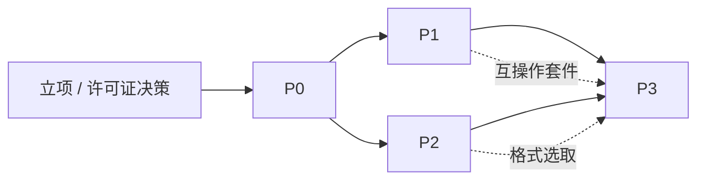

# 14 项目计划与风险管理

> 文档编号：UD-DOC-14 ｜ 版本：v0.7 ｜ 状态：草案（P0 有条件通过、附加条件已关闭，P1 进行中） ｜ 日期：2026-11-10

> **v0.7 说明**：P1 序 3（WBS 9）于 2026-11-10 交付——FTP / FTPS / SFTP 三个 Transport
> 与 `DirectFile` Resolver 落地，前置 `10` 许可证检查（4 个新链接模块 ISC/BSD，
> 0 copyleft / 0 未识别）与 `11` 安全检查（FTP 被动数据通道 SSRF pin、SFTP host key 强制
> pin）均已完成；§11 序 3 与交付边界同步，门禁包由 10 增至 13。合入前 `govulncheck`
> 复扫发现 `x/crypto v0.54.0` 有两条可达 `ssh` DoS，已升 v0.58.0 并复扫干净，
> `make gates-strict` 6 PASS / 0 WARN。下一个工作包为序 4
> （WBS 7 BT / 磁力，最大工作包，需 MPL 修改清单）。

> **v0.6 说明**：P1 序 2（WBS 8）于 2026-11-10 交付——thunder/flashget/qqdl 解码与
> Metalink v3/v4 + RFC 6249 解析作为内置 Resolver 落地，含 SSRF 校验与按清单算法的
> 整文件/逐片校验；§3 WBS 8、§11 序 2 与能力边界同步。下一个工作包为序 3（WBS 9 FTP/SFTP，
> 引入新依赖须先过 `10` 许可证与 `11` 安全检查）。
>
> **v0.5 说明**：P0「有条件通过」的覆盖率附加条件已于 2026-11-10 关闭——8 个未达标包全部补测至阈值（全仓 59.0% → 80.1%），`make gates-strict`（`gates.py --strict`）接入 CI，R-16 由「中」降为「低」。§11 序 1 完成，P1 功能 PR 可按序合入。
>
> **v0.4 说明**：P0 里程碑评审于 2026-11-09 由项目发起人全权批准，结论「**有条件通过**」（§10）；ADR 0001–0020 批量转 `Accepted`，OPEN-01 定档 MPL-2.0、OPEN-02 定档 Flutter，`v0.1.0` 附注标签已打。§3 的 P1 门禁解除，P1 排期见新增的 §11。覆盖率 8 个包未达标作为附加条件延后至 P1 首个 PR 前（**已于 2026-11-10 关闭，见 v0.5**）。
>
> **v0.3 说明**：新增 [17 P0 里程碑评审材料](17-P0里程碑评审材料.md) 作为评审单一入口，`make gates` 补齐 §8 要求的度量输出（覆盖率、SBOM、许可证、漏洞、吞吐基线、回滚演练）；§5 新增 R-16 覆盖率债。**当时 P0 尚未通过正式评审**，§3 的门禁有效；后续结论、签署与 ADR 状态变更见 v0.4 与 §10（本段为 v0.3 当时的快照）。
>
> **v0.2 说明**：WBS 1–6 的代码已落地并通过本文 §2 P0 验收项，逐项证据见 §9。P0 **当时已实现但尚未通过正式里程碑评审**，§3 门禁有效；OPEN-01/OPEN-02 当时保持未决（两者及评审均已于 2026-11-09 完成，见 v0.4 / §7 / §10）。

## 1. WBS（工作分解）

| WBS | 工作包 | 主要交付 | 所属阶段 |
|---|---|---|---|
| 1 | 项目建立 | 仓库、CI、文档基线、许可证决策 | 立项 |
| 2 | 核心模型 | `core` 类型、`Resource`、Task 状态机、事件总线 | P0 |
| 3 | 调度与存储 | Scheduler、Limiter、SQLite + migration、钥匙串接口 | P0 |
| 4 | HTTP 传输 | Range 分段、慢启动、断点、校验、重试 | P0 |
| 5 | 控制面 | REST/WS/CLI、配置、健康检查 | P0 |
| 6 | 最小 UI | 任务列表与基础操作（验证契约） | P0 |
| 7 | BT / 磁力 | anacrolix 接入、tracker、private flag、做种策略 | P1 |
| 8 | 链接封装 | ✅ thunder/flashget/qqdl 解码、Metalink 纯 Go 解析（2026-11-10） | P1 已交付 |
| 9 | FTP / SFTP | `jlaffaye/ftp`、`pkg/sftp` | P1 |
| 10 | 插件引擎 | goja、manifest、SSRF Guard、规则热更新 | P1 |
| 11 | 互操作套件 v1 | 真实 BT 客户端 + 自建 tracker 矩阵 | P1 |
| 12 | 站点解析 | lux 进程内 + yt-dlp/Deno sidecar + 格式选取 | P2 |
| 13 | 流媒体 | HLS/DASH 清单、AES-128、分片并发 | P2 |
| 14 | 后处理 | 纯 Go Remux（含 PTS/DTS 重基准）+ 可选 Transcode | P2 |
| 15 | Telegram | `gotd/td` MTProto 流式接入 | P3 |
| 16 | ed2k | goed2k 接入 + eD2k 互操作套件 | P3 |
| 17 | RPC facade | L1 aria2 compat subset + AriaNg 验收 | P3（可选） |
| 18 | 微信插件 | 隔离发布、提权助手、合规评审 | P3（可选，独立立项） |
| 19 | 发布与运维 | 打包、签名、SBOM、升级演练 | 各阶段末 |

## 2. 里程碑

> 每个里程碑的「阶段验收」引自 `03` §7；DoD 统一遵循 `12` §8 与 `15` §6。

### P0 —— 骨架与统一模型（最高风险阶段）
| 项 | 内容 |
|---|---|
| 目标 | 把统一模型钉死，一条 HTTP 直链跑通完整流水线 |
| 交付 | WBS 2–6；`Resource`（含 `Files[]` 与 `ProtocolIdentity`）、Task 状态机、SQLite DDL、REST/WS/CLI、最简 UI |
| 必须一次做对 | ADR-0013（`Resource` 协议身份字段与多文件）、ADR-0012（PostProcessor 本地路径契约）、单调度器 |
| 验收 | 创建/暂停/恢复/取消全语义一致；`kill -9` 后分片 100% 复用；`CGO_ENABLED=0` 六平台构建通过 |
| 不做 | 任何 sidecar 框架实现、任何 L1 facade、任何真实协议接入 |

### P1 —— 协议与插件
| 项 | 内容 |
|---|---|
| 交付 | WBS 7–11 |
| 验收 | 与 qBittorrent/Transmission 双向互通；UDP/HTTP/HTTPS tracker + passkey + private flag 全矩阵；SSRF 用例全过 |
| 关键门禁 | 互操作套件 v1 全绿；`goed2k` 暂不接入 |

### P2 —— 内容源与后处理
| 项 | 内容 |
|---|---|
| 交付 | WBS 12–14 |
| 验收 | 分离流合成为可双击播放 MP4 且**无 ffmpeg**；yt-dlp 只吐 JSON；sidecar 全缺失时下载不受影响 |
| 关键门禁 | PTS/DTS 重基准正确；YouTube 画质不因缺 ffmpeg 退化到 720p |

### P3 —— 长尾与生态
| 项 | 内容 |
|---|---|
| 交付 | WBS 15–18 |
| 验收 | eD2k 小范围试连（ED-01/02/05/06）；Telegram 2GB 文件完成；AriaNg 可连接（若启用 L1） |
| 备注 | 微信插件独立立项、单独合规评审、默认不随主包分发 |

## 3. 依赖关系

P0 的 `Resource` 定义是全局关键路径：P1 的 private flag / 双 infohash、P3 的 eD2k UserHash / RSA 身份 / 积分、L1 的 `getFiles` 映射全部依赖它。**P0 未通过评审不得启动 P1。**（该门禁已于 2026-11-09 满足：结论「有条件通过」，见 §10；P1 排期见 §11。）

## 4. 角色与投入

| 角色 | 主要职责 | 关键阶段 |
|---|---|---|
| 架构师（1） | ADR、模型、评审否决权 | 全周期，P0 高强度 |
| Go 后端（2–3） | 核心、协议、插件 | P0–P3 |
| 客户端（1–2） | UI / 移动端 | P0 起 |
| QA（1–2） | 追踪矩阵、互操作套件、门禁 | P1 起 |
| 安全/法务（兼职） | SSRF、许可证、平台条款 | 立项 + 各发布前 |
| DevOps（兼职） | CI、构建矩阵、签名 | P0 起 |

## 5. 风险登记册

| ID | 风险 | 概率 | 影响 | 等级 | 缓解措施 | 触发条件 / 应急 | 责任 |
|---|---|---|---|---|---|---|---|
| R-01 | `Resource` 建模不全导致全局返工 | 中 | 极高 | **高** | P0 一次性纳入多文件 + 协议身份字段；评审门禁 | P0 评审发现字段缺失即冻结 P1 | 架构师 |
| R-02 | 外部依赖回潮引入第二调度器 | 中 | 高 | **高** | CI 静态检查 + 评审清单 + 架构组否决权 | 出现第二处限速读取即阻断 | 架构师 |
| R-03 | 站点规则高频失效 | 高 | 中 | **高** | 双层 Resolver（lux + yt-dlp）、规则独立通道、失败明确提示 | 周失效率 > 20% 时增补维护投入 | 后端 |
| R-04 | YouTube 对抗持续升级（EJS / PO token / SABR） | 高 | 中 | 中 | 不自研对抗，依赖 yt-dlp + Deno 独立通道 | 失效时标记能力不可用，不阻塞其余下载 | 后端 |
| R-05 | ffmpeg 无单一干净静态源 / CLI 破坏性变更 | 高 | 中 | **高** | 降级为可选桌面插件、能力协商按 major 分支、锁定 LGPL、保留 buildconf | macOS 槽位构建失败时禁用 Transcode | DevOps |
| R-06 | `goed2k` v0.1.0 互操作未充分回归 | 中高 | 高 | **高** | 自建 eD2k 套件（aMule + eNode-go + Kad）；必要时 fork 自维护 | ED-01/02/05/06 未过则 P3 不发布 | 后端 |
| R-07 | LGPL/GPL 合规瑕疵 | 中 | 高 | 中 | exec arm's-length、锁定 LGPL、SBOM + 源码随附、法务签字 | 发布前扫描发现 GPL 进入传输路径即阻断 | 法务 |
| R-08 | SSRF / 凭据泄漏 | 中 | 极高 | **高** | SSRF Guard、钥匙串、脱敏、`security` 覆盖 ≥ 90% | 用例不过即阻断发布 | 安全 |
| R-09 | 移动端无法派生子进程导致能力缺口 | 高 | 中 | 中 | 零 sidecar 基线；移动端禁用 yt-dlp/ffmpeg/提权助手；能力面板明示 | 新增依赖必须过移动端可达性检查 | 架构师 |
| R-10 | BT 做种默认 `Seed=false` 被视为吸血 | 中 | 中 | 中 | 显式分享率/时长策略、上传槽、UPnP、统一 announce 统计 | 被 PeerBanHelper 类工具封禁时复核礼仪 | 后端 |
| R-11 | PT 用户误以为支持 | 中 | 低 | 低 | 文案只声明「标准 BT 网络」；不承诺 PT；提供 BYO 适配器 | 客诉即对照 `01` §5 / `16` §7 | 产品 |
| R-12 | Metalink / ed2k 投入产出比低 | 高 | 低 | 低 | 按容器格式与兼容能力处理，不进核心排期 | 超预算即降级为插件 | 产品 |
| R-13 | 微信插件法律与平台条款风险 | 中 | 高 | **高** | 单独分发、默认不安装、独立合规评审、不碰 DRM | 法务否决即整体移除 | 法务 |
| R-14 | 规则/依赖供应链被投毒 | 低 | 极高 | 中 | 签名校验、sha256、SBOM、`govulncheck` | 校验失败即降级能力 | 安全 |
| R-15 | 纯 Go Remux 的坏流兼容不足 | 中 | 中 | 中 | 正常 PTS/DTS 重基准自研；坏流容错交可选 ffmpeg | 用户可手动启用 Transcode | 后端 |
| R-16 | 覆盖率债导致 P1 回归无人兜底 | 高 | 中 | **低**（2026-11-10 降级） | 已缓解：10 个门禁包全部达标，`make gates-strict` 接入 CI，任何包跌破阈值即 CI 失败 | 新增包或新代码使阈值回落 | QA |

## 6. 假设与约束

见 `01` §9、§8。追加计划假设：团队具备 Go 网络编程与容器化测试环境；互操作套件需要可自建 tracker 与 eD2k 服务器的隔离网络。

## 7. 未决事项（Open Issues）

| ID | 事项 | 责任 | 截止 | 影响 |
|---|---|---|---|---|
| OPEN-01 | ✅ **已决：MPL-2.0**（2026-11-09，`LICENSE` 已入库；依据见 `17` §8） | 法务 + 架构 | 已关闭 | 阻塞已解除 |
| OPEN-02 | ✅ **已决：Flutter**（2026-11-09，正式 UI 不进入 P1；依据见 `17` §8） | 客户端 | 已关闭 | 移动端排期已定 |
| OPEN-03 | `goed2k` 是否 fork 自维护 | 架构 | P3 启动前 | 影响 R-06 |
| OPEN-04 | L1 aria2 RPC facade 是否纳入范围 | 产品 | P2 结束前 | 影响 WBS 17 |
| OPEN-05 | 是否支持同文件跨协议混合拉流（NG-08 远期） | 架构 | P3 后 | 影响分片设计扩展 |
| OPEN-06 | 微信插件是否立项 | 法务 + 产品 | P3 启动前 | 影响 WBS 18 |

## 8. 度量与报告

每里程碑输出：需求追踪矩阵完成率、互操作套件通过率、性能基准对比、风险登记册更新、ADR 变更清单。每次架构讨论的结论必须落到 ADR 与本文档，禁止只留在会议记录。

**P0 度量输出（2026-11-09）**：`17` §3/§5/§6/§7 已给出追踪矩阵完成率（P0 行 100%）、回环吞吐回归基线（非 NFR-PERF-01）、风险登记册更新（R-08/R-14/R-07 缓解进展 + 新增 R-16）与 ADR 变更清单（0001–0020 拟批量转 `Accepted`）。互操作套件通过率 **N/A（P1 交付）**，不伪装为 0% 或 100%。

## 9. P0 验收结果（2026-11-08）

| WBS | 工作包 | 状态 | 交付证据 |
|---|---|---|---|
| 1 | 项目建立 | ✅ | `go.mod`、`Makefile`、`.github/workflows/ci.yml`、`.gitignore`、`config.example.yaml`、`CHANGELOG.md`；**许可证 OPEN-01 已定档 MPL-2.0（2026-11-09）** |
| 2 | 核心模型 | ✅ | `internal/core/`：`Resource` 全字段、Task 状态机、ULID、错误码表、事件总线、输入分类、全部契约接口 |
| 3 | 调度与存储 | ✅ | `internal/scheduler/`（单调度器 + 唯一 Limiter + ChunkWriter）、`internal/store/`（DDL v1 11 表、崩溃恢复、备份）；**钥匙串为进程内参考实现，OS 适配器待 P1** |
| 4 | HTTP 传输 | ✅ | `internal/resolve/direct.go`、`internal/transport/http/http.go`（Range / 无 Range 退化 / 重试 / 镜像轮换 / 分片 sha256）、`internal/postproc/` |
| 5 | 控制面 | ✅ | `internal/api/`（L0 REST + WS）、`internal/app/daemon.go`（随机端口 + 本地发现）、`cmd/udd`、`cmd/udctl` |
| 6 | 最小 UI | ✅ | `internal/api/ui/index.html`（`go:embed` 单文件，仅验证契约；**可替换，OPEN-02 已定档 Flutter**） |

**§2 P0 验收逐条核对**：

| 验收项 | 结果 | 证据 |
|---|---|---|
| 创建/暂停/恢复/取消全语义一致 | ✅ | `TestPauseResumeCancel`；`TestFullPipelineSingleFile` |
| `kill -9` 后分片 100% 复用 | ✅ | `TestCrashRecoveryReusesChunks`；`store/recover.go` 只信 `chunks` + `.part` 实际字节 |
| `CGO_ENABLED=0` 六平台构建通过 | ✅ | `make build` 12 个二进制全绿 |
| 一条 HTTP 直链跑通完整流水线 | ✅ | 端到端冒烟：700KiB / 11 分片，逐字节一致，终态 `Completed` 且 `chunksVerified == numPieces == 11`；另验证空库 `/stats`、token 脱敏与内联凭据头拒绝 |
| ADR-0013 一次建模 | ✅ | `TestResourceJSONRoundTrip` + `TestTorrentMetaNotSerialized` |
| ADR-0012 本地文件契约 | ✅ | `TestPostProcessorSignature`；`check_arch.py` 守卫 3 |
| 单调度器（无第二限速权威） | ✅ | `check_arch.py` 守卫 4；`TestLimiterSingleAuthority` |
| 不做 sidecar / L1 facade / 真实协议接入 | ✅ | `go.mod` 仅 3 个直接依赖；`/jsonrpc` 未注册（404） |

**P0 收尾带入 P1 的事项**（不视为 P0 未完成）：OS 钥匙串适配器与凭据跨重启、`events` 保留期清理、`chunks` 批量刷盘聚合、慢启动动态扩连、`POST /tasks` 响应内嵌 `Resource` 预览、L4 互操作与千兆内网性能基准（**8 个包的覆盖率补测与 `--strict` 接入 CI 已于 2026-11-10 完成，移出本清单**；OPEN-01 许可证、OPEN-02 UI 已于 2026-11-09 定档，同样移出）。完整范围声明见 [ADR-0020](adr/ADR-0020-P0实现基线与范围声明.md)。

> **已从 P1 队列移出**：CycloneDX SBOM、`govulncheck`、许可证扫描、`go mod verify`、覆盖率报告、回环吞吐回归基线、备份/回滚演练均已在 2026-11-09 的评审准备轮落地（`make gates`），证据见 `17` §3。首次漏洞扫描发现并修复了 Go 标准库 `GO-2026-6809`。

**风险登记册更新**：R-01 / R-02 / R-08 的 P0 缓解措施已落地（一次建模 + 静态守卫 + SSRF/脱敏/凭据不落库），风险等级维持不变。R-14 的 SBOM / `govulncheck` / 许可证扫描已由 `make gates` 执行并接入 CI，R-07 的 `THIRD_PARTY_NOTICES.md` 已生成；项目发起人的全权批准与 OPEN-01 定档已于 2026-11-09 完成，但法务独立复核、签名校验与规则供应链扫描仍待 P1+，故等级不变。新增 R-16（覆盖率债）。残余风险见 `11` §10，`17` §6 给出逐条更新表。

## 10. P0 里程碑评审结论（已签署）

评审材料、门禁证据、ADR 变更清单、OPEN 决策与签署表见 [17 P0 里程碑评审材料](17-P0里程碑评审材料.md)。

| 项 | 结论 |
|---|---|
| WBS 1–6 交付与 §2 验收 | ✅ 见 §9 |
| §8 度量输出 | ✅ 见 `17` §3/§5/§6/§7 |
| **评审结论** | ✅ **有条件通过**（2026-11-09） |
| 批准方式 | 项目发起人（用户）一次性全权批准，代行架构 / QA / 安全 / 法务 / 产品五个签署角色（`17` §1，不虚构实名签字） |
| ADR 0001–0020 | ✅ 全部转 `Accepted`（`17` §7） |
| OPEN-01 | ✅ MPL-2.0（`LICENSE` 已入库，`10` §4 已同步） |
| OPEN-02 | ✅ Flutter（正式 UI 不进入 P1 编码范围） |
| 覆盖率阈值 | ✅ 2026-11-10 关闭：10 个门禁包全部达标（全仓 80.1%），`make gates-strict` 已接入 CI |
| `v0.1.0` 标签 | ✅ 附注标签已打并同步 GitHub |

**附加条件**：见 `17` §1 三条；其中覆盖率债已于 2026-11-10 关闭，许可证履行与风险等级维持继续有效。

> `14` §3 的「P0 未通过评审不得启动 P1」已于 2026-11-09 解除；P1 启动安排见 §11。

## 11. P1 启动（WBS 7–11）

**状态：已解锁（2026-11-09）**。P1 范围是协议与插件，不是 UI（OPEN-02 定档 Flutter 后，正式 UI 按 `13` 的客户端排期单独推进）。

| 序 | WBS | 工作包 | 前置 | 备注 |
|---|---|---|---|---|
| 1 | — | ✅ **覆盖率债清零**（2026-11-10）：`scheduler` / `config` / `postproc` / `api` / `store` / `transport/http` / `resolve` / `app` 全部达标，`gates.py --strict` 已接入 CI | 无 | 已完成：全仓 59.0% → 80.1%，新增 8 个测试文件，R-16 降为「低」 |
| 2 | 8 | ✅ **链接封装（2026-11-10）**：thunder / flashget / qqdl 解码、Metalink v3/v4 + RFC 6249 纯 Go 解析 | ADR-0006 / 0007、序 1 | 已交付：`resolve` 两个内置 Resolver + `store/checksum.go` 校验链 |
| 3 | 9 | ✅ **FTP / FTPS / SFTP（2026-11-10）**：`jlaffaye/ftp` + `pkg/sftp` / `x/crypto/ssh`，被动数据通道 SSRF pin、host key 强制 pin | `10` 许可证检查、`11` 安全检查、序 1 | 已交付：3 个 Transport/工具包 + `DirectFile` Resolver + 回环真实协议集成测试；4 个新链接模块全为 ISC/BSD |
| 4 | 7 | BT / 磁力：`anacrolix/torrent` 接入、tracker、private flag、做种 | ADR-0004、MPL 修改清单、序 1 | 最大工作包 |
| 5 | 10 | 插件引擎 goja / manifest / SSRF Guard / 规则热更新 | ADR-0014、序 1 | 与序 2 解耦 |
| 6 | 11 | 互操作套件 v1 | 序 2–5 | 真实 BT 客户端 + 自建 tracker 矩阵 |

**序 2 交付边界（2026-11-10）**：Resolver 只描述 `Resource`、不解包字节；冻结的 `Resource`
只有全局 `Mirrors` / `Checksum`，故**多 `<file>` 清单显式拒绝**（`E_CAPABILITY_UNAVAILABLE`）；
远端 `https://…/*.meta4` 不由 Resolver 发起第二次网络请求，同样返回显式能力错误；RFC 6249
响应头经 `ResolveContext.Options[metalink_headers]` 注入，待 Transport 集成。产品文案按 `16` §7
沿用「支持解析 thunder:// 链接」「支持 Metalink 多源清单解析」，不承诺加速或完整生态。
逐 URL SSRF Guard、4MiB XML / 32 镜像 / DTD 禁令、按声明算法的整文件与逐片校验均已落地并有自动化测试。

**序 3 交付边界（2026-11-10）**：Resolver 与 Transport 分层保持不变，`DirectFile`
只产出冻结的 `Resource`（ADR-0013 未改字段）。FTP 支持明文、990 隐式 TLS、
21 端口 `AUTH TLS` 显式升级与 `REST` 续传；SFTP 支持密码/私钥认证与 `ReadAt` 随机读。
**明确不做**：FTP 主动模式、FTPS 数据通道 TLS session 复用、连接池（P1 首版每片独立
会话，并发上限 8）、URL 内嵌凭据、无主机密钥校验的 SSH 连接、真实公网服务器互操作矩阵。
凭据经 `POST /api/v1/credentials` 写入 JSON 字符串后以 `credentialRef` 引用；FTP 可匿名。
产品文案按 `16` §7 只写「支持 FTP / FTPS / SFTP 下载」，不承诺完整协议生态。

**门禁**：每个 PR 需 `make lint` / `make test` / `make build` / `make gates-strict` 全绿（CI 已用严格模式，任何 WARN 即失败）。序 1 已完成，P1 功能 PR 可按上表顺序合入；R-16 已于 2026-11-10 降为「低」。里程碑评审按 `15` §4 与本文 §8 输出度量。实现进度以 `CHANGELOG.md` 为唯一真值源。
