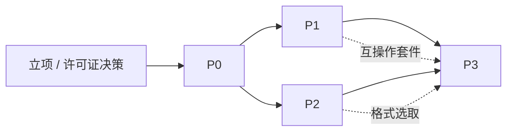

# 14 项目计划与风险管理

> 文档编号：UD-DOC-14 ｜ 版本：v0.3 ｜ 状态：草案（评审材料已备齐，待签署） ｜ 日期：2026-11-09

> **v0.3 说明**：新增 [17 P0 里程碑评审材料](17-P0里程碑评审材料.md) 作为评审单一入口，`make gates` 补齐 §8 要求的度量输出（覆盖率、SBOM、许可证、漏洞、吞吐基线、回滚演练）；§5 新增 R-16 覆盖率债。**P0 仍未通过正式评审**，§3 的门禁继续有效；评审通过后须在 §10 记录结论、签署与 ADR 状态变更。
>
> **v0.2 说明**：WBS 1–6 的代码已落地并通过本文 §2 P0 验收项，逐项证据见 §9。P0 **已实现但未通过正式里程碑评审**，因此 §3「P0 未通过评审不得启动 P1」仍然有效；OPEN-01/OPEN-02 保持未决。

## 1. WBS（工作分解）

| WBS | 工作包 | 主要交付 | 所属阶段 |
|---|---|---|---|
| 1 | 项目建立 | 仓库、CI、文档基线、许可证决策 | 立项 |
| 2 | 核心模型 | `core` 类型、`Resource`、Task 状态机、事件总线 | P0 |
| 3 | 调度与存储 | Scheduler、Limiter、SQLite + migration、钥匙串接口 | P0 |
| 4 | HTTP 传输 | Range 分段、慢启动、断点、校验、重试 | P0 |
| 5 | 控制面 | REST/WS/CLI、配置、健康检查 | P0 |
| 6 | 最小 UI | 任务列表与基础操作（验证契约） | P0 |
| 7 | BT / 磁力 | anacrolix 接入、tracker、private flag、做种策略 | P1 |
| 8 | 链接封装 | thunder/flashget/qqdl 解码、Metalink 纯 Go 解析 | P1 |
| 9 | FTP / SFTP | `jlaffaye/ftp`、`pkg/sftp` | P1 |
| 10 | 插件引擎 | goja、manifest、SSRF Guard、规则热更新 | P1 |
| 11 | 互操作套件 v1 | 真实 BT 客户端 + 自建 tracker 矩阵 | P1 |
| 12 | 站点解析 | lux 进程内 + yt-dlp/Deno sidecar + 格式选取 | P2 |
| 13 | 流媒体 | HLS/DASH 清单、AES-128、分片并发 | P2 |
| 14 | 后处理 | 纯 Go Remux（含 PTS/DTS 重基准）+ 可选 Transcode | P2 |
| 15 | Telegram | `gotd/td` MTProto 流式接入 | P3 |
| 16 | ed2k | goed2k 接入 + eD2k 互操作套件 | P3 |
| 17 | RPC facade | L1 aria2 compat subset + AriaNg 验收 | P3（可选） |
| 18 | 微信插件 | 隔离发布、提权助手、合规评审 | P3（可选，独立立项） |
| 19 | 发布与运维 | 打包、签名、SBOM、升级演练 | 各阶段末 |

## 2. 里程碑

> 每个里程碑的「阶段验收」引自 `03` §7；DoD 统一遵循 `12` §8 与 `15` §6。

### P0 —— 骨架与统一模型（最高风险阶段）
| 项 | 内容 |
|---|---|
| 目标 | 把统一模型钉死，一条 HTTP 直链跑通完整流水线 |
| 交付 | WBS 2–6；`Resource`（含 `Files[]` 与 `ProtocolIdentity`）、Task 状态机、SQLite DDL、REST/WS/CLI、最简 UI |
| 必须一次做对 | ADR-0013（`Resource` 协议身份字段与多文件）、ADR-0012（PostProcessor 本地路径契约）、单调度器 |
| 验收 | 创建/暂停/恢复/取消全语义一致；`kill -9` 后分片 100% 复用；`CGO_ENABLED=0` 六平台构建通过 |
| 不做 | 任何 sidecar 框架实现、任何 L1 facade、任何真实协议接入 |

### P1 —— 协议与插件
| 项 | 内容 |
|---|---|
| 交付 | WBS 7–11 |
| 验收 | 与 qBittorrent/Transmission 双向互通；UDP/HTTP/HTTPS tracker + passkey + private flag 全矩阵；SSRF 用例全过 |
| 关键门禁 | 互操作套件 v1 全绿；`goed2k` 暂不接入 |

### P2 —— 内容源与后处理
| 项 | 内容 |
|---|---|
| 交付 | WBS 12–14 |
| 验收 | 分离流合成为可双击播放 MP4 且**无 ffmpeg**；yt-dlp 只吐 JSON；sidecar 全缺失时下载不受影响 |
| 关键门禁 | PTS/DTS 重基准正确；YouTube 画质不因缺 ffmpeg 退化到 720p |

### P3 —— 长尾与生态
| 项 | 内容 |
|---|---|
| 交付 | WBS 15–18 |
| 验收 | eD2k 小范围试连（ED-01/02/05/06）；Telegram 2GB 文件完成；AriaNg 可连接（若启用 L1） |
| 备注 | 微信插件独立立项、单独合规评审、默认不随主包分发 |

## 3. 依赖关系

P0 的 `Resource` 定义是全局关键路径：P1 的 private flag / 双 infohash、P3 的 eD2k UserHash / RSA 身份 / 积分、L1 的 `getFiles` 映射全部依赖它。**P0 未通过评审不得启动 P1。**

## 4. 角色与投入

| 角色 | 主要职责 | 关键阶段 |
|---|---|---|
| 架构师（1） | ADR、模型、评审否决权 | 全周期，P0 高强度 |
| Go 后端（2–3） | 核心、协议、插件 | P0–P3 |
| 客户端（1–2） | UI / 移动端 | P0 起 |
| QA（1–2） | 追踪矩阵、互操作套件、门禁 | P1 起 |
| 安全/法务（兼职） | SSRF、许可证、平台条款 | 立项 + 各发布前 |
| DevOps（兼职） | CI、构建矩阵、签名 | P0 起 |

## 5. 风险登记册

| ID | 风险 | 概率 | 影响 | 等级 | 缓解措施 | 触发条件 / 应急 | 责任 |
|---|---|---|---|---|---|---|---|
| R-01 | `Resource` 建模不全导致全局返工 | 中 | 极高 | **高** | P0 一次性纳入多文件 + 协议身份字段；评审门禁 | P0 评审发现字段缺失即冻结 P1 | 架构师 |
| R-02 | 外部依赖回潮引入第二调度器 | 中 | 高 | **高** | CI 静态检查 + 评审清单 + 架构组否决权 | 出现第二处限速读取即阻断 | 架构师 |
| R-03 | 站点规则高频失效 | 高 | 中 | **高** | 双层 Resolver（lux + yt-dlp）、规则独立通道、失败明确提示 | 周失效率 > 20% 时增补维护投入 | 后端 |
| R-04 | YouTube 对抗持续升级（EJS / PO token / SABR） | 高 | 中 | 中 | 不自研对抗，依赖 yt-dlp + Deno 独立通道 | 失效时标记能力不可用，不阻塞其余下载 | 后端 |
| R-05 | ffmpeg 无单一干净静态源 / CLI 破坏性变更 | 高 | 中 | **高** | 降级为可选桌面插件、能力协商按 major 分支、锁定 LGPL、保留 buildconf | macOS 槽位构建失败时禁用 Transcode | DevOps |
| R-06 | `goed2k` v0.1.0 互操作未充分回归 | 中高 | 高 | **高** | 自建 eD2k 套件（aMule + eNode-go + Kad）；必要时 fork 自维护 | ED-01/02/05/06 未过则 P3 不发布 | 后端 |
| R-07 | LGPL/GPL 合规瑕疵 | 中 | 高 | 中 | exec arm's-length、锁定 LGPL、SBOM + 源码随附、法务签字 | 发布前扫描发现 GPL 进入传输路径即阻断 | 法务 |
| R-08 | SSRF / 凭据泄漏 | 中 | 极高 | **高** | SSRF Guard、钥匙串、脱敏、`security` 覆盖 ≥ 90% | 用例不过即阻断发布 | 安全 |
| R-09 | 移动端无法派生子进程导致能力缺口 | 高 | 中 | 中 | 零 sidecar 基线；移动端禁用 yt-dlp/ffmpeg/提权助手；能力面板明示 | 新增依赖必须过移动端可达性检查 | 架构师 |
| R-10 | BT 做种默认 `Seed=false` 被视为吸血 | 中 | 中 | 中 | 显式分享率/时长策略、上传槽、UPnP、统一 announce 统计 | 被 PeerBanHelper 类工具封禁时复核礼仪 | 后端 |
| R-11 | PT 用户误以为支持 | 中 | 低 | 低 | 文案只声明「标准 BT 网络」；不承诺 PT；提供 BYO 适配器 | 客诉即对照 `01` §5 / `16` §7 | 产品 |
| R-12 | Metalink / ed2k 投入产出比低 | 高 | 低 | 低 | 按容器格式与兼容能力处理，不进核心排期 | 超预算即降级为插件 | 产品 |
| R-13 | 微信插件法律与平台条款风险 | 中 | 高 | **高** | 单独分发、默认不安装、独立合规评审、不碰 DRM | 法务否决即整体移除 | 法务 |
| R-14 | 规则/依赖供应链被投毒 | 低 | 极高 | 中 | 签名校验、sha256、SBOM、`govulncheck` | 校验失败即降级能力 | 安全 |
| R-15 | 纯 Go Remux 的坏流兼容不足 | 中 | 中 | 中 | 正常 PTS/DTS 重基准自研；坏流容错交可选 ffmpeg | 用户可手动启用 Transcode | 后端 |
| R-16 | 覆盖率债导致 P1 回归无人兜底 | 高 | 中 | **中** | `make gates` 采集并按包报阈值；P1 首个 PR 前补测并把 `--strict` 接入 CI | 阈值持续 WARN 即阻断 P1 发布门禁 | QA |

## 6. 假设与约束

见 `01` §9、§8。追加计划假设：团队具备 Go 网络编程与容器化测试环境；互操作套件需要可自建 tracker 与 eD2k 服务器的隔离网络。

## 7. 未决事项（Open Issues）

| ID | 事项 | 责任 | 截止 | 影响 |
|---|---|---|---|---|
| OPEN-01 | 代码许可证定档（MPL-2.0 / Apache-2.0） | 法务 + 架构 | 立项前 | 阻塞依赖合入 |
| OPEN-02 | Flutter vs Tauri 定档 | 客户端 | P0 结束前 | 影响移动端排期 |
| OPEN-03 | `goed2k` 是否 fork 自维护 | 架构 | P3 启动前 | 影响 R-06 |
| OPEN-04 | L1 aria2 RPC facade 是否纳入范围 | 产品 | P2 结束前 | 影响 WBS 17 |
| OPEN-05 | 是否支持同文件跨协议混合拉流（NG-08 远期） | 架构 | P3 后 | 影响分片设计扩展 |
| OPEN-06 | 微信插件是否立项 | 法务 + 产品 | P3 启动前 | 影响 WBS 18 |

## 8. 度量与报告

每里程碑输出：需求追踪矩阵完成率、互操作套件通过率、性能基准对比、风险登记册更新、ADR 变更清单。每次架构讨论的结论必须落到 ADR 与本文档，禁止只留在会议记录。

**P0 度量输出（2026-11-09）**：`17` §3/§5/§6/§7 已给出追踪矩阵完成率（P0 行 100%）、回环吞吐回归基线（非 NFR-PERF-01）、风险登记册更新（R-08/R-14/R-07 缓解进展 + 新增 R-16）与 ADR 变更清单（0001–0020 拟批量转 `Accepted`）。互操作套件通过率 **N/A（P1 交付）**，不伪装为 0% 或 100%。

## 9. P0 验收结果（2026-11-08）

| WBS | 工作包 | 状态 | 交付证据 |
|---|---|---|---|
| 1 | 项目建立 | ✅ | `go.mod`、`Makefile`、`.github/workflows/ci.yml`、`.gitignore`、`config.example.yaml`、`CHANGELOG.md`；**许可证 OPEN-01 仍未决** |
| 2 | 核心模型 | ✅ | `internal/core/`：`Resource` 全字段、Task 状态机、ULID、错误码表、事件总线、输入分类、全部契约接口 |
| 3 | 调度与存储 | ✅ | `internal/scheduler/`（单调度器 + 唯一 Limiter + ChunkWriter）、`internal/store/`（DDL v1 11 表、崩溃恢复、备份）；**钥匙串为进程内参考实现，OS 适配器待 P1** |
| 4 | HTTP 传输 | ✅ | `internal/resolve/direct.go`、`internal/transport/http/http.go`（Range / 无 Range 退化 / 重试 / 镜像轮换 / 分片 sha256）、`internal/postproc/` |
| 5 | 控制面 | ✅ | `internal/api/`（L0 REST + WS）、`internal/app/daemon.go`（随机端口 + 本地发现）、`cmd/udd`、`cmd/udctl` |
| 6 | 最小 UI | ✅ | `internal/api/ui/index.html`（`go:embed` 单文件，仅验证契约；**可替换，OPEN-02 未决**） |

**§2 P0 验收逐条核对**：

| 验收项 | 结果 | 证据 |
|---|---|---|
| 创建/暂停/恢复/取消全语义一致 | ✅ | `TestPauseResumeCancel`；`TestFullPipelineSingleFile` |
| `kill -9` 后分片 100% 复用 | ✅ | `TestCrashRecoveryReusesChunks`；`store/recover.go` 只信 `chunks` + `.part` 实际字节 |
| `CGO_ENABLED=0` 六平台构建通过 | ✅ | `make build` 12 个二进制全绿 |
| 一条 HTTP 直链跑通完整流水线 | ✅ | 端到端冒烟：700KiB / 11 分片，逐字节一致，终态 `Completed` 且 `chunksVerified == numPieces == 11`；另验证空库 `/stats`、token 脱敏与内联凭据头拒绝 |
| ADR-0013 一次建模 | ✅ | `TestResourceJSONRoundTrip` + `TestTorrentMetaNotSerialized` |
| ADR-0012 本地文件契约 | ✅ | `TestPostProcessorSignature`；`check_arch.py` 守卫 3 |
| 单调度器（无第二限速权威） | ✅ | `check_arch.py` 守卫 4；`TestLimiterSingleAuthority` |
| 不做 sidecar / L1 facade / 真实协议接入 | ✅ | `go.mod` 仅 3 个直接依赖；`/jsonrpc` 未注册（404） |

**P0 收尾带入 P1 的事项**（不视为 P0 未完成）：OS 钥匙串适配器与凭据跨重启、`events` 保留期清理、`chunks` 批量刷盘聚合、慢启动动态扩连、`POST /tasks` 响应内嵌 `Resource` 预览、L4 互操作与千兆内网性能基准、**8 个包的覆盖率补测并把 `--strict` 接入 CI**、OPEN-01 许可证定档、OPEN-02 UI 定档。完整范围声明见 [ADR-0020](adr/ADR-0020-P0实现基线与范围声明.md)。

> **已从 P1 队列移出**：CycloneDX SBOM、`govulncheck`、许可证扫描、`go mod verify`、覆盖率报告、回环吞吐回归基线、备份/回滚演练均已在 2026-11-09 的评审准备轮落地（`make gates`），证据见 `17` §3。首次漏洞扫描发现并修复了 Go 标准库 `GO-2026-6809`。

**风险登记册更新**：R-01 / R-02 / R-08 的 P0 缓解措施已落地（一次建模 + 静态守卫 + SSRF/脱敏/凭据不落库），风险等级维持不变。R-14 的 SBOM / `govulncheck` / 许可证扫描已由 `make gates` 执行并接入 CI，R-07 的 `THIRD_PARTY_NOTICES.md` 已生成；但法务签字与 OPEN-01 仍未完成，故等级不变。新增 R-16（覆盖率债）。残余风险见 `11` §10，`17` §6 给出逐条更新表。

## 10. P0 里程碑评审（待签署）

评审材料、门禁证据、ADR 变更清单、OPEN-01/02 决策简报与签署表集中见 [17 P0 里程碑评审材料](17-P0里程碑评审材料.md)。

| 项 | 状态 |
|---|---|
| WBS 1–6 交付与 §2 验收 | ✅ 见 §9 |
| §8 度量输出 | ✅ 见 `17` §3/§5/§6/§7 |
| 评审结论 / 签署表 | ⬜ **待签**（`17` §1） |
| ADR 0001–0020 转 `Accepted` | ⬜ 待评审（`17` §7） |
| OPEN-01 / OPEN-02 结论 | ⬜ 逾期未决（`17` §8） |
| 覆盖率阈值 | ⚠️ 8 个包未达标（`17` §5）；建议作为「有条件通过」的条件 |
| `v0.1.0` 标签 | ⬜ 仓库尚未初始化 git，见 `17` §9 第 4 条 |

> **评审结论记录处（签署后填写）**：结论 ⬜ 通过 / ⬜ 有条件通过 / ⬜ 不通过；日期 ____；签署人 ____；附加条件 ____。
>
> 在结论填好并按 `17` §9 完成 1–5 前，`14` §3 的「P0 未通过评审不得启动 P1」继续生效。
