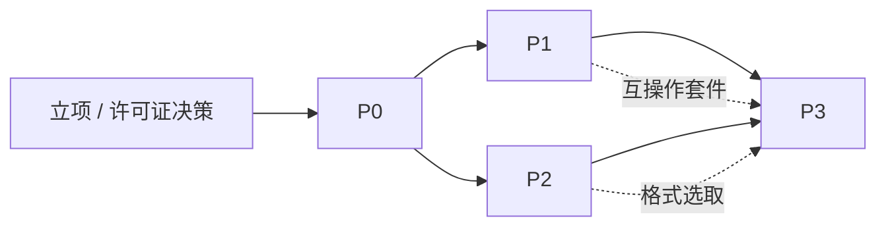

# 14 项目计划与风险管理

> 文档编号：UD-DOC-14 ｜ 版本：v1.5 ｜ 状态：草案（P0 有条件通过、附加条件已关闭，P1 编码工作包 1–5 全部交付，序 6 路径 A 编码已落地但评审组复签与 L4 验收待补） ｜ 日期：2026-11-14

> **v1.5 变更 / 2026-11-14 时点口径（ADR-0021 路径 A 裁决与实现；下文各版说明为提案期时点值，保留不改）**：
> 项目发起人明确指令「按 A 方案补齐」，ADR-0021 由 `Proposed` 转
> `Accepted（路径 A）` 并同步 ADR 索引。`bt.*` 已生效，受限做种 / 分享率与
> `seed-time` / 上传槽 / UPnP-NAT-PMP / 诚实 PeerID / `tasks.bytes_uploaded`
> 与 announce 同源统计、条件状态迁移均已落地；私有种子恒不上传且恒禁
> DHT / PEX，上传字节速率仍只由 `scheduler.Limiter` 管理。
> **「实现相对已批准 ADR / M 级需求的未签署范围缩减」这一根因已消除**，
> §5 R-10 改为「路径 A 落地后待重评」，§11 追加路径 A 落地注。
> **但 `12` §3.1 判据未改**：`BT-01..BT-14` 仍 **0/14**，套件 v1 的
> `BT-02` / `BT-11` 仍按 `ScopeProductGap` 固定 `UNSUPPORTED`
> （实现具备 ≠ 真实客户端矩阵已验证），`release_gate_met=false`、
> `l4_executed=false`、`nfr_perf_01.met=false`、序 6 **仍开放**。
> `docs/18` §六 评审组五方签署表仍全部留白：本次为发起人指令裁决，
> **不冒充**三方会签；法务口径、R-10 重评与安全 / P2P 礼仪复签仍待补。
> 门禁包 **16**、链接模块 **90**、严格门禁 **6 PASS / 0 WARN / 0 FAIL** 不变。
>
> **v1.4 说明**（2026-11-13，序 6 阻塞定档，**序 6 仍开放**）：§11 新增
> 「序 6 阻塞二次校准」——核对 ADR-0004 / ADR-0017、`03` M 级需求与
> `01` / `05` / `07` / `13` / R-10 后，确认阻塞根因是**实现相对已批准决策的
> 未签署范围缩减（合规差距）**，而非「ADR-0004 已授权的不做种边界」；
> 已按 `15` §4 提交 [ADR-0021](adr/ADR-0021-L4门禁与P2P礼仪范围冲突裁决提案.md)
> （`Proposed`，未生效）列出 A / B / C 三条须签署的裁决路径与影响面。
> 同轮补齐 `make l4-preflight` / `l4-preflight-check` / `l4-run` 实验室链路
> （仅清点 / 接线，不是 L4 执行证据）、修正门户生成器过期横幅。
> **评审签署前**：`release_gate_met: false`、L4 **0/14**、`make interop-gate`
> 明确失败、`UNSUPPORTED` 不得计 PASS 或豁免；NFR-PERF-01 双机千兆基准仍未执行。
> 门禁包 **16**、链接模块 **90**、严格门禁 **6 PASS / 0 WARN / 0 FAIL** 不变；
> §10 已签署结论表与 v1.1–v1.3 的时点数值不改写。
>
> **v1.3 说明**（2026-11-13，交付收尾、不改变序 6 结论）：`9530c35` 的 CI
> `quality` 因 `internal/scheduler::TestLifecycleErrors` 偶发 `SQLITE_BUSY` 失败
> （**5 PASS / 0 WARN / 1 FAIL**），已在 `internal/store` 修复并补 4 条回归用例。
> 这是**质量门禁修复**，不构成 WBS 11 功能交付或 L4 证据：序 6 **仍开放**、
> 「14/14 PASS」与不做种边界的形式冲突仍待评审，NFR-PERF-01 双机千兆基准仍未执行。
> 门禁包 **16**、链接模块 **90**、本机严格门禁 **6 PASS / 0 WARN / 0 FAIL** 不变。
> §10 已签署结论表与 v1.1 / v1.2 的时点数值均不改写。
> CI 复跑 run `43399289527` 为 `quality: success`（质量门禁已闭环，不改变序 6 结论）。
>
> **v1.2 说明**（2026-11-13）：P1 序 6 / WBS 11 续包，**序 6 仍不关闭**。
> §11 序 6 行与交付边界补记：① 真实 **`libtorrent 2.1.1`** 单向回环补充证据
> `BX-03` / `BX-04`（连同 aria2-next 的 `BX-01` / `BX-02` 共 **4/4 PASS**，
> `make interop-external` 可复跑），**均不计入 L4**；② **正式登记 L4 判据与
> ADR-0004 产品边界的形式冲突**——`BT-02` / `BT-11` 恒 `UNSUPPORTED`、
> `BT-03` 双向半向不可达，故「14/14 PASS 才关闭序 6」在现有边界下不可能成立，
> 须经评审在「修订判据豁免 / 扩大产品范围 / 保持开放」三条路径中签署决定；
> ③ NFR-PERF-01 新增 `make perf` 1GiB 可复跑回环参考基准（固定
> `nfr_perf_01.met=false`），双机千兆实验室仍待执行。
> 门禁包仍 **16** 个、链接模块仍 **90**，`make gates-strict` 仍 6 PASS / 0 WARN / 0 FAIL。
> 已签署的 §10 评审结论表**不改写**。
> **时点口径**：v1.1 说明中的 `BX-01 / BX-02（2/2 PASS）` 是 **2026-11-11 时点值**，
> 当前证据已扩为 `BX-01..BX-04`（4/4 PASS，见 §11 序 6 续包补记），原历史数值保留不改。
>
> **v1.1 说明**（2026-11-11）：P1 序 6 / WBS 11 **互操作套件 v1** 交付——
> `internal/interop/` + `cmd/udinterop` 建立 `BT-01..BT-14` L4 门禁注册表、自建
> BEP 3 / BEP 15 tracker fixture、9 条纯回环自动化用例与 `dist/interop.json` /
> `dist/INTEROP.md` 证据链；CI 新增 `make interop`。
> **关键口径：序 6 不关闭**。真实 qBittorrent / Transmission / libtorrent 客户端、
> 自建 tracker 二进制、抓包与千兆内网构成的 **L4 外部矩阵仍未执行**，
> `BT-01..BT-14` 全部为 `SKIPPED`（`BT-02`/`BT-11` 为产品明确不做的 `UNSUPPORTED`），
> `release_gate_met: false`，`make interop-gate` 明确失败。`SKIPPED` 绝不计为 `PASS`。
> **补充证据（非 L4 门禁）**：本机 MotrixNext 打包的 **aria2-next 3.0.9** 是真实
> BitTorrent 引擎，已用 `cmd/udinteropx` 驱动项目真实 `bttransport` 对其做种方完成下载并
> sha256 校验，取得 **BX-01 / BX-02（2/2 PASS）真实跨客户端互通证据**
> （`dist/interop_external.json`，并由 `make interop` 合并进 `dist/INTEROP.md`）；
> 但 aria2-next **不点名于** `BT-01..BT-14`，故仅作补充证据、不计入 L4 门禁。
> §1 WBS 11 行、§11 序 6 行与新增「序 6 交付边界」、§10 时点口径注同步更新为
> **16 个门禁包 / 90 个链接模块 / 6 PASS / 0 WARN / 0 FAIL**。
> 已签署的 §10 评审结论表**不改写**。同轮 `govulncheck` 新增可达的 `GO-2026-6859`
> （Go 1.27.3 `net/http`），`go.mod` / CI 工具链升至 **1.27.4** 后复扫干净
> （模块依赖图不变，仍 90 个链接模块；`10` §8.3）；另修复两处 `-race` 竞态。
> NFR-PERF-01 千兆内网基准仍待执行。
>
> **v1.0 说明**（2026-11-10）：P1 序 5 / WBS 10（插件引擎）交付，`internal/plugin/` 落地
> goja ES5.1 运行时、manifest 严格校验、Ed25519 规则包签名、能力裁剪、逐跳 SSRF Guard
> 与目录指纹热更新；`udctl plugin` 六个离线子命令可用。§11 序 5 标记 ✅ 并补「序 5 交付边界」，
> §3 WBS 总表 WBS 10 改为「P1 已交付」，§10 时点口径注更新为 15 个门禁包 / 90 个链接模块。
> **P1 编码工作包（序 1–5）至此全部交付，v1.0 时点的下一个工作包为序 6 / WBS 11 互操作套件 v1**（套件已于 v1.1 交付，但 L4 门禁未通过、序 6 仍开放）。
> 已签署的 §10 评审结论表**不改写**。
>
> **v0.9 说明**（2026-11-10）：P1 WBS 7（BT / 磁力，序 4 最大工作包）交付。§11 序 4 标记
> ✅ 并补「序 4 交付边界」，§3 WBS 总表 WBS 7/8/9 三行统一为「P1 已交付」，版本头注记的
> 下一个工作包改为序 5 / WBS 10 插件引擎。已签署的 §10 评审结论表**不改写**。
>
> **v0.8 说明**（2026-11-10，仅文档口径校准）：R-16 缓解描述补上「覆盖率清零时
> 10 个门禁包 → WBS 9 后 13 个」的时点区分，§10 评审结论表补时点口径注，
> **不改写已签署评审结论**。`docs/README` §三 新增「当前态口径（唯一速查）」：
> 13 个门禁包、16 个链接模块、`make gates-strict` 6 PASS / 0 WARN；
> `17` 与 ADR-0020 中的 10 / 12 / 5 PASS 仍为 P0 时点证据。
>
> **v0.7 说明**：P1 序 3（WBS 9）于 2026-11-10 交付——FTP / FTPS / SFTP 三个 Transport
> 与 `DirectFile` Resolver 落地，前置 `10` 许可证检查（4 个新链接模块 ISC/BSD，
> 0 copyleft / 0 未识别）与 `11` 安全检查（FTP 被动数据通道 SSRF pin、SFTP host key 强制
> pin）均已完成；§11 序 3 与交付边界同步，门禁包由 10 增至 13。合入前 `govulncheck`
> 复扫发现 `x/crypto v0.54.0` 有两条可达 `ssh` DoS，已升 v0.58.0 并复扫干净，
> `make gates-strict` 6 PASS / 0 WARN。序 4（WBS 7 BT / 磁力，最大工作包）已于
> 2026-11-10 交付并通过全部门禁（0 左版、0 未知、86 链接模块），下一个工作包为序 5（WBS 10 插件引擎）。

> **v0.6 说明**：P1 序 2（WBS 8）于 2026-11-10 交付——thunder/flashget/qqdl 解码与
> Metalink v3/v4 + RFC 6249 解析作为内置 Resolver 落地，含 SSRF 校验与按清单算法的
> 整文件/逐片校验；§3 WBS 8、§11 序 2 与能力边界同步。下一个工作包为序 3（WBS 9 FTP/SFTP，
> 引入新依赖须先过 `10` 许可证与 `11` 安全检查）。
>
> **v0.5 说明**：P0「有条件通过」的覆盖率附加条件已于 2026-11-10 关闭——8 个未达标包全部补测至阈值（全仓 59.0% → 80.1%），`make gates-strict`（`gates.py --strict`）接入 CI，R-16 由「中」降为「低」。§11 序 1 完成，P1 功能 PR 可按序合入。
>
> **v0.4 说明**：P0 里程碑评审于 2026-11-09 由项目发起人全权批准，结论「**有条件通过**」（§10）；ADR 0001–0020 批量转 `Accepted`，OPEN-01 定档 MPL-2.0、OPEN-02 定档 Flutter，`v0.1.0` 附注标签已打。§3 的 P1 门禁解除，P1 排期见新增的 §11。覆盖率 8 个包未达标作为附加条件延后至 P1 首个 PR 前（**已于 2026-11-10 关闭，见 v0.5**）。
>
> **v0.3 说明**：新增 [17 P0 里程碑评审材料](17-P0里程碑评审材料.md) 作为评审单一入口，`make gates` 补齐 §8 要求的度量输出（覆盖率、SBOM、许可证、漏洞、吞吐基线、回滚演练）；§5 新增 R-16 覆盖率债。**当时 P0 尚未通过正式评审**，§3 的门禁有效；后续结论、签署与 ADR 状态变更见 v0.4 与 §10（本段为 v0.3 当时的快照）。
>
> **v0.2 说明**：WBS 1–6 的代码已落地并通过本文 §2 P0 验收项，逐项证据见 §9。P0 **当时已实现但尚未通过正式里程碑评审**，§3 门禁有效；OPEN-01/OPEN-02 当时保持未决（两者及评审均已于 2026-11-09 完成，见 v0.4 / §7 / §10）。

## 1. WBS（工作分解）

| WBS | 工作包 | 主要交付 | 所属阶段 |
|---|---|---|---|
| 1 | 项目建立 | 仓库、CI、文档基线、许可证决策 | 立项 |
| 2 | 核心模型 | `core` 类型、`Resource`、Task 状态机、事件总线 | P0 |
| 3 | 调度与存储 | Scheduler、Limiter、SQLite + migration、钥匙串接口 | P0 |
| 4 | HTTP 传输 | Range 分段、慢启动、断点、校验、重试 | P0 |
| 5 | 控制面 | REST/WS/CLI、配置、健康检查 | P0 |
| 6 | 最小 UI | 任务列表与基础操作（验证契约） | P0 |
| 7 | BT / 磁力 | ✅ `anacrolix/torrent v1.62.0` 接入、tracker 注入、private flag、做种策略（2026-11-10） | P1 已交付 |
| 8 | 链接封装 | ✅ thunder/flashget/qqdl 解码、Metalink 纯 Go 解析（2026-11-10） | P1 已交付 |
| 9 | FTP / SFTP | ✅ `jlaffaye/ftp`、`pkg/sftp`/`x/crypto/ssh`（2026-11-10） | P1 已交付 |
| 10 | 插件引擎 | ✅ goja ES5.1、manifest + Ed25519 签名、SSRF Guard、能力裁剪、规则热更新、`udctl plugin` 工具链（2026-11-10） | P1 已交付 |
| 11 | 互操作套件 v1 | ✅ 套件骨架 / `BT-01..BT-14` 门禁注册表 / 自建 BEP 3·BEP 15 tracker fixture / 9 条回环用例 / `make interop` 证据链（2026-11-11）；❌ **L4 真实客户端外部矩阵未执行、发布门禁未通过** | P1 套件已交付，序 6 仍开放 |
| 12 | 站点解析 | lux 进程内 + yt-dlp/Deno sidecar + 格式选取 | P2 |
| 13 | 流媒体 | HLS/DASH 清单、AES-128、分片并发 | P2 |
| 14 | 后处理 | 纯 Go Remux（含 PTS/DTS 重基准）+ 可选 Transcode | P2 |
| 15 | Telegram | `gotd/td` MTProto 流式接入 | P3 |
| 16 | ed2k | goed2k 接入 + eD2k 互操作套件 | P3 |
| 17 | RPC facade | L1 aria2 compat subset + AriaNg 验收 | P3（可选） |
| 18 | 微信插件 | 隔离发布、提权助手、合规评审 | P3（可选，独立立项） |
| 19 | 发布与运维 | 打包、签名、SBOM、升级演练 | 各阶段末 |

## 2. 里程碑

> 每个里程碑的「阶段验收」引自 `03` §7；DoD 统一遵循 `12` §8 与 `15` §6。

### P0 —— 骨架与统一模型（最高风险阶段）
| 项 | 内容 |
|---|---|
| 目标 | 把统一模型钉死，一条 HTTP 直链跑通完整流水线 |
| 交付 | WBS 2–6；`Resource`（含 `Files[]` 与 `ProtocolIdentity`）、Task 状态机、SQLite DDL、REST/WS/CLI、最简 UI |
| 必须一次做对 | ADR-0013（`Resource` 协议身份字段与多文件）、ADR-0012（PostProcessor 本地路径契约）、单调度器 |
| 验收 | 创建/暂停/恢复/取消全语义一致；`kill -9` 后分片 100% 复用；`CGO_ENABLED=0` 六平台构建通过 |
| 不做 | 任何 sidecar 框架实现、任何 L1 facade、任何真实协议接入 |

### P1 —— 协议与插件
| 项 | 内容 |
|---|---|
| 交付 | WBS 7–11 |
| 验收 | 与 qBittorrent/Transmission 双向互通；UDP/HTTP/HTTPS tracker + passkey + private flag 全矩阵；SSRF 用例全过 |
| 关键门禁 | 互操作套件 v1 全绿；`goed2k` 暂不接入 |

### P2 —— 内容源与后处理
| 项 | 内容 |
|---|---|
| 交付 | WBS 12–14 |
| 验收 | 分离流合成为可双击播放 MP4 且**无 ffmpeg**；yt-dlp 只吐 JSON；sidecar 全缺失时下载不受影响 |
| 关键门禁 | PTS/DTS 重基准正确；YouTube 画质不因缺 ffmpeg 退化到 720p |

### P3 —— 长尾与生态
| 项 | 内容 |
|---|---|
| 交付 | WBS 15–18 |
| 验收 | eD2k 小范围试连（ED-01/02/05/06）；Telegram 2GB 文件完成；AriaNg 可连接（若启用 L1） |
| 备注 | 微信插件独立立项、单独合规评审、默认不随主包分发 |

## 3. 依赖关系

P0 的 `Resource` 定义是全局关键路径：P1 的 private flag / 双 infohash、P3 的 eD2k UserHash / RSA 身份 / 积分、L1 的 `getFiles` 映射全部依赖它。**P0 未通过评审不得启动 P1。**（该门禁已于 2026-11-09 满足：结论「有条件通过」，见 §10；P1 排期见 §11。）

## 4. 角色与投入

| 角色 | 主要职责 | 关键阶段 |
|---|---|---|
| 架构师（1） | ADR、模型、评审否决权 | 全周期，P0 高强度 |
| Go 后端（2–3） | 核心、协议、插件 | P0–P3 |
| 客户端（1–2） | UI / 移动端 | P0 起 |
| QA（1–2） | 追踪矩阵、互操作套件、门禁 | P1 起 |
| 安全/法务（兼职） | SSRF、许可证、平台条款 | 立项 + 各发布前 |
| DevOps（兼职） | CI、构建矩阵、签名 | P0 起 |

## 5. 风险登记册

| ID | 风险 | 概率 | 影响 | 等级 | 缓解措施 | 触发条件 / 应急 | 责任 |
|---|---|---|---|---|---|---|---|
| R-01 | `Resource` 建模不全导致全局返工 | 中 | 极高 | **高** | P0 一次性纳入多文件 + 协议身份字段；评审门禁 | P0 评审发现字段缺失即冻结 P1 | 架构师 |
| R-02 | 外部依赖回潮引入第二调度器 | 中 | 高 | **高** | CI 静态检查 + 评审清单 + 架构组否决权 | 出现第二处限速读取即阻断 | 架构师 |
| R-03 | 站点规则高频失效 | 高 | 中 | **高** | 双层 Resolver（lux + yt-dlp）、规则独立通道、失败明确提示 | 周失效率 > 20% 时增补维护投入 | 后端 |
| R-04 | YouTube 对抗持续升级（EJS / PO token / SABR） | 高 | 中 | 中 | 不自研对抗，依赖 yt-dlp + Deno 独立通道 | 失效时标记能力不可用，不阻塞其余下载 | 后端 |
| R-05 | ffmpeg 无单一干净静态源 / CLI 破坏性变更 | 高 | 中 | **高** | 降级为可选桌面插件、能力协商按 major 分支、锁定 LGPL、保留 buildconf | macOS 槽位构建失败时禁用 Transcode | DevOps |
| R-06 | `goed2k` v0.1.0 互操作未充分回归 | 中高 | 高 | **高** | 自建 eD2k 套件（aMule + eNode-go + Kad）；必要时 fork 自维护 | ED-01/02/05/06 未过则 P3 不发布 | 后端 |
| R-07 | LGPL/GPL 合规瑕疵 | 中 | 高 | 中 | exec arm's-length、锁定 LGPL、SBOM + 源码随附、法务签字 | 发布前扫描发现 GPL 进入传输路径即阻断 | 法务 |
| R-08 | SSRF / 凭据泄漏 | 中 | 极高 | **高** | SSRF Guard、钥匙串、脱敏、`security` 覆盖 ≥ 90% | 用例不过即阻断发布 | 安全 |
| R-09 | 移动端无法派生子进程导致能力缺口 | 高 | 中 | 中 | 零 sidecar 基线；移动端禁用 yt-dlp/ffmpeg/提权助手；能力面板明示 | 新增依赖必须过移动端可达性检查 | 架构师 |
| R-10 | 路径 A 受限做种落地后，上传额度 / 时长配置、UPnP 失败或真实 L4 未实测仍可能触发反吸血判定 | 中 | 中 | 中（**2026-11-14 路径 A 落地后待重评**） | `bt.seedEnabled=true`、分享率 1.0 / 60min 任一达标即停、8 上传槽、UPnP 可配、`Client.ConnStats()` → `tasks.bytes_uploaded` 与 announce 同源；私有种子恒不上传且恒禁 DHT/PEX；速率仍由 `scheduler.Limiter` 唯一管理 | 评审组复签 / 安全与 P2P 礼仪复签 / `11` §7.1 控制复核 / 真实 L4 矩阵未补；被 PeerBanHelper 类工具封禁时复核礼仪 | 后端 |
| R-11 | PT 用户误以为支持 | 中 | 低 | 低 | 文案只声明「标准 BT 网络」；不承诺 PT；提供 BYO 适配器 | 客诉即对照 `01` §5 / `16` §7 | 产品 |
| R-12 | Metalink / ed2k 投入产出比低 | 高 | 低 | 低 | 按容器格式与兼容能力处理，不进核心排期 | 超预算即降级为插件 | 产品 |
| R-13 | 微信插件法律与平台条款风险 | 中 | 高 | **高** | 单独分发、默认不安装、独立合规评审、不碰 DRM | 法务否决即整体移除 | 法务 |
| R-14 | 规则/依赖供应链被投毒 | 低 | 极高 | 中 | 签名校验、sha256、SBOM、`govulncheck` | 校验失败即降级能力 | 安全 |
| R-15 | 纯 Go Remux 的坏流兼容不足 | 中 | 中 | 中 | 正常 PTS/DTS 重基准自研；坏流容错交可选 ffmpeg | 用户可手动启用 Transcode | 后端 |
| R-16 | 覆盖率债导致 P1 回归无人兜底 | 高 | 中 | **低**（2026-11-10 降级） | 已缓解：覆盖率清零时 10 个门禁包全部达标，WBS 9 后 13 个、WBS 10 后 15 个、**WBS 11 后当前 16 个**（新增 `internal/interop` 87.1%）；`make gates-strict` 接入 CI，任何包跌破阈值即 CI 失败 | 新增包或新代码使阈值回落 | QA |

## 6. 假设与约束

见 `01` §9、§8。追加计划假设：团队具备 Go 网络编程与容器化测试环境；互操作套件需要可自建 tracker 与 eD2k 服务器的隔离网络。

## 7. 未决事项（Open Issues）

| ID | 事项 | 责任 | 截止 | 影响 |
|---|---|---|---|---|
| OPEN-01 | ✅ **已决：MPL-2.0**（2026-11-09，`LICENSE` 已入库；依据见 `17` §8） | 法务 + 架构 | 已关闭 | 阻塞已解除 |
| OPEN-02 | ✅ **已决：Flutter**（2026-11-09，正式 UI 不进入 P1；依据见 `17` §8） | 客户端 | 已关闭 | 移动端排期已定 |
| OPEN-03 | `goed2k` 是否 fork 自维护 | 架构 | P3 启动前 | 影响 R-06 |
| OPEN-04 | L1 aria2 RPC facade 是否纳入范围 | 产品 | P2 结束前 | 影响 WBS 17 |
| OPEN-05 | 是否支持同文件跨协议混合拉流（NG-08 远期） | 架构 | P3 后 | 影响分片设计扩展 |
| OPEN-06 | 微信插件是否立项 | 法务 + 产品 | P3 启动前 | 影响 WBS 18 |

## 8. 度量与报告

每里程碑输出：需求追踪矩阵完成率、互操作套件通过率、性能基准对比、风险登记册更新、ADR 变更清单。每次架构讨论的结论必须落到 ADR 与本文档，禁止只留在会议记录。

**P0 度量输出（2026-11-09）**：`17` §3/§5/§6/§7 已给出追踪矩阵完成率（P0 行 100%）、回环吞吐回归基线（非 NFR-PERF-01）、风险登记册更新（R-08/R-14/R-07 缓解进展 + 新增 R-16）与 ADR 变更清单（0001–0020 拟批量转 `Accepted`）。互操作套件通过率 **N/A（P1 交付）**，不伪装为 0% 或 100%。

## 9. P0 验收结果（2026-11-08）

| WBS | 工作包 | 状态 | 交付证据 |
|---|---|---|---|
| 1 | 项目建立 | ✅ | `go.mod`、`Makefile`、`.github/workflows/ci.yml`、`.gitignore`、`config.example.yaml`、`CHANGELOG.md`；**许可证 OPEN-01 已定档 MPL-2.0（2026-11-09）** |
| 2 | 核心模型 | ✅ | `internal/core/`：`Resource` 全字段、Task 状态机、ULID、错误码表、事件总线、输入分类、全部契约接口 |
| 3 | 调度与存储 | ✅ | `internal/scheduler/`（单调度器 + 唯一 Limiter + ChunkWriter）、`internal/store/`（DDL v1 11 表、崩溃恢复、备份）；**钥匙串为进程内参考实现，OS 适配器待 P1** |
| 4 | HTTP 传输 | ✅ | `internal/resolve/direct.go`、`internal/transport/http/http.go`（Range / 无 Range 退化 / 重试 / 镜像轮换 / 分片 sha256）、`internal/postproc/` |
| 5 | 控制面 | ✅ | `internal/api/`（L0 REST + WS）、`internal/app/daemon.go`（随机端口 + 本地发现）、`cmd/udd`、`cmd/udctl` |
| 6 | 最小 UI | ✅ | `internal/api/ui/index.html`（`go:embed` 单文件，仅验证契约；**可替换，OPEN-02 已定档 Flutter**） |

**§2 P0 验收逐条核对**：

| 验收项 | 结果 | 证据 |
|---|---|---|
| 创建/暂停/恢复/取消全语义一致 | ✅ | `TestPauseResumeCancel`；`TestFullPipelineSingleFile` |
| `kill -9` 后分片 100% 复用 | ✅ | `TestCrashRecoveryReusesChunks`；`store/recover.go` 只信 `chunks` + `.part` 实际字节 |
| `CGO_ENABLED=0` 六平台构建通过 | ✅ | `make build` 12 个二进制全绿 |
| 一条 HTTP 直链跑通完整流水线 | ✅ | 端到端冒烟：700KiB / 11 分片，逐字节一致，终态 `Completed` 且 `chunksVerified == numPieces == 11`；另验证空库 `/stats`、token 脱敏与内联凭据头拒绝 |
| ADR-0013 一次建模 | ✅ | `TestResourceJSONRoundTrip` + `TestTorrentMetaNotSerialized` |
| ADR-0012 本地文件契约 | ✅ | `TestPostProcessorSignature`；`check_arch.py` 守卫 3 |
| 单调度器（无第二限速权威） | ✅ | `check_arch.py` 守卫 4；`TestLimiterSingleAuthority` |
| 不做 sidecar / L1 facade / 真实协议接入 | ✅ | `go.mod` 仅 3 个直接依赖；`/jsonrpc` 未注册（404） |

**P0 收尾带入 P1 的事项**（不视为 P0 未完成）：OS 钥匙串适配器与凭据跨重启、`events` 保留期清理、`chunks` 批量刷盘聚合、慢启动动态扩连、`POST /tasks` 响应内嵌 `Resource` 预览、L4 互操作与千兆内网性能基准（**8 个包的覆盖率补测与 `--strict` 接入 CI 已于 2026-11-10 完成，移出本清单**；OPEN-01 许可证、OPEN-02 UI 已于 2026-11-09 定档，同样移出）。完整范围声明见 [ADR-0020](adr/ADR-0020-P0实现基线与范围声明.md)。

> **已从 P1 队列移出**：CycloneDX SBOM、`govulncheck`、许可证扫描、`go mod verify`、覆盖率报告、回环吞吐回归基线、备份/回滚演练均已在 2026-11-09 的评审准备轮落地（`make gates`），证据见 `17` §3。首次漏洞扫描发现并修复了 Go 标准库 `GO-2026-6809`。

**风险登记册更新**：R-01 / R-02 / R-08 的 P0 缓解措施已落地（一次建模 + 静态守卫 + SSRF/脱敏/凭据不落库），风险等级维持不变。R-14 的 SBOM / `govulncheck` / 许可证扫描已由 `make gates` 执行并接入 CI，R-07 的 `THIRD_PARTY_NOTICES.md` 已生成；项目发起人的全权批准与 OPEN-01 定档已于 2026-11-09 完成，但法务独立复核、签名校验与规则供应链扫描仍待 P1+，故等级不变。新增 R-16（覆盖率债）。残余风险见 `11` §10，`17` §6 给出逐条更新表。

## 10. P0 里程碑评审结论（已签署）

评审材料、门禁证据、ADR 变更清单、OPEN 决策与签署表见 [17 P0 里程碑评审材料](17-P0里程碑评审材料.md)。

| 项 | 结论 |
|---|---|
| WBS 1–6 交付与 §2 验收 | ✅ 见 §9 |
| §8 度量输出 | ✅ 见 `17` §3/§5/§6/§7 |
| **评审结论** | ✅ **有条件通过**（2026-11-09） |
| 批准方式 | 项目发起人（用户）一次性全权批准，代行架构 / QA / 安全 / 法务 / 产品五个签署角色（`17` §1，不虚构实名签字） |
| ADR 0001–0020 | ✅ 全部转 `Accepted`（`17` §7） |
| OPEN-01 | ✅ MPL-2.0（`LICENSE` 已入库，`10` §4 已同步） |
| OPEN-02 | ✅ Flutter（正式 UI 不进入 P1 编码范围） |
| 覆盖率阈值 | ✅ 2026-11-10 关闭：10 个门禁包全部达标（全仓 80.1%），`make gates-strict` 已接入 CI |
| `v0.1.0` 标签 | ✅ 附注标签已打并同步 GitHub |

> **时点口径**：本表是 2026-11-09/10 的 P0 评审结论快照，其中「10 个门禁包」为当时数量；
> WBS 9 后为 13 个门禁包、16 个链接模块；WBS 7 后为 14 个门禁包、86 个链接模块；
> WBS 10 后为 15 个门禁包（新增 `internal/plugin` 88.4%）、90 个链接模块；
> **WBS 11 后当前为 16 个门禁包（新增 `internal/interop` 87.1%）、90 个链接模块（零新增依赖）、
> `make gates-strict` 6 PASS / 0 WARN / 0 FAIL**，见 `docs/README` §三 当前态口径与 `CHANGELOG.md`。
> 上述均为门禁包 / 供应链指标，**不代表 §2 P1 验收的 L4 互操作矩阵已通过**（见 §11 序 6）。

**附加条件**：见 `17` §1 三条；其中覆盖率债已于 2026-11-10 关闭，许可证履行与风险等级维持继续有效。

> `14` §3 的「P0 未通过评审不得启动 P1」已于 2026-11-09 解除；P1 启动安排见 §11。

## 11. P1 启动（WBS 7–11）

**状态：已解锁（2026-11-09）**。P1 范围是协议与插件，不是 UI（OPEN-02 定档 Flutter 后，正式 UI 按 `13` 的客户端排期单独推进）。

| 序 | WBS | 工作包 | 前置 | 备注 |
|---|---|---|---|---|
| 1 | — | ✅ **覆盖率债清零**（2026-11-10）：`scheduler` / `config` / `postproc` / `api` / `store` / `transport/http` / `resolve` / `app` 全部达标，`gates.py --strict` 已接入 CI | 无 | 已完成：全仓 59.0% → 80.1%，新增 8 个测试文件，R-16 降为「低」 |
| 2 | 8 | ✅ **链接封装（2026-11-10）**：thunder / flashget / qqdl 解码、Metalink v3/v4 + RFC 6249 纯 Go 解析 | ADR-0006 / 0007、序 1 | 已交付：`resolve` 两个内置 Resolver + `store/checksum.go` 校验链 |
| 3 | 9 | ✅ **FTP / FTPS / SFTP（2026-11-10）**：`jlaffaye/ftp` + `pkg/sftp` / `x/crypto/ssh`，被动数据通道 SSRF pin、host key 强制 pin | `10` 许可证检查、`11` 安全检查、序 1 | 已交付：3 个 Transport/工具包 + `DirectFile` Resolver + 回环真实协议集成测试；4 个新链接模块全为 ISC/BSD |
| 4 | 7 | ✅ **BT / 磁力（2026-11-10）**：`anacrolix/torrent v1.62.0` 接入、tracker 注入、private flag（禁 DHT/PEX、不做种）、诚实 PeerID（ADR-0017）、做种默认 `Seed=false`（ADR-0004）、`file.NewReader()` 流式拷贝回 ChunkWriter | ADR-0004、MPL 修改清单、序 1 | 已交付：`resolve/magnet.go` + `resolve/torrent.go`（raw/base64/本地下载、远程 URL 显式拒绝）+ `transport/bt`（单元 + 回环真实协议集成测试）；`make gates-strict` 6 PASS / 0 WARN，86 链接模块 0 左版、0 未知；MPL-2.0 合规：仅依赖、无修改文件、0 左版门禁通过 |
| 5 | 10 | ✅ **插件引擎（2026-11-10）**：`goja`（MIT，ES5.1）规则运行时、manifest 严格校验与静态禁用 API 扫描、Ed25519 规则包签名、能力默认全关、逐跳 SSRF Guard、目录指纹热更新、`udctl plugin scaffold/keygen/sign/verify/test/list` | ADR-0014、序 1 | 已交付：`internal/plugin/` + CLI + 15 个门禁包（新增 `plugin` 88.4%）；`make gates-strict` 6 PASS / 0 WARN / 0 FAIL，90 链接模块 0 左版 / 0 未识别；goja 为软隔离、WASM 硬隔离与规则仓库仍为未来项 |
| 6 | 11 | ◐ **互操作套件 v1（2026-11-11，仅套件与证据链）**：`internal/interop/` + `cmd/udinterop`，`BT-01..BT-14` L4 门禁注册表、自建 BEP 3 / BEP 15 tracker fixture、9 条 `L3-xx` 回环用例全部 PASS、`make interop` → `dist/interop.json` / `dist/INTEROP.md`（CI 跑并上传证据） | 序 2–5 | **未关闭**：L4 外部矩阵 0/14 PASS（12 `SKIPPED` + 2 `UNSUPPORTED`），`release_gate_met: false`，`make interop-gate` 明确失败；16 个门禁包 / 90 链接模块（零新增依赖）、`make gates-strict` 6 PASS / 0 WARN / 0 FAIL、`go test -race ./...` 全绿；另发现并修复两处生产数据竞态（`transport/bt.waitInfo` 元数据发布序、`scheduler.Close()` / dispatch 的 WaitGroup 生命周期，均补回归用例）；**续包（2026-11-13）**：`BX-01..BX-04` 4/4 PASS（真实 aria2-next + `libtorrent 2.1.1`，单向回环补充证据、不计入 L4）、**L4 判据与 ADR-0004 不做种边界的形式冲突已登记待评审**、`make perf` 1GiB 回环参考基准（`nfr_perf_01.met=false`）；**二次校准（2026-11-13）**：该表述属误归属，阻塞根因已定档为未签署范围缩减并转 ADR-0021 待评审，`make l4-preflight` 只清点条件、L4 仍 0/14 |

**序 2 交付边界（2026-11-10）**：Resolver 只描述 `Resource`、不解包字节；冻结的 `Resource`
只有全局 `Mirrors` / `Checksum`，故**多 `<file>` 清单显式拒绝**（`E_CAPABILITY_UNAVAILABLE`）；
远端 `https://…/*.meta4` 不由 Resolver 发起第二次网络请求，同样返回显式能力错误；RFC 6249
响应头经 `ResolveContext.Options[metalink_headers]` 注入，待 Transport 集成。产品文案按 `16` §7
沿用「支持解析 thunder:// 链接」「支持 Metalink 多源清单解析」，不承诺加速或完整生态。
逐 URL SSRF Guard、4MiB XML / 32 镜像 / DTD 禁令、按声明算法的整文件与逐片校验均已落地并有自动化测试。

**序 3 交付边界（2026-11-10）**：Resolver 与 Transport 分层保持不变，`DirectFile`
只产出冻结的 `Resource`（ADR-0013 未改字段）。FTP 支持明文、990 隐式 TLS、
21 端口 `AUTH TLS` 显式升级与 `REST` 续传；SFTP 支持密码/私钥认证与 `ReadAt` 随机读。
**明确不做**：FTP 主动模式、FTPS 数据通道 TLS session 复用、连接池（P1 首版每片独立
会话，并发上限 8）、URL 内嵌凭据、无主机密钥校验的 SSH 连接、真实公网服务器互操作矩阵。
凭据经 `POST /api/v1/credentials` 写入 JSON 字符串后以 `credentialRef` 引用；FTP 可匿名。
产品文案按 `16` §7 只写「支持 FTP / FTPS / SFTP 下载」，不承诺完整协议生态。

**序 4 交付边界（2026-11-10）**：协议接入遵循 ADR-0004，私有种子强制 `NoDHT=true` / `DisablePEX=true` / `NoUpload=true` / `Seed=false`（BT-08）；即便公有网络也默认不主动做种，规避 R-10 吸血判定。PeerID 由 `-UD0000-` 前缀 + 6 随机字节构成，诚实标识本客户端（ADR-0017），不伪装为流行客户端。tracker 由 Resolver 透传，私有种子仅用注入的 bootstrap 对等点与显式 tracker，不做 DHT/PEX 以符合 PT 礼仪（R-11：不承诺 PT 支持）。metadata 仅经 BEP 9 扩展从直连对等点获取；远端 `http(s)://*.torrent` 改由 `DirectFile` 负责，不在 Resolver 内二次请求。产品文案按 `16` §7 只写「支持 BT / 磁力链接下载（标准 BitTorrent 网络）」，不承诺 PT / 私有站 / 加速。

> **2026-11-14 时点口径（ADR-0021 路径 A）**：上段是 WBS 7 交付时点值，保留不改。
> 当前 daemon 已按生效的 `bt.*` 注入 `SeedingPolicy`：公开种子可受限做种，
> 分享率 / 时长任一达标即停，上传槽与 UPnP 可配；**私有种子仍恒不上传且
> 恒禁 DHT / PEX**，诚实 PeerID 强制回落，R-10 重评与 L4 实测仍待补。
> 这**不**改 `12` §3.1 判据，**不**翻转 `release_gate_met`。

**序 5 交付边界（2026-11-10）**：插件契约严格遵循 ADR-0014 与 `08`，`core.Resolver` / 冻结的
`Resource`（ADR-0013）均未改动；`plugins.dir` 为空时链中完全没有插件 Resolver，P0/P1 既有行为不变。
配置规则通道后，插件位于协议专属内置 Resolver 之后、通用 `direct-http` 兜底之前，加载期还会拒绝与
thunder / magnet / ed2k 等内置冲突的 `match` 规则。规则包按 `SHA256(canonicalManifest ‖ 0x00 ‖ script)`
签名，签名失败 / 缺失 / 公钥未配置一律拒绝加载并保留上一份可用快照；`RULE_OUTDATED` 转
`E_CAPABILITY_UNAVAILABLE` 并交内置兜底 Resolver，不静默丢弃任务。产品文案按 `16` §7
只写「支持 goja 声明式站点规则插件（规则包可独立热更新）」，**不承诺** WASM 硬隔离、
第三方规则仓库 / 发布流水线、规则失效遥测、`lux` 站点解析、`yt-dlp` 兜底或真实站点互操作；
goja 无 per-VM 堆上限，`limits.memoryMB` 只约束宿主可见分配，不得宣传为「内存硬隔离」。

**序 6 交付边界（2026-11-11）**：套件 v1 只交付**框架 / fixture / 本地证据链**，不改写
`12` §3.1 的 L4 判据，也不改写 §2 P1 验收项。① `BT-01..BT-14` 原序登记为外部用例，
仅当隔离网络 + 真实 qBittorrent / Transmission / libtorrent + `chihaya` / `opentracker`
二进制 + 抓包设备齐备并经 `--require-external --external-config` 执行后才可能置 `PASS`；
② `BT-02`（我方做种）与 `BT-11`（分享率 / seed-time）按序 4 已确认的产品边界标
`UNSUPPORTED`，属明确不做而非漏测；③ 9 条 `L3-xx` 是纯回环自动化补充证据
（自建 BEP 3 / BEP 15 tracker、真实 BT 线协议独立 seeder、诚实 PeerID 握手抓包、纯磁力
BEP 9 元数据、选择下载、流式首片时延），**不等于 L4 通过**；④ `make interop` 绿只说明本地
部分健康，CI 只跑 `make interop`，发布结论以 `dist/interop.json:release_gate_met` 为准，
`make interop-gate` 在 14 条门禁未全绿时明确失败；⑤ NFR-PERF-01 千兆内网 1GiB ≥ 80MB/s
基准、eD2k 组与 AriaNg L1 facade 验收仍未执行。产品文案继续按 `16` §7 只写
「兼容标准 BitTorrent 网络，可与主流客户端互通」，不得写「已与主流客户端实测互通」。
**序 6 / WBS 11 保持开放，直到 14/14 PASS 且基准达标。**

**序 6 续包补记（2026-11-13，仍不关闭）**：

1. **补充证据扩容**：`cmd/udinteropx` 支持双引擎（aria2-next 3.0.9 + 真实
   `libtorrent 2.1.1` python 绑定；`tools/interop_libtorrent.py` 为可选外部工具、
   **非项目依赖、不入库、CI 不跑**），产出 `BX-01..BX-04` **4/4 PASS** 的真实跨客户端证据，
   `make interop-external` 可复跑并由 `make interop` 合并。libtorrent **点名于 `BT-03`**，
   但证据仅「对方做种 → 我方下载」的单向回环路径，缺双向、抓包、隔离千兆内网与
   `chihaya` / `opentracker` 二进制，**不计入 L4**。
2. **阻塞性质变更（关键）**：`BT-02` / `BT-11` 因 ADR-0004 的 `NoUpload=true` /
   `Seed=false` 恒为 `UNSUPPORTED`，`BT-03` 的「双向」半向同样不可达，因此
   「14/14 PASS」**在现有产品边界下形式不可满足**——序 6 的阻塞不只是「缺实验室」，
   还包含**验收判据与已批准产品边界冲突**。三条处置路径与签署要求见 `12` §3.1
   「L4 门禁可满足性冲突」；**评审签署前不得把 `UNSUPPORTED` 计为 PASS 或豁免**。
3. **性能基准可复跑化**：`make perf` / `cmd/udperf` 用真实 HTTP Range Transport
   跑 1GiB（4 连接、256KiB 分片、逐片字节校验），本机回环 885.83 MB/s，
   但 `dist/perf.json` 固定 `nfr_perf_01.met=false`；双机千兆内网基准仍待执行。
4. 实验室握手稳定性：`bt.WithPlainHandshake()` **仅用于外部互通实验室**，
   `udd` 默认 MSE 优先与 ADR-0004 边界零改动（`11` §7.1）。

**序 6 阻塞二次校准与实验室可执行化（2026-11-13，仍不关闭）**：上文第 2 条中
「ADR-0004 的 `NoUpload=true` / `Seed=false`」「验收判据与已批准产品边界冲突」
属**误归属**，原文保留不改，以下述口径为准（详见 `12` §3.1.2 与 ADR-0021）：

1. **阻塞性质（关键修正）**：已批准的 ADR-0004「后果 / 后续动作」与 ADR-0017 决策 4
   都**要求**显式实现分享率 / `seed-time` / 上传槽 / UPnP-NAT-PMP 与统一 announce 统计，
   `03` FR-INT-01 / FR-INT-04 / FR-TRN-05 亦为 **M** 级；WBS 7 实现却把
   `NoUpload=true` / `Seed=false` 固定下来且 `config.BTConfig` 至今未接入。
   按 `15` §4 规则②，这是**未签署范围缩减（合规差距）**，与「14/14 PASS」判据冲突、
   实验室条件缺失三者并存，**合规差距是根因**。
2. **因此 C 路径（保持开放）必须明确**：阻塞不是「仅环境缺失」，也不允许只改
   `12` §3.1 判据了事——若选择 B（修订范围），须同时把 ADR-0004 / ADR-0017
   标 `Superseded` 并同步 `03` 等九处；若选择 A（补齐实现）则是新功能工作包。
   三条路径与影响面见 ADR-0021，**须评审签署**，签署前 `Proposed` ADR 不构成实现依据。
3. **实验室链路已就绪但仍未执行**：`make l4-preflight` 产出 9 项条件清点
   （`l4_executed=false` / `release_gate_met=false` 硬不变量）、
   `make l4-preflight-check` 未齐备即失败、`make l4-run` 用示例 stub 配置必须
   0/14 PASS 并失败；三者均**不接入 CI**。这解决「可执行性」，**不产生 L4 证据**。
4. **收口条件不变且更严格**：只有评审按 ADR-0021 签署并完成适用用例全 PASS
   （或非目标用例附签署证据显式豁免）、真实 L4 矩阵与 NFR-PERF-01 双机千兆基准
   达标，序 6 才可能关闭；`UNSUPPORTED` 永远不是 `PASS`。

**序 6 路径 A 裁决与编码落地（2026-11-14，仍不关闭）**：上文「序 4 / 序 6
交付边界」「续包补记」「阻塞二次校准」中「默认不做种」「ADR-0004 不做种
边界」「ADR-0021 `Proposed` 待评审」「B / C / 修订判据路径」等均为各自
登记时点值，保留不改；当前态以本节与卷首 v1.5 注为准。

1. **合规差距已消除**：项目发起人明确指令按 A 方案补齐，ADR-0021 转为
   `Accepted（路径 A）`；受限做种、分享率 / `seed-time`、上传槽、UPnP /
   NAT-PMP、诚实 PeerID、`tasks.bytes_uploaded` 与 announce 同源统计及
   条件状态迁移均已落地。B（修订范围）与 C（保持开放）**未被选择**，
   `12` §3.1 判据**未修改**。
2. **证据状态未翻转**：`BT-01..BT-14` 仍 **0/14**；真实 qBittorrent /
   Transmission / libtorrent、`chihaya` / `opentracker` 二进制、抓包与隔离
   千兆内网**均未执行**。套件 v1 注册表仍把 `BT-02` / `BT-11` 按
   `ScopeProductGap` 固定为 `UNSUPPORTED`，`BT-03` 我方做种半向未实测；
   `release_gate_met=false`、`l4_executed=false`、`nfr_perf_01.met=false`。
3. **复签与重评仍待补**：`docs/18` §六 评审组五方签署表仍留白，本次为
   发起人指令裁决，**不冒充**三方会签；法务口径、§5 R-10 反吸血风险重评、
   安全 / P2P 礼仪复签与 `16` §7 产品文案会签均未完成。
4. **实验室链路口径不变**：`l4-preflight` / `l4-preflight-check` / `l4-run` /
   `l4-audit` **四目标均不接入 CI**；`PRESENT` / `CONSISTENT` 只表示条件
   可见或证据内部自洽，**绝不等于 PASS**，也不替代 `make interop-gate`。
5. **收口条件不变**：只有复签完成、适用 L4 用例全 PASS（或非目标用例附
   签署证据显式豁免）、NFR-PERF-01 双机千兆基准达标后，序 6 才可能关闭；
   `SKIPPED` / `UNSUPPORTED` / `PRESENT` / `CONSISTENT` 一律不计 PASS。

> **时点口径**：下段「门禁」中的「序 6 的编码部分（套件 v1）」是 2026-11-11
> 时点值；当前又追加了路径 A 编码，但**验收部分结论零变化**。

**门禁**：每个 PR 需 `make lint` / `make test` / `make build` / `make interop` / `make gates-strict`
全绿（CI 已用严格模式，任何 WARN 即失败）。**序 1–5 已全部完成**；序 6 的**编码部分**（套件 v1）
已交付并通过全部门禁，但其**验收部分**（L4 外部矩阵与性能基准）需真实客户端与隔离网络，
当前 `release_gate_met: false`，故 P1 里程碑尚不能按 §2 验收收口。R-16 已于 2026-11-10
降为「低」。里程碑评审按 `15` §4 与本文 §8 输出度量。实现进度以 `CHANGELOG.md` 为唯一真值源。
`make interop-external` 与 `make perf` **不接入 CI**（依赖本机可选外部引擎 / 产生回环参考值，
不得伪装成 L4 或 NFR 达标）；CI 仍只跑 `make interop`。
