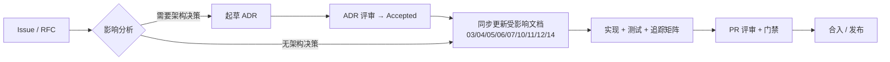

# 15 开发规范与协作流程

> 文档编号：UD-DOC-15 ｜ 版本：v0.5 ｜ 状态：草案（P0 评审门禁已接入；CI 偶发失败处置口径已补记） ｜ 日期：2026-11-13

> **v0.5 说明**（2026-11-13，仅流程口径补记）：§4 规则新增⑥「发现实现与已批准 ADR
> 冲突时的处置」——须以 `Proposed` ADR 定档并列待评审，不得只改验收判据、
> 不得把 `UNSUPPORTED` 记为 PASS 或豁免；配套
> [ADR-0021](adr/ADR-0021-L4门禁与P2P礼仪范围冲突裁决提案.md)（未生效）。
> §6 DoD、§11 / §12 / §13 原文保留不改，`17` / ADR-0020 时点值不改写。
>
> **v0.4 说明**（2026-11-13，仅流程口径补记、不改已签署 P0 证据）：新增
> §13「CI 偶发失败处置」，把 2026-11-13 `SQLITE_BUSY` 事件的处置方式固化为
> 协作规则；§6 DoD 与 §11 / §12 原文保留不改，`17` / ADR-0020 时点值不改写。

## 1. 编码规范（Go）

| 项 | 规定 |
|---|---|
| 风格 | `gofmt` + `goimports`，`golangci-lint`（errcheck、govet、staticcheck、ineffassign、gocritic） |
| Context | 所有可能阻塞的函数第一个参数为 `context.Context`；取消必须沿调用树传递 |
| 错误 | `fmt.Errorf("...: %w", err)` 包装；禁止吞错；按 `05` §7 分类为 permanent/transient/capability/security |
| Panic | 核心路径禁止 panic；插件/sidecar 边界必须 recover 并转错误码 |
| 并发 | 用 `errgroup`；共享状态优先交给 Scheduler 串行化；禁止在 goroutine 中直接写 Task 状态 |
| 命名 | 接口以能力命名（`Resolver`/`ChunkWriter`），实现以技术命名（`torrentTransport`） |
| 日志 | 结构化 JSON；禁止打印 URL 完整 query、Cookie、Authorization、passkey、session；统一走 `security.Redact` |
| 常量 | 超时、上限、退避参数集中在配置，禁止散落魔数 |
| 注释 | 导出符号必须有 doc comment；协议相关代码注明 BEP / RFC 编号 |
| 测试 | 表驱动；fixture 放 `test/testdata`；禁止 CI 直连真实站点 |

## 2. 架构依赖规则（CI 强制）

```
core  ←  resolve / transport / postproc / store / api / scheduler
core  不得 import 任何具体实现包
transport 之间不得互相 import
api 只依赖 scheduler + core
```

**自定义静态检查项（违反即阻断合入）**

- [ ] `internal/core/` 中无 `internal/transport`、`internal/resolve` 的 import
- [ ] 代码中不存在第二处全局速率配置读取（唯一权威 `Limiter`）
- [ ] `PostProcessor.Process` 签名不含 URL / `io.Reader` / 网络流
- [ ] 无 `exec.Command` 出现在传输热路径包
- [ ] `CGO_ENABLED=0 go build ./...` 通过
- [ ] 新增日志字段过脱敏检查表
- [ ] 新增依赖已登记 `10` 并通过许可证扫描

## 3. Git 与分支

| 项 | 规定 |
|---|---|
| 分支 | `main`（可发布）/ `develop` / `feat/<scope>-<short>` / `fix/<id>` / `release/<v>` / `hotfix/<id>` |
| 提交 | Conventional Commits：`feat(resolve): ...`、`fix(torrent): ...`、`docs(adr): ...` |
| 粒度 | 一个 PR 一个逻辑变更；纯格式化与功能改动分开 |
| 保护 | `main` 禁止直推；需 1 名架构/后端评审 + CI 全绿；架构相关 PR 需架构师批准 |
| 标签 | `vX.Y.Z` 附注标签，附 changelog |

## 4. 变更管理流程



**规则**：① 决策的唯一真值源是 ADR；② 与已批准 ADR 冲突的实现视为缺陷；③ 文档编号清单见 `docs/README.md`；④ 每次 ADR 状态变更必须在 `docs/adr/README.md` 索引中同步；⑤ 需求变更必须同步 `03` §8 追踪矩阵与 `12` 用例；⑥ **发现实现与已批准 ADR / M 级需求冲突时，须先提交 `Proposed` ADR 定档阻塞性质、影响面与可选裁决路径并列入待评审**（`Proposed` 不构成实现依据），**不得**只改写验收判据、把 `UNSUPPORTED` 记为 `PASS`／以「豁免」计入通过数，也不得就地改写已接受 ADR；评审签署后再按④同步索引状态（实例：`12` §3.1.2、ADR-0021）。

## 5. 评审清单（PR 模板）

```markdown
## 变更说明
## 关联 Issue / ADR / 需求编号
## 受影响文档（编号列表）
## 架构检查
- [ ] 未引入第二个调度器 / 第二处限速配置
- [ ] 未破坏 CGO_ENABLED=0 与移动端可达性
- [ ] 未新增 GPL 依赖到传输路径
## 安全检查
- [ ] 新增 URL 经 SSRF Guard；新增日志字段已脱敏
- [ ] 凭据只存钥匙串、按任务最小化传递
- [ ] 插件/规则权限最小化
## 质量
- [ ] 单元/契约/集成测试通过，覆盖新增分支
- [ ] 追踪矩阵与用例已更新
- [ ] 性能基准无回归
## 回滚方案
```

## 6. DoR / DoD

| DoR（就绪定义） | DoD（完成定义） |
|---|---|
| 需求编号明确、验收标准可验证 | 代码合入、CI 全绿、`12` §8 门禁通过 |
| 相关 ADR 已批准或明确无需 | `03` 追踪矩阵对应行已填、用例已加 |
| 接口/数据模型变更已同步 `05`/`06`/`07` | 文档（含 ADR 索引、变更记录）已同步 |
| 安全/许可证影响已评估 | 日志脱敏与 SBOM 检查通过 |
| 测试环境与 fixture 就绪 | 回滚/降级路径已验证 |

## 7. 依赖引入流程

1. 提交依赖提案：用途、许可证、是否 cgo、维护活跃度、替代方案。
2. `10` 表格登记 + `11` §6 许可证检查 + `govulncheck`。
3. 验证 `CGO_ENABLED=0` 六平台构建与移动端可达性。
4. 架构评审通过后方可合入；GPL 组件一律不得进入传输路径。
5. 升级 `anacrolix/torrent` / `goed2k` 必须通过 `12` §3 互操作套件。

## 8. 缺陷管理

| 级别 | 定义 | 响应 |
|---|---|---|
| P0 | 数据损坏、凭据泄漏、SSRF 可打内网、daemon 全局崩溃 | 立即停发布，24h 内修复 |
| P1 | 核心协议不可用、断点失效、限速翻倍 | 当前里程碑内修复 |
| P2 | 单个站点规则失效、非关键 UI 缺陷 | 排入下个迭代 |
| P3 | 文案、优化建议 | 按需 |

站点规则失效按 `RULE_OUTDATED` 事件聚合处理，属于**常态维护**而非 P0 缺陷；但不得静默失败，必须给用户可读提示并允许兜底 Resolver。

## 9. 文档即代码

- 所有规范文档随仓库版本化；`docs/_site/` 由 `python3 tools/build_docs.py` 生成，禁止手工编辑。
- PR 若修改 `docs/`，CI 重新生成门户并校验内部链接可解析。
- 会议/聊天中的架构结论必须在 2 个工作日内落到 ADR，否则视为未决策。

## 10. 变更日志规范（P0 起强制）

项目根目录 [`CHANGELOG.md`](../CHANGELOG.md) 是**变更记录的唯一真值源**，格式遵循 [Keep a Changelog 1.1.0](https://keepachangelog.com/en/1.1.0/) + [Semantic Versioning 2.0.0](https://semver.org/spec/v2.0.0.html)。

| 规则 | 说明 |
|---|---|
| 分组 | 只用 `Added` / `Changed` / `Deprecated` / `Removed` / `Fixed` / `Security`；安全修复优先归入 `Security` |
| 版本语义 | `0.1.x` = P0 里程碑，`PATCH` 对应构建批次；`MAJOR.MINOR.PATCH` 正式启用于 P3 后首个稳定版 |
| 时机 | **每次代码变更必须在合入前写入** `Unreleased` 或当前版本段，禁止事后补记；同时同步受影响的 `docs/` 文档 |
| 链接 | 版本标题用 `[0.1.0] - YYYY-MM-DD`，文末维护 compare / release 链接定义 |
| 门户 | 已纳入 `tools/build_docs.py` 的 `GROUPS`，slug 为 `changelog`；新增文档必须同步门户并跑 `--check`（见 `docs/README.md` §5） |
| 与 ADR 的分工 | ADR 记「为什么这样决定」，CHANGELOG 记「实际改了什么」；新增/修订 ADR 时两者都要更新 |

## 11. P0 架构检查链落地

`tools/check_arch.py`（纯标准库、无依赖）由 `make lint-arch` 调用，CI 中随 `make lint` 执行，共 6 条守卫，与 §2 清单一一对应：

| 守卫 | §2 检查项 | 实现要点 |
|---|---|---|
| 1 | `core` 零实现依赖 | 扫描 `internal/core/*.go` 的 import 路径前缀 |
| 2 | 传输热路径无外部进程 / cgo | 扫描 `os/exec`、`exec.Command`、`import "C"`、`syscall.Exec` |
| 3 | `PostProcessor` 本地文件契约 | 正则解析 `core/interfaces.go` 的接口块，禁止 `url.URL` / `io.Reader` / `net.Conn` 等 |
| 4 | 全局速率唯一读取点 | 仅 `internal/scheduler/limiter.go` 与 `internal/config/` 可读 `MaxDownloadRate`；**测试夹具构造 config 字面量不算第二权威**，故守卫只扫生产代码 |
| 5 | 禁用 cgo / GPL 驱动 | 检查 `go.mod` 是否含 `mattn/go-sqlite3`、`aria2`、`libtorrent`，并扫描全仓 `import "C"` |
| 6 | `docs/_site` 为生成物 | 由 `tools/build_docs.py` 的导航图校验保证，禁止手工编辑 |

**P0 检查链实际执行结果**：`make fmt`、`make vet`、`python3 tools/check_arch.py`、`go test ./... -count=1`、`go test -race`（关键包）、`make build`（6 平台）、`python3 tools/build_docs.py --check` 全部通过，0 违规 / 0 断链。

**与 §6 DoD 的偏差**：`12` §8 的发布门禁在 2026-11-09 评审准备轮部分补齐——`make gates` 已执行 CycloneDX SBOM、`go mod verify`、许可证扫描、`govulncheck`、覆盖率报告与备份/回滚演练并接入 CI；**仍未达标**的是 L4 互操作、千兆内网性能基准与法务签字（覆盖率阈值已于 2026-11-10 全部达标并启用 `--strict`）。因此 P0 的「DoD 全绿」应理解为**P0 范围内的检查链全绿**，不是 `12` §8 发布门禁全绿；逐条差异见 `17` §3/§5，`14` §9/§10 与 `ADR-0020`。

## 12. 评审门禁证据（P0 起）

`make gates` 是评审材料的证据来源，六项门禁各自把机器可读结果写入 `dist/`：

| 目标 | 证据 | 失败语义 |
|---|---|---|
| `make cover` | `dist/coverage.json` | 低于阈值记 WARN（不伪装通过），`--strict` 可阻断 |
| `make sbom` / `make licenses` | `dist/sbom.cdx.json`、`dist/license-report.json`、`THIRD_PARTY_NOTICES.md` | copyleft 进入传输路径直接 FAIL |
| `make vuln` | `dist/vuln.txt` | 发现漏洞 FAIL；工具/漏洞库不可用记 WARN 并写明原因 |
| `make bench` | `dist/bench.json` | 仅作回归基线，不代替 NFR-PERF-01 |
| `make rollback-drill` | `dist/rollback-drill.txt` | 备份→坏升级→恢复→复用分片任一环节失败即 FAIL |

按 ADR-0020 §4「变更同步规则」，新增/修改门禁工具时须同步本文件、`12`/`13`/`14`/`17` 与 `CHANGELOG.md`，并跑 `python3 tools/build_docs.py --check`。

## 13. CI 偶发失败处置（2026-11-13 补记）

CI 出现低概率、本机难以复现的失败时，按下列规则处置；**「重跑一次变绿」不构成修复**：

1. **如实记录**：失败的运行编号、失败步骤与原始结论必须保留（如 run `43393512271`
   的 `cover` 步骤 **5 PASS / 0 WARN / 1 FAIL**），不得把 FAIL 改记为
   `SKIPPED` / `UNSUPPORTED` / PASS，也不得事后改写历史数值冒充通过。
2. **定位根因**：先做线协议 / 并发 / 依赖层诊断，区分「产品代码缺陷」「测试夹具缺陷」
   与「环境噪声」；本机同条件多轮复跑、`-race`、`-coverprofile` 对照是取证手段，
   不是结论。
3. **修产品代码 + 补回归用例**：修复必须落在真实实现上并附带可复跑的回归用例
   （本例为 `internal/store.withTx` 有界事务重放 + 4 条 `extra_test.go` 用例），
   不得只放宽阈值、加 `--retry`、跳过用例或关闭 `--strict`。
4. **不改 CI 门禁语义**：步骤顺序与严格模式原样保留；随后由新提交触发
   `quality` 复跑并把结论写回 `CHANGELOG` / `13` §4 / `docs/README` §三。
5. **文档闭环**：`docs/` 任一文件改动后必须重建 `docs/_site/index.html` 并跑
   `python3 tools/build_docs.py --check`；进度真值源仍为 `CHANGELOG.md`。

> **口径**：本规则只约束质量门禁处置，**不改变** `14` §11 序 6 的开放状态；
> L4 真实客户端矩阵、判据冲突评审与 NFR-PERF-01 双机千兆基准仍属未执行项。
> 已签署的 `17` 与 ADR-0020 正文不改写。
