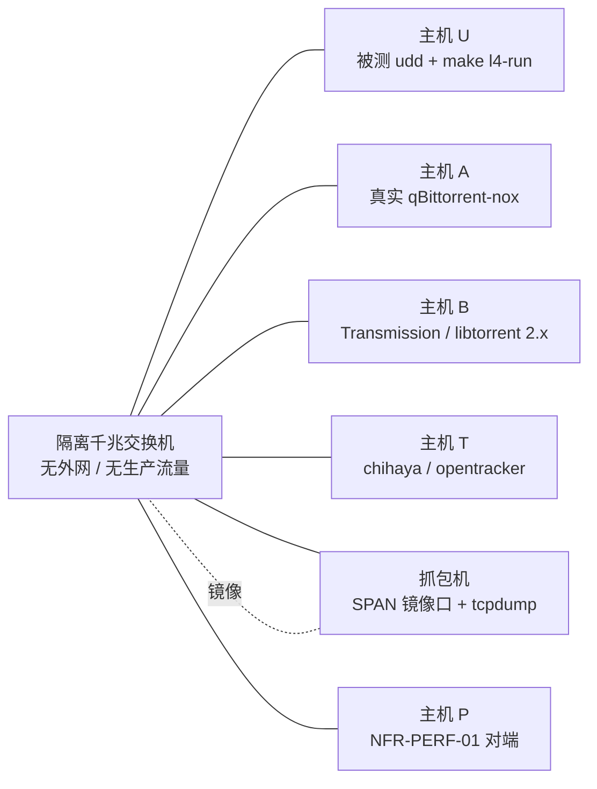

# 18 序 6 评审与 L4 实验室准备材料包

> 文档编号：UD-DOC-18 ｜ 版本：v0.2 ｜ 状态：**草案（待评审签署材料，不构成实现依据、不产出 L4 证据）** ｜ 日期：2026-11-14 ｜ 维护责任：架构组 ｜ 上游：[ADR-0021](adr/ADR-0021-L4门禁与P2P礼仪范围冲突裁决提案.md)、[12](12-测试策略与测试计划.md) §3.1.2 / §3.1.3 / §3.1.4、[14](14-项目计划与风险管理.md) §11、[15](15-开发规范与协作流程.md) §4

> **v0.2 变更**（2026-11-14，衔接 L4 证据包完整性审计；**仍为待评审草案、
> 不代行裁决、不产出 L4 证据**）：§7.3 补第 5 条「归档后先跑 `make l4-audit`
> 独立复核证据包完整性」、§7.4 步骤 5 补审计、§九 收口清单补一项、
> §十 增第 9 条硬不变量（完整性结论 ≠ L4 通过，审计器恒
> `l4_executed_by_audit=false`、不接入 CI、不替代 `make interop-gate`）。
> 实验室目标由「三目标」扩为**四目标**并明确四者均不接入 CI；
> 原 v0.1 的「8 条硬不变量」「三目标」等为时点值，只在新增版本说明中标注，
> 不改写历史表述。同步 `12` v1.4 §3.1.4、`13` v0.12 §3 / §12、
> `docs/README` v1.8、根文档与 `CHANGELOG`。**签署表仍为空白、未签署无效**，
> ADR-0021 保持 `Proposed`；L4 **0/14**、`release_gate_met=false`、
> `l4_executed=false`、`nfr_perf_01.met=false`、序 6 仍开放。
>
> **性质与边界（必读）**：本文是**待评审材料包**，只提供事实清单、核对清单、
> 空白签署表与实验室执行方案。它**不代行裁决**、不预选 A / B / C 路径、
> 不修改 [ADR-0021](adr/ADR-0021-L4门禁与P2P礼仪范围冲突裁决提案.md) 的决策内容、
> 不改写 [17](17-P0里程碑评审材料.md) 与 ADR-0020 的已签署证据，
> **不产出任何 L4 通过证据**。评审签署前 `release_gate_met` 恒为 `false`、
> `BT-01..BT-14` 保持 **0/14 PASS**，`SKIPPED` / `UNSUPPORTED` 绝不计为 PASS。
> 本文所有表格均留白待签；任何表格在被评审组填写并签署前**不具备效力**。

## 一、用途与不做的事

| 用途 | 明确不做的事 |
|---|---|
| 把序 6 阻塞的事实、影响面与签署要件集中到一处，供评审组直接使用 | 不代评审组选择路径、不预填结论或签署人 |
| 提供 A / B / C 三条路径签署后的逐项变更核对清单 | 不修改 `12` §3.1 已登记的 L4 判据、不改任何产品代码与门禁语义 |
| 提供隔离实验室拓扑、抓包留痕与双机基准的**执行方案** | 不执行矩阵、不产生 pcap / 日志 / 实测值、不翻转 `l4_executed` |
| 提供可追溯签署证据的模板与归档要求 | 不把空表或草案当作已签署证据，不以「豁免」冒充「通过」 |
| 衔接 `make l4-audit` 证据完整性审计（独立工作包，见 `12` §3.1.4） | 不把 `CONSISTENT` 当作 L4 通过、不把审计器当作发布门禁 |

> 当前态唯一速查仍为 [`docs/README` §三](README.md)，进度真值源仍为
> [`CHANGELOG`](../CHANGELOG.md)；本文是**评审输入材料**，不是新的真值源。

## 二、评审输入：已核实事实清单

以下只做引用与登记，不复制原文、不改写数值。带日期的历史时点值按
[`15` §4](15-开发规范与协作流程.md) 只允许追加「时点口径」注。

| # | 事实 | 权威来源 | 当前值 |
|---|---|---|---|
| 1 | ADR 0001–0020 全部 `Accepted`；ADR-0021 为 `Proposed`（待评审、**未生效**） | [`adr/README`](adr/README.md)、[ADR-0021](adr/ADR-0021-L4门禁与P2P礼仪范围冲突裁决提案.md) | 20 `Accepted` / 1 待评审 |
| 2 | 序 6 阻塞根因是**实现相对已批准 ADR 与 M 级需求的未签署范围缩减（合规差距）**，判据冲突与实验室条件缺失并存 | [ADR-0021 背景](adr/ADR-0021-L4门禁与P2P礼仪范围冲突裁决提案.md)、[`12` §3.1.2](12-测试策略与测试计划.md) | 合规差距为根因 |
| 3 | `NoUpload=true` / `Seed=false` 自 WBS 7 固定，`config.BTConfig` 至今只解析不生效 | [`05` §5](05-详细设计说明书-LLD.md)、[`07`](07-接口规范-API.md)、[`13` §7](13-构建发布与运维.md) | `bt.*` 配置键未接通 |
| 4 | L4 发布门禁未通过 | `dist/interop.json`、[`12` §3.1](12-测试策略与测试计划.md) | **0/14 PASS**，12 `SKIPPED` + 2 `UNSUPPORTED`，`release_gate_met=false` |
| 5 | 真实跨客户端补充证据为单向回环，不计入 L4 | `dist/interop_external.json`、[`12` §3.1.1](12-测试策略与测试计划.md) | `BX-01..BX-04` 4/4 PASS（aria2-next + 真实 libtorrent 2.1.1） |
| 6 | 1GiB 回环参考基准不等于双机千兆达标 | `dist/perf.json`、[`12` §5](12-测试策略与测试计划.md) | 885.83 MB/s，`nfr_perf_01.met=false` |
| 7 | L4 实验室链路只清点前置条件 | `dist/L4_PREFLIGHT.md`、[`13` §3 / §12](13-构建发布与运维.md) | `l4_executed=false`，9 项条件，4 项须人工签署 |
| 8 | P0 已签署证据不可改写 | [`17`](17-P0里程碑评审材料.md)、ADR-0020 | 只允许追加带日期的时点口径注 |

## 三、待裁决事项：三条互斥路径

评审组须**显式选择其一并签署**，结论回写
[`adr/README`](adr/README.md) 索引（`15` §4 规则④）。完整影响面以
[ADR-0021 D2](adr/ADR-0021-L4门禁与P2P礼仪范围冲突裁决提案.md) 为准，本表仅为核对入口。

| 路径 | 内容摘要 | 签署后必须同步（缺一不可） | 收口影响 |
|---|---|---|---|
| **A 补齐实现** | 实现受限做种 / 上传、分享率与 `seed-time`、上传槽、UPnP/NAT-PMP、统一 announce 统计，接通 `bt.*` 配置键 | 新增 P1 工作包 + `03` 追踪矩阵 + `05` 状态机 + `07` / `13` 配置生效 + `11` §7.1 + 重评 `14` R-10 + 全量 L4 与 NFR-PERF-01 | 判据不改、代码回到 ADR 基线；属**新功能范围**，须重做安全与 P2P 礼仪评审，工作量最大 |
| **B 修订范围** | 把「v1 仅下载、不做种」正式定为产品边界 | ADR-0004 / ADR-0017 标 `Superseded`（或附经批准修订附录）+ `03` 三条 M 级需求降级或改写 + `01` 章程 + `12` §3.1 判据 + `14` §11 收口条件 + `05` / `07` / `13` / `11` / `16` 文案 | 范围与判据一致；但**必须**有可追溯签署证据，`BT-02` / `BT-11` / `BT-03` 我方做种半向只能记「豁免」，**永远不得记为 PASS** |
| **C 保持开放** | 不改任何决策或判据 | 仅在 `14` §11 明确「阻塞源自合规差距 + 判据冲突，而非仅环境缺失」 | `release_gate_met` 恒 `false`、序 6 永不关闭；**不得以默认状态冒充已处置** |

> **未签署时的默认现实**：无论流程是否推进，未签署即按 C 的**客观状态**处理
> （`release_gate_met=false`、序 6 开放）；这**不等于**评审组已选择 C，
> 也不构成任何处置结论。仅改 `12` §3.1 判据、不动 ADR 与 SRS 属 ADR-0021
> 明令禁止的处置方式。

## 四、影响面核对表（签署后逐项核对）

以下清单供执行者逐项打勾，任一项未完成不得宣称路径已落地。

### 4.1 路径 A

- [ ] 新增 P1 工作包与验收标准（`14` §11 排期与风险登记）
- [ ] `03` §8 追踪矩阵补 FR-INT-01 / FR-INT-04 / FR-TRN-05 的实现映射
- [ ] `05` Task 状态机补做种 / 上传 / 分享率阶段与不变式
- [ ] `07` / `13` 的 `seedRatio` / `seedTimeMinutes` / `enableUPnP` 配置真正生效
- [ ] `11` §7.1 上传礼仪控制与 `14` R-10 反吸血风险重评
- [ ] `internal/transport/bt` 与 `internal/config` 代码 + 单元 / 回环回归用例
- [ ] 安全与 P2P 礼仪评审复签，凭据与上传槽约束记入 `11` §7.1 / `14` R-10
- [ ] 全量 L4 矩阵与 NFR-PERF-01 按 §七 / §八 重跑并留痕

### 4.2 路径 B

- [ ] ADR-0004 / ADR-0017 标 `Superseded by ADR-0021` 或附经批准的修订附录
- [ ] `03` 三条 M 级需求降级或改写，`01` 章程互操作验收行同步
- [ ] `12` §3.1 判据改为「适用用例全 PASS + 非目标用例经签署显式豁免」
- [ ] `14` §11 收口条件、`05` 状态机、`07` / `13` 配置键、`11` §7.1、`16` §4 / §7 文案同步
- [ ] [`adr/README`](adr/README.md) 索引状态与影响面同步
- [ ] 按 §五 填写豁免清单并附签署证据入库

### 4.3 路径 C

- [ ] `14` §11 明确阻塞源自合规差距 + 判据冲突，而非仅环境缺失
- [ ] 明确 `release_gate_met` 恒 `false`、序 6 永不关闭
- [ ] 明确不得以默认状态冒充已处置

### 4.4 三路径共同收尾

- [ ] ADR-0021 状态由 `Proposed` 改为 `Accepted` / `Rejected`（`15` §4 规则④）
- [ ] 签署证据（签署人、日期、所选路径、豁免清单版本）作为可追溯文件入库
- [ ] [`CHANGELOG`](../CHANGELOG.md) / `docs/README` §三 / 受影响 `docs/NN` / 根 [`README`](../README.md) / 门户 `docs/_site/index.html` / CI 证据同步
- [ ] 复跑 `make lint` / `make test` / `make build` / `make interop` / `make gates-strict` / `go test -race ./...` / `build_docs.py --check`

## 五、豁免清单模板（留白）

> **仅路径 B 经评审签署后方可填写**。`BT-02` / `BT-11` 与 `BT-03` 我方做种半向
> 只能记为「**豁免**（非目标）」，**永远不得记为 PASS**；`SKIPPED` 不是豁免；
> 每行必须引用签署后 ADR 的具体条款并附证据链接。

| 判据 | 非目标理由 | 依据条款（签署后 ADR） | 豁免批准人 | 签署日期 | 证据链接 |
|---|---|---|---|---|---|
| —（待填写） | —（待填写） | —（待填写） | —（待填写） | —（待填写） | —（待填写） |

## 六、评审签署表（留白模板）

> 本表**留白**，不预填任何结论、路径或签署人；未签署即无效。
> 评审组构成依 [`docs/README` §一](README.md) 状态机与 [`15` §4](15-开发规范与协作流程.md)。

| 角色 | 姓名 / 签署 | 日期 | 意见 | 结论（同意 / 附条件 / 否决） |
|---|---|---|---|---|
| 架构组 | — | — | — | — |
| 产品 | — | — | — | — |
| 法务 / 合规 | — | — | — | — |
| QA / 安全 | — | — | — | — |
| PM（记录） | — | — | — | — |

| 签署要件 | 填写处 |
|---|---|
| 所选路径（A / B / C，**单选**） | — |
| 签署日期与生效条件 | — |
| 豁免清单版本与存放路径 | — |
| 评审结论证据文件（可追溯） | — |
| ADR-0021 索引状态变更（Accepted / Rejected） | — |

## 七、L4 实验室拓扑与抓包方案（草案，**未执行**）

> 本节是**方案**，不是执行报告。当前 `make l4-preflight` 实测
> `ready=false`、`PRESENT 0 / MISSING 6 / UNVERIFIED 3`、`l4_executed=false`；
> 本节任何描述都不得被引用为实验室已具备。

### 7.1 逻辑拓扑

所有节点须时间同步（NTP / chrony）、固定 IP、关闭外网路由；`CAP` 只从
SPAN 口被动取流，不注入、不改写被测流量。

### 7.2 前置条件与 `make l4-preflight` 的映射

下表 ID 与 `internal/interop/preflight.go` 的 `LAB-*` 一一对应；
「核验方式」为签署前必须完成的动作。

| ID | 条件 | 核验方式 / 环境变量 | 当前状态 |
|---|---|---|---|
| `LAB-CLIENT-QB` | 真实 qBittorrent 客户端 | `UD_L4_QBITTORRENT` 或 `qbittorrent-nox` 可执行文件 | `MISSING` |
| `LAB-CLIENT-TR` | 真实 Transmission / libtorrent 系客户端 | `UD_L4_TRANSMISSION` 或 `transmission-daemon` | `MISSING` |
| `LAB-TRACKER` | 自建真实 tracker 二进制 | `UD_L4_TRACKER` 或 `chihaya` / `opentracker` | `MISSING` |
| `LAB-CAPTURE` | 抓包能力（BT-08 / BT-14） | `UD_L4_TCPDUMP` 或 `tcpdump` + SPAN 权限 | `MISSING` |
| `LAB-CONFIG` | 外部 harness 配置（真实命令，非 stub） | `UD_L4_CONFIG` / `--config`，须替换 `tools/l4_external_config.example.json` 中的 stub | `MISSING` |
| `LAB-TOPOLOGY` | 隔离千兆内网 + 第二台主机 | 人工签署 `UD_L4_TOPOLOGY_ATTESTATION` + 拓扑图归档 | `UNVERIFIED`（人工签署项） |
| `LAB-REVIEW` | 判据 / 范围冲突的评审签署 | 人工签署 `UD_L4_REVIEW_SIGNATURE` + §六 签署表入库 | `UNVERIFIED`（人工签署项） |
| `LAB-PERF` | NFR-PERF-01 双机千兆基准 | 人工签署 `UD_L4_PERF_ATTESTATION` + §八 实测归档 | `UNVERIFIED`（人工签署项） |
| `LAB-CLIENT-LT` | libtorrent 2.x 双向会话客户端 | 人工签署 + 双向会话抓包佐证 | `UNVERIFIED`（人工签署项） |

> `make l4-preflight` 的 `PRESENT` 只表示「工具可核验的条件存在」，
> **绝不等于 PASS**；示例 stub 配置只能产出 `SKIPPED`。

### 7.3 真实 harness 与证据留痕

1. 每个 `BT` 外部用例实现真实 harness，stdout 最后一行输出 JSON verdict
   `{status, reason, evidence}`，`status` 仅允许 `PASS` / `FAIL` / `SKIPPED` / `UNSUPPORTED`。
2. 每条判据至少留：pcap 片段（含握手 / announce / 数据传输）、tracker announce 与
   scrape 日志、双方 PeerID 与 infohash、整文件 sha256、原始 JSON verdict、
   执行时间戳与主机角色。**BT-08 的 private=1 禁 DHT/PEX/LSD 与 BT-14 的诚实
   PeerID 必须以抓包为准**，不得只凭日志自述。
3. 证据落 `dist/l4_lab/`，归档时保留原始文件与校验和清单；
   汇总进 `dist/interop.json` 的 `release_gate_met` **只能由真实结果翻转**。
4. `BT-02` / `BT-11` 按产品边界固定 `UNSUPPORTED`，不得出现在声称覆盖的配置中；
   `BT-03` 须双向（我方做种半向当前不可达），单向补充证据不计入。
5. 归档后运行 `make l4-audit`（`L4_EVIDENCE=<path>` 可指定），由
   `internal/interop/audit.go` 独立重算证据包的 9 项 `AUD-*` 检查，
   产出 `dist/l4_audit.json` / `dist/L4_AUDIT.md`；`CONSISTENT` 仅表示
   **内部自洽**，不等于 L4 已执行或通过。审计器不执行用例、不访问网络、
   不写回被审计文档，恒 `l4_executed_by_audit=false`，**不替代**
   `make interop-gate`（详见 [`12` §3.1.4](12-测试策略与测试计划.md)）。

### 7.4 执行顺序与失败判据

1. 按 §六 完成评审签署并回写 ADR 索引状态（**先裁决，后执行**）。
2. `make l4-preflight` 清点 → `make l4-preflight-check`（未齐备必须非零退出）。
3. 补齐 `UD_L4_TOPOLOGY_ATTESTATION` / `UD_L4_REVIEW_SIGNATURE` / `UD_L4_PERF_ATTESTATION`。
4. 用真实配置执行 `make l4-run`（`--require-external --external-config --release-gate-only`）。
5. 逐条人工复核 §7.3 留痕，并用 `make l4-audit` 独立复核证据包完整性
   （`CONSISTENT` 不等于 L4 通过）；`SKIPPED` / `UNSUPPORTED` / `PRESENT` 一律不计 PASS。
6. 只有**适用用例全 PASS**（或非目标用例附签署豁免）且 §八 基准达标，
   才可能进入序 6 收口评审；任何缺项、超时、抓包缺失一律保持 `release_gate_met=false`。

> 用示例 stub 跑 `make l4-run` 必须保持 **0/14 PASS 并明确失败**；
> 四目标（`l4-preflight` / `l4-preflight-check` / `l4-run` / `l4-audit`）均**不接入 CI**。

## 八、NFR-PERF-01 双机基准执行方案（草案，**未执行**）

| 项 | 要求 |
|---|---|
| 链路 | 两台物理主机经隔离千兆交换直连，先以链路能力测试佐证千兆可用，记录网卡协商速率 |
| 负载 | 1GiB 单文件、4 连接、256KiB 分片，走真实 HTTP Range Transport，逐片字节校验 |
| 判据 | 端到端吞吐 **≥ 80 MB/s**；至少 3 轮取中位数，同时记录 CPU / 磁盘 / 网卡利用率与丢包重传 |
| 证据 | 原始计时日志、逐轮结果、链路能力佐证、拓扑与主机配置、签署后的 `UD_L4_PERF_ATTESTATION` |
| 当前值 | `dist/perf.json` 的 1GiB **回环**参考 885.83 MB/s（1.156s）；`nfr_perf_01.met=false`，**不得**当作达标 |

> 若需把双机实测写入 `dist/perf.json`，须扩展 `cmd/udperf` 的输入与报告字段，
> 属**代码变更工作包**，须按 `15` §10 先写 [`CHANGELOG`](../CHANGELOG.md)
> 并同步全量文档与门禁证据。

## 九、签署后收口清单

- [ ] 评审组按 §六 签署，ADR-0021 状态与索引同步
- [ ] 按所选路径完成 §四 全部变更项
- [ ] §七 真实 L4 矩阵执行并留痕，适用用例全 PASS 或非目标用例签署豁免
- [ ] `make l4-audit` 对归档证据包结论为 `CONSISTENT`（完整性，非 L4 通过），失败项已闭环
- [ ] §八 NFR-PERF-01 双机基准达标
- [ ] 全量文档 / 门禁 / CI 证据同步，`make interop-gate` 才可能转为通过
- [ ] 序 6 / WBS 11 在 `14` §11 与 `docs/README` §三 标记为关闭

## 十、硬不变量（不得伪造）

1. 签署前 ADR-0021 保持 `Proposed`，**不构成实现依据**（`15` §4）。
2. `release_gate_met` / `l4_executed` 保持 `false`，直到真实矩阵执行并复核。
3. `SKIPPED` / `UNSUPPORTED` 绝不计 PASS；**豁免 ≠ PASS**，`PRESENT ≠ PASS`。
4. `BX-01..BX-04` 是单向回环补充证据，**不计入 L4**；`libtorrent` 点名于 `BT-03`
   不代表该判据通过。
5. `make perf` 的回环 MB/s **不得**当作 NFR-PERF-01 达标（文件固定 `met=false`）。
6. `17` / ADR-0020 已签署证据与各文档历史版本说明中的时点数值**不改写**，
   只允许追加带日期的「时点口径」注。
7. 本文是**待评审材料**，不是签署证据；空白表未填写签署前不具备效力。
8. 序 6 保持开放；产品文案继续按 [`16` §7](16-互操作性与兼容性设计.md)
   只写「兼容标准 BitTorrent 网络，可与主流客户端互通」。
9. `make l4-audit` 的 `CONSISTENT` **只是证据包内部自洽结论**，
   不等于 L4 矩阵已执行或通过；审计器恒 `l4_executed_by_audit=false`、
   不设置 `release_gate_met`、不接入 CI、不替代 `make interop-gate`。

## 十一、关联文档

[ADR-0021](adr/ADR-0021-L4门禁与P2P礼仪范围冲突裁决提案.md)（待裁决提案）·
[`adr/README`](adr/README.md)（ADR 索引与状态机）·
[`12`](12-测试策略与测试计划.md) §3.1 / §3.1.2 / §3.1.3 / **§3.1.4 证据完整性审计** / §5（判据与证据链）·
[`14`](14-项目计划与风险管理.md) §11（序 6 与 R-10）·
[`15`](15-开发规范与协作流程.md) §4 / §10（ADR 与变更流程）·
[`16`](16-互操作性与兼容性设计.md) §6 / §7（兼容边界与文案）·
[`13`](13-构建发布与运维.md) §3 / §12（实验室目标不接入 CI）·
[`docs/README` §三](README.md)（当前态唯一速查）·
[`CHANGELOG`](../CHANGELOG.md)（进度真值源）
