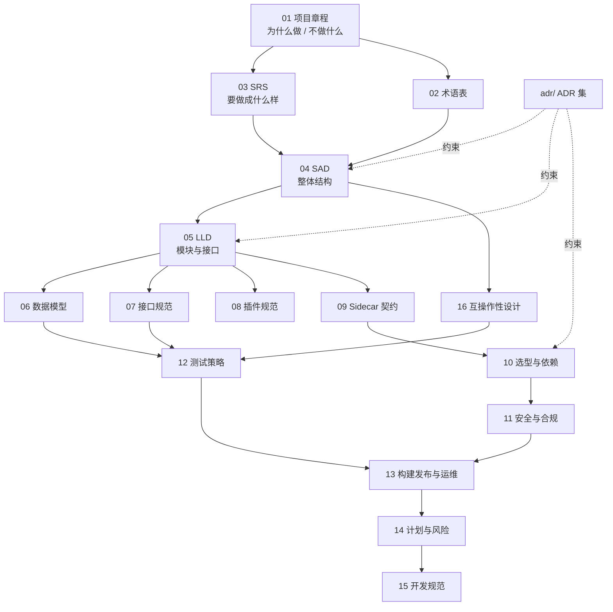

# 文档总览与文档控制

> 文档编号：UD-DOC-00 ｜ 版本：v1.58 ｜ 状态：**草案（P0 已通过有条件评审；ADR 0001–0032 已批准（0021 为路径 A，2026-11-16 发起人指令复签；0022 为 NFR-PERF-01 口径修订；0023–0029 为 HLS / DASH / Web / lux / 多文件 / HLS 分离音轨 / Telegram L1；0030–0032 为 WBS 16/17/18 的 OPEN-03/04/06 三项裁决；0021–0032 均为非实名会签）；**L4 门禁 14/14 与 NFR-PERF-01（ADR-0022 口径）均已实测通过**；**序 6 于 2026-11-17 按发起人裁决关闭（实名会签待补）**；其余文档待逐篇评审）** ｜ 日期：2026-11-28 ｜ 维护责任：架构组

> **v1.58 变更 / 2026-11-28（查源证据补强 + 性能主线复核）**：[`docs/26`](26-eD2k-UDP互通验证报告.md)
> 升 v1.5，新增 §4.8——改用每台服务器自己搜到的热门文件哈希重跑 9 台，8 台在线服务器
> 8/8 全回 `0x9B`，坐实此前 6 台未回包是「无该文件的源」而非协议不兼容；探针新增
> 自动选热门哈希与按 opcode 计数的回包统计，新增 2 个单测。性能主线复核：`b8e9de9`
> 的 3 个吞吐断言（`TestDoReadDrainsMoreThanOneChunk` 等）在当前代码全部 PASS，
> 160 KiB/s 读路径硬顶解除的增益仍成立，无需新建基准。

> **v1.57 变更 / 2026-11-28（UDP 收口归档 + SX2 根因修正）**：[`docs/26`](26-eD2k-UDP互通验证报告.md)
> 升 v1.4 并正式收口归档，明确不再为「自动选择 0x92/0x9A 的服务器」继续投入。
> [`docs/16`](16-互操作性与兼容性设计.md) §6.1.3 修正 SX2 结论：`0x83/0x84` 是 peer 间
> 源交换而非服务器协议；真机未回 0x84 的根因是对端作为完整源节点 `m_SrcList` 为空、
> 按 eMule/aMule 约定不发空应答，报文格式与时序均合规，属「应答前提未满足」而非缺陷。
> 补单测 `TestHandleRequestSources2WithoutSourcesSendsNothing` 固化无源不应答语义。

> **v1.56 变更 / 2026-11-28（eD2k UDP 抽样复跑）**：[`docs/26`](26-eD2k-UDP互通验证报告.md)
> 升 v1.3：对 9 台服务器逐台重试自动查源，并强制 `0x92` 搜索 + `0x9A` 查源再跑一轮。
> 强制 `0x92` 达到 9/9 回包；自动查源与强制 `0x9A` 仍是同一批 3 台回包。三轮 crypt key
> 下发分别为 5/9、7/9、8/9，说明 `0x97` key 下发跨会话不稳定，不能当作固定能力属性。

> **v1.55 变更 / 2026-11-28（eD2k legacy UDP 与 9 台抽样闭环）**：[`docs/26`](26-eD2k-UDP互通验证报告.md)
> 升 v1.2：强制 opcode 真机跑通 `0x98`→`0x99`（10 条）与 `0x9A`→`0x9B`（1 个目标哈希回包）；
> 抽样中 9 台 UDP 能力服务器逐台复测，9/9 登录、9/9 搜索回包、3/9 查源回包、5/9 经 crypt ping
> 装上 server key。探针新增 `-udp-only` / `-udp-source-opcode` 与按哈希计数的 UDP 回包统计，
> 会话层新增 `SetForcedUDPSourcesOpcode()` / `UDPStats()` 与对应单测。自动选择 `0x92`/`0x9A`
> 仍未找到，6 台查源未回包仅记录事实、不外推不兼容结论。

> **v1.54 变更 / 2026-11-28（eD2k UDP 真机闭环）**：[`docs/26`](26-eD2k-UDP互通验证报告.md)
> 升 v1.1：补齐真实服务器 crypt ping 下发 `ST_UDPKEY`、RC4 加密请求/回包端到端，
> 以及 `0x92` 强制 opcode 的真实往返（服务器回传 10 个加密 `0x99`）。修复 crypt ping
> 请求被错误加密的问题（eMule raw packet 明文发送），并更新 `docs/16` §6.1 的结论。
> 仍需真实服务器自动选择 `0x92` 才闭环该分支的选择逻辑。

> **v1.53 变更 / 2026-11-28（eD2k UDP 互通验证闭环）**：新增 [`docs/26`](26-eD2k-UDP互通验证报告.md)
> 存档 UDP 搜索（0x90/0x92/0x98）、查源（0x94/0x9A→0x9B）、能力位时序与 RC4 信封的验证结论；
> 以按 eMule 源码独立实现的编解码器做字节级交叉验证，并用真实 UDP socket 跑通加密请求/回包全链路。
> 修复 UDP key 绑定对象错误（原按 LOW_ID `clientID`，eMule 按 `OP_IDCHANGE` 报告的公网 IP），
> `IdChange` 解析扩至 20 字节。真机下发 `ST_UDPKEY` 的服务器与 0x92 真实往返仍未执行，不翻转发布结论。

> **v1.51 变更 / 2026-11-24（项目更名 GoBitMule）**：项目显示名由
> `Universal Downloader（通用下载器 / UD）` 更新为 **GoBitMule**；GitHub 仓库名与
> Go module 路径统一为 `github.com/asdfgh129/gobitmule`。README、项目章程、ADR 索引、
> 文档门户标题、Web 控制台标题、示例配置与源码 import 均已同步。为保持兼容，
> `udd` / `udctl` 等命令名、`UD_*` 环境变量、`ud.interop/v1` schema 与 `-UD0000-`
> PeerID 前缀继续保留；历史证据中的旧名称按取证时点原样保留，不追溯改写。
>
> **v1.52 变更 / 2026-11-27 时点口径（WBS 16 eD2k 生产下载链路补齐）**：
> 对照真实 eMule 1.82 MB/s 与本引擎 30–60 KB/s 的差距取证后，解除
> `DoRead` 16 KiB/tick 读硬顶与请求批间空转（同一源帧率 1.8→3.8 帧/s；
> 请求窗口维持 3，调 8 实测更慢）；补齐服务器 port callback 的 6 字节
> Hello 头握手、默认持续重连（线性退避→封顶 60s）与登录前 `user_hash`
> 恢复（线上 `IdChange` + 每分钟 `FoundFileSources`）；实现 SX2 `0x83/0x84`
> 版本 4 并修复 `MiscOptions` 移位优先级（Hello 能力位
> `83FA74000000`→`83FA04100010`）；进行中文件 `OfferFiles` 且引擎上传字节
> 经 `UploadSink` 上报 `tasks.bytes_uploaded`。全量 `go test` 通过；
> ED 门禁与发布结论不变，真机 AnswerSources2 仍待验证。
> `14` WBS 16 / `16` §3 / `25` §13 / `CHANGELOG` 同步。
>
> **v1.40 变更 / 2026-11-21 时点口径（P3 WBS 16–18 三项 OPEN 裁决）**：
> 发起人指令启动 ed2k / RPC facade / 微信插件，新增 [ADR-0030](adr/ADR-0030-ed2k引擎fork自维护.md)
> / [0031](adr/ADR-0031-aria2-RPC-facade纳入.md) / [0032](adr/ADR-0032-微信插件立项与代行签批.md)，
> 关闭 OPEN-03（goed2k fork 自维护）、OPEN-04（L1 facade 纳入）、OPEN-06（微信立项 + 代行签批）。
> 三个 WBS 进入「进行中」；真实环境门禁（ED-01/02/05/06、AriaNg、视频号 MITM）均 NOT_EXECUTED。
> `14`（WBS / OPEN）、`docs/adr`、`CHANGELOG` 同步，门户重建。
>
> **v1.50 变更 / 2026-11-23 时点口径（WBS 16 六项 ED 门禁全部 PASS）**：
> ① **ED-01 PARTIAL → PASS**：新增 `cmd/uded2khelloprobe`，222 真 TCP 连 209 真实
> eMule(31969)，从其 HelloAnswer 读到真实 16B user hash（3 次一致、抓包 10 包），
> 另两独立 fork 进程经受控服务器 broker 互学 hash（658 包），连接层「双方可见对方」成立。
> ② **ED-03/04 PARTIAL → PASS**：新增 `cmd/uded2kfakeserver` + `cmd/uded2kserverprobe`，
> High ID 6 源保留 3 可连接源（数量正常）、Low ID 可见源 6→3（50%）且功能不崩，
> 各抓包 13 包。③ 六项 ED 门禁（01~06）全部 PASS，按 docs/12 P3 可进入发布评审，
> R-06 降为「已缓解」。边界：ED-01 仅连接层未做块传输、eMule 单版本；ED-04 为
> clientID 模拟非真实 NAT。详见 docs/25 §12.7 与 ed010304-closeout-2026-11-23.json。
>
> **v1.49 变更 / 2026-11-23 时点口径（WBS 16 ED-02/ED-05 提升 PASS）**：
> ① **ED-02 PARTIAL → PASS**：新增 `cmd/uded2kkadpeer`，在 222 真机用两个独立
> 进程经内核 UDP 回环完成受控 KAD 搜源，探针 `source_count=1`、两阶段
> `responses=1/timeouts=0`、抓包 8 包；受控对端从不调用 `PublishSource`，排除本地自证。
> 结合上一轮 105 出站/0 入站 tcpdump，公网 0 源为 NAT+节点过时的环境限制。
> ② **ED-05 PARTIAL → PASS**：生产下载路径出站混淆自动武装落地（KAD source ID /
> Hello hash → `Peer.UserHash` → `PeerConnection.Connect` 拨号前武装，未知 hash
> 明文、推断 hash 失败回退明文），新增 7 项测试；结合上轮跨进程真 TCP 仅混淆
> 对端互操作，已满足 docs/12 ED-05「能建立连接」条件，第三方客户端对端为已知边界。
> ③ **ED-03/04 补强**：High ID 握手模拟 + 可见源比例 6→3（50%）可测且功能不崩，
> 真机指标未闭环维持 PARTIAL；**ED-01 评估后维持 PARTIAL**（需侵入式实验室改造）。
> 门禁：ED-02/05/06 PASS，ED-01/03/04 PARTIAL；P3 不发布、R-06 维持。
> 详见 docs/25 §12.6 与 `docs/evidence/ed2k-ed-gates-2026-11-22/ed-advance-2026-11-23.json`。
>
> **v1.48 变更 / 2026-11-23 时点口径（WBS 16 ED-02 根因实验 + ED-05 跨进程互操作）**：两项推进，门禁均不翻转。① **ED-02 根因由推断升级为实验证明**：本地正对照 `TestKADSourceSearchLocalPositiveControl` 用 fork 同一 codec 得到 find-sources/search-sources 均 `responses=1/entries=1`、callback 端点解码正确；给 `dht_tracker.go` 补逐包 send/recv/decode-failed 日志后，222 真机 `tcpdump` 捕获 **105 出站 UDP / 0 入站**，坐实 `responses=0` 为 NAT 阻断入站 + 节点过时的环境层问题，协议编码/RPC/遍历无 bug，ED-02 维持 PARTIAL。② **ED-05 补齐仅混淆对端跨进程真 TCP 互操作**：新增 `cmd/uded2kobfspeer`，222 上两个独立进程经内核 TCP 完成 A/B 握手 + 加密 nonce 往返、双方 verdict=PASS、抓包明文泄漏 0，闭环此前互操作缺口；剩余出站自动武装 + 第三方客户端对端，ED-05 仍 PARTIAL。证据 `docs/evidence/ed2k-ed-gates-2026-11-22/kad-rootcause-2026-11-23.json` 与 `obfs-cross-process-interop-2026-11-23.json`，详见 docs/25 §12.5。P3 不发布、R-06 维持。
>
> **v1.47 变更 / 2026-11-23 时点口径（WBS 16 ED-05 live-TCP 接线）**：ED-05 由协议层 PARTIAL 推进为 **live-TCP 已接入 PARTIAL**——新增 `obfuscation.Stream`（`net.Conn` 透明 RC4 加解密）+ `WrapOutgoing`/`WrapIncoming`（A/B 阻塞握手、入站明文自动回退），接入 `Connection` 收发与 `config.ED2K.Obfuscation`（默认 true）；`crypt_layer_wired=true` 经 222 真机确认且 KAD bootstrap 不回归，18 项单测（含 net.Pipe 真实双向握手/明文回退/篡改拒绝）全绿。排查并排除 KAD UDP checksum 假设（ED-02 零响应仍为环境层，不改协议格式）。出站混淆需显式 peer hash、未做仅混淆对端真机互操作，ED-05 不判 PASS，P3 发布结论不变。详见 docs/25 §12 与证据 `docs/evidence/ed2k-ed-gates-2026-11-22/`。
>
> **v1.46 变更 / 2026-11-23 时点口径（WBS 16 ED-05 混淆协议层）**：ED-05 由 BLOCKED 推进为 PARTIAL——fork 新增 `internal/ed2k/protocol/obfuscation`（RC4 + 21 字节 MD5 密钥派生 + A/B 握手帧 codec），算法常量经 aMule/eNode/eMule Wiki 三源交叉验证，7 项单测含 A↔B 完整握手往返全绿；`CryptLayerSupported()=true`（协议层），新增 `CryptLayerWired()=false`（未接入 live TCP）以避免误判 PASS。ED-02 零响应经协议常量核对确认为环境层（节点时效 + NAT），不改常量。ED-01/02/03/04 维持 PARTIAL、ED-06 PASS，P3 发布结论不变。详见 docs/25 §11 与证据 `docs/evidence/ed2k-ed-gates-2026-11-22/`。
>
> **v1.45 变更 / 2026-11-22 时点口径（WBS 16 ED 门禁补缺）**：ED-06 从 BLOCKED 推进为 PASS——fork 暴露 UserHash/SecureIdent 持久化 API，222/209 双机各两次独立进程启动 UserHash 不变；KAD 搜源两阶段 traversal 现可收敛并回调（`search_completed=true`），但真机仍 `source_count=0`，ED-02 维持 PARTIAL；ED-04 本地 Low ID 握手模拟通过（PARTIAL）；fork 明确无 CryptLayer/RC4 能力，ED-05 BLOCKED。发布结论不变，详见 docs/25 §10 与证据 `docs/evidence/ed2k-ed-gates-2026-11-22/`。
>
> **v1.44 变更 / 2026-11-22 时点口径（WBS 16 真机 ED 门禁执行）**：fork goed2k 引擎接入完成（internal/ed2k + Goed2kDownloader，单测全绿）；真机 KAD bootstrap 两机 PASS（ud fork 首次入网，LiveNodes=50/KnownNodes=200）；ED-01/02/03 PARTIAL、ED-04/05 NOT_EXECUTED、ED-06 BLOCKED，搜源 traversal 在 NAT 下未收敛，P3 发布结论不变。证据 docs/evidence/ed2k-ed-gates-2026-11-22/，详见 docs/25 §9。GOCACHE 路径异常已定位（非网络）。

> **v1.42 变更 / 2026-11-22 时点口径（WBS 16 对端就绪 + LocalFileDownloader）**：
> 209 上 eMule KAD 已配置并真实入网（TCP 31969 入站 + 3 外部 ESTABLISHED、UDP 41296、
> nodes.dat + SecureIdent/CryptLayer + 72 个完成文件），推翻 `docs/25` §6.2「KAD 未配置」
> 旧论断；证据见 [`docs/evidence/ed2k-209-2026-11-22/`](evidence/ed2k-209-2026-11-22/kad-environment.json)。
> 对端条件 READY，但 ED 门禁验证 ud 引擎互操作，故 ED-01/02/05/06 仍 NOT_EXECUTED、
> ED-03 PARTIAL，发布结论不变。`transport/ed2k` 新增真实 `LocalFileDownloader`
> （受控完成目录 → seekable reader，安全路径 + byte-exact 端到端测试），仍默认不注册。
> `14` / `25` / `CHANGELOG` 同步。
>
> **v1.41 变更 / 2026-11-21 时点口径（WBS 17 AriaNg 真机验收）**：
> 隔离双机（`192.168.1.222` / `221`）完成 AriaNg 1.3.15 真机验收——跨机真实下载
> 1MiB 文件落盘 SHA256 一致、握手 7/7 方法 + CORS 预检通过，证据见
> [`docs/evidence/ariang-2026-11-21/`](evidence/ariang-2026-11-21/ariang.json)。
> 真机暴露并修复两处单测盲区（`getGlobalOption` 缺失、`OPTIONS /jsonrpc` 405），
> 新增 [`docs/25`](25-goed2k-fork-api-spike.md) goed2k fork API spike（细化 ADR-0030）。
> WBS 17 升为「技术收口」；ED-01/02/05/06 与视频号 MITM 仍 NOT_EXECUTED，不翻转发布结论。
>

> **v1.39 变更 / 2026-11-21 时点口径（P3 三项：Telegram MTProto L1 落地）**：
> 新增 [ADR-0029](adr/ADR-0029-Telegram-MTProto-L1.md)：gotd/td v0.166.1（+16 链接
> 模块全宽松许可）、四形态链接归一化（内部 tg://ud 镜像）、`Stream(io.Writer)` →
> 顺序提交、FLOOD_WAIT 分类、会话经钥匙串凭据化（L1 只读）、私有链接拒绝、
> opt-in `sources.telegram.*`。**修复 streamErr 双接收死锁**（集成测试抓出）。
> **真实 MTProto 互通 NOT_EXECUTED**（需真实凭据与网络）。`03` / `05` / `07` v0.16 /
> `10` / `11` / `12` / `14` 同步，门户重建。
>
> **v1.38 变更 / 2026-11-21 时点口径（P3 次项：HLS 多 rendition 分离发射落地）**：
> 新增 [ADR-0028](adr/ADR-0028-HLS多rendition分离发射.md)：可选 `core.FilePlanner`
> 能力接口 + EXT-X-MEDIA 音频组解析 + 调度器计划采纳与逐文件 Probe 补尺寸；muxed
> rendition 永不拆分（空 URI 解析缺陷修复）；**发现并修复变量遮蔽零长 chunk**
> （集成测试抓出）。调度器级集成 `hls_multi_test.go` 兑现（双播放清单下载 → remux
> 合并，零 ffmpeg）。`03` / `05` / `06` / `07` v0.15 / `12` / `14` 同步，门户重建。
>
> **v1.37 变更 / 2026-11-21 时点口径（P3 首项：多文件下载与容器合并落地）**：
> 新增 [ADR-0027](adr/ADR-0027-多文件下载与容器合并.md)：**DDL v2**（`files.url` 列 +
> 记录式迁移 runner `schema_migrations`）、调度器顺序多文件下载（逐文件 chunk 计划 /
> `.part` / 校验 / 恢复，传输接口零改动）、yt-dlp 分离 A/V 发射双文件（需声明尺寸）、
> **resolver 站点头双断流修复**（持久化剥离 + injectHeaders 合并）。ADR-0010 验证清单
> 「无 ffmpeg 1080p 合并」调度器级集成兑现（`multifile_test.go`，真实 HTTP + 真实 Remux）。
> `03` / `05` / `06` §4.4 + DDL v2 / `07` v0.14 / `12` / `14` 同步，门户重建。
>
> **v1.36 变更 / 2026-11-21 时点口径（P2 WBS 12 收口：lux 进程内站点解析落地）**：
> 新增 [ADR-0026](adr/ADR-0026-lux进程内站点解析.md)：lux v0.24.1（MIT）**精选提取器子集**
> （B站/抖音/爱奇艺/芒果/西瓜/快手，+12 链接模块全宽松许可；全 extractors 树 160+ 模块
> 含第二 JS 引擎 otto 与 colly 抓取框架，刻意不导入）+ opt-in `sources.lux.enabled` +
> SSRF 双检 + 站点 Referer 头 + 确定性选流 + 单 Part 边界。**修复 lux nil 分发 panic**
> （域名覆盖预检 + 提取 recover 双层防御——库对无匹配站点取 `extractorMap[""]`=nil 直接
> panic，forced 路由测试触发）与 forced 路由死代码；未注册占位 `site.go` 移除。
> `10` §4 落地注、`14` WBS 12 收口、`07` v0.13、`12` §3.3、`03` FR-SRC-01 时点注同步，
> 门户重建。
>
> **v1.35 变更 / 2026-11-20 时点口径（Web 控制台 CI 结论回填）**：`4604d0c`
> 的 run `44692698811` 为 `quality: success`，新增的 Node 22 安装与
> `make web && make web-check` 步骤通过，共 20 步；当前滚动结论停在 `4604d0c`。
>
> **v1.34 变更 / 2026-11-20 时点口径（WBS 20 Web 控制台 + ADR-0025）**：新增
> [ADR-0025](adr/ADR-0025-Web控制台架构.md)（Vue 3 + TS 单文件嵌入、类型化 RPC 方法层、
> L0 线协议不变），`07` 升 v0.14（§9 方法映射 + 两条 additive 端点）、`13` v0.32、
> `14` v1.17、`23` v1.5；构建链新增 `make web` / `make web-check` 与 CI Node 22 步骤。
>
> **v1.33 变更 / 2026-11-20 时点口径（P2 WBS 13 收口：DASH L1 + 两处分发缺陷修复）**：
> 新增 [ADR-0024](adr/ADR-0024-DASH-L1流媒体传输.md)：`internal/transport/dash` +
> `internal/resolve/dash`——静态 MPD、SegmentTemplate（@duration / SegmentTimeline）、
> SegmentList、init 段前置拼接、BANDWIDTH 选流；与 HLS 共享顺序提交原语
> `tputil.SequentialCommit`。**边界**：仅静态 / 单 Period 单 AdaptationSet（分离音视频轨
> 待 WBS 14 Remux）/ 仅明文（CENC 拒绝）/ SegmentBase 拒绝；`14` WBS 13 记 ✅（技术交付）。
> **两处分发缺陷修复**：① 通用 HTTP 传输 Kind 盲声明会吞掉流任务（仅声明 single/multi）；
> ② `{"hls"|"dash": true}` forced 选项死代码 → `resolve.Registry` 集中强制路由。
> `dash` 包 24 例 / 覆盖率 83.2%；`03` / `05` / `06` / `07` v0.12 / `12` / `14` / `16` 同步，门户重建。
>
> **v1.32 变更 / 2026-11-19 时点口径（P2 WBS 13 半边：HLS L1 流媒体传输落地）**：
> 新增 [ADR-0023](adr/ADR-0023-HLS-L1流媒体传输.md)（Accepted，发起人全权授权按建议裁决）：
> `internal/transport/hls` + `internal/resolve/hls`——RFC 8216 清单解析、AES-128（仅
> `METHOD=AES-128`）、BANDWIDTH 选流、有界并发（64MiB 字节信号量 + 8 worker）乱序下载、
> 按序提交进 ChunkWriter、Budget 唯一限速计费、字节边界断点续传；Resolver 链
> `…torrent → hls → [plugin]…`。**边界**：仅 VOD（live 拒绝）、DASH / 多音轨 /
> SAMPLE-AES / 站点页解析（WBS 12）未落地，`14` WBS 13 记「HLS 已交付、DASH 待做」。
> `hls` 包 27 例 / 覆盖率 82.8%（`tools/gates.py` 新阈值 80%）；`03` / `05` / `06` / `07` v0.11 /
> `12` / `14` / `16` 同步，门户重建。
> Windows 10 x64 本机全量回归：21 包 `go test ./...` 零 FAIL；`gates-strict`
> **5 PASS / 1 WARN / 0 FAIL**（唯一 WARN 为 cover：`internal/security` 在 Windows 编译集
> 86.6% < 90%——`keychain_cli.go` 已按 darwin/linux 收窄构建标签，剩余差距为 Windows 不可构造的
> chmod 分支；Linux CI 集合 91.3% 达标，CI 仍为门禁权威）。`-race` 需 cgo，本机无 C 工具链，
> 如实记 NOT_EXECUTED。
>
> **v1.31 变更 / 2026-11-19 时点口径（Linux `secret-tool` 真机验证补齐，纯文档 + 测试）**：
> 主机 A（Ubuntu 23.04 / x86_64 / Go 1.27.4，`192.168.1.222` 为其第二网卡地址）以真实
> D-Bus session + 已解锁的 GNOME Keyring + 真实 `/usr/bin/secret-tool` 跑
> `keychain_linux_real_test.go` 五条真机用例全部 PASS，证据
> `docs/evidence/linux-keychain-2026-11-19/keychain_linux_real_machine.txt`；测试带
> `linux && keyringreal` 标签，不进 CI。三平台钥匙串真机路径至此均有实测，`12` §5 技术
> 真机项只剩移动端 BT 内存。同步 `CHANGELOG`、`06` v0.7、`11` v1.5、`23` v1.3 §十一
> 与门户重建；**CI 复验：`daa91fb` run `44476794842` 为 `quality: success`（14/14 步通过），
> 滚动结论停在 `daa91fb`（v1.30 的 `1880ffa` 为时点值，保留不改）**。
>
> **v1.30 变更 / 2026-11-19 时点口径（WBS 19 + Windows 钥匙串真机 + CI gofmt 失败修复）**：
> `c298420` 落地 `udctl backup / restore / migrate` 离线运维命令（一致性快照、配置脱敏、
> 钥匙串引用清单、逐文件 SHA-256、运行中恢复拒绝、恢复前快照、逐片校验 `.part`、`--from` 意图校验），
> 并补 Windows 10 x64 真实 DPAPI 五项 PASS / 两项 SKIP；`06` / `07` v0.10 / `11` / `13` v0.27 /
> `14` WBS 19 已局部更新。该提交 CI run `44449908661` 因两个 security 测试文件未 gofmt 失败，
> 后续步骤全部 skipped；本包已修复并本机复跑全量门禁，另发现 `internal/app` 覆盖率
> 71.9% < 80%，补 8 组回归后 80.9%，`gates-strict` 6 PASS / 0 WARN / 0 FAIL、`-race` 全绿；
> `internal/security` 在主机 A Linux 编译集实测 **91.3%**（阈值 90%）。首轮修复包 `9ed2b61`
> run `44454550241` 又暴露 `internal/postproc` 的 `cmd.Wait()` / `wg.Wait()` 管道竞态
> （快速 runner 误报 `E_POSTPROCESS_FAILED`），本包改为先排空再 `Wait` 并复跑。
> 同步 `CHANGELOG`、`13` v0.28、`23` v1.2 与门户重建；
> **最终修复包 `1880ffa` run `44456182011` 为 `quality: success`（全 14 步通过），滚动结论停在 `1880ffa`；失败 run `44449908661` / `44454550241` 如实留档。**
>
> **v1.29 变更 / 2026-11-18 时点口径（P2 ffmpeg 提交 CI 结论回填，纯文档）**：
> `67e87dd`（P2 ffmpeg 后处理 + `12` §5 两项实测）run `44259082720` 为 `quality: success`；
> `13` §4 追加 v0.26 补记，滚动结论更新为 `67e87dd`（v1.28 所述代码/文档内容不变）。

> **v1.28 变更 / 2026-11-18 时点口径（P2 ffmpeg 后处理落地 + `12` §5 收口；下文各版说明为更早时点值，保留不改）**：
> `postproc.Transcode` 以**真实 ffmpeg exec** 实现（默认 `postProcess.ffmpegEnabled: false`，零 sidecar 基线不变），
> 新增 `cmd/udffmpegbench` + `make bench-ffmpeg`；`12` §5 余下两项在真实 ffmpeg 5.1.2 / 主机 A（1 vCPU）实测：
> **exec 中位 163.1ms / P95 187.7ms**（目标 200–500ms）、**哈希并发吞吐为单跑的 73%**（判据 ≥25%）均 PASS。
> 首跑即发现并修复「`.transcode.part` 后缀导致 ffmpeg 无法推断容器」缺陷（改为显式 `-f`）。
> §5 仅剩移动端 BT 内存需真机。同步 `12` v1.13、`13` v0.25、`22` v1.1、`23` v1.1，并补上 §三 表缺失的 `23` 行。

> **v1.27 变更 / 2026-11-18 时点口径（全仓一致性 / 安全 / 性能审计；下文各版说明为更早时点值，保留不改）**：
> 新增 [`23`](23-当前状态审计报告.md) 记录本次审计结论：**代码 / 文档 / 测试一致**（文档版本头、
> 当前态声明、ADR-0020 状态表、CI 台账与真实 `gh run` 逐条对照均吻合；文档引用的 7 个关键测试全部存在且通过；
> 历史「未落地 / 序 6 仍开放」均为显式时点注，未被当当前态使用）；**安全无新问题**（6 架构守卫 0 违规、
> SBOM / 许可证 / `govulncheck` PASS，代码受影响 0 漏洞、3 个不可达 require 漏洞已如实登记、无硬编码密钥、
> 凭据 stdin 传输 + ref 形状校验 + 0600 权限守卫）；**性能无回归**（回环基线 572.86 MB/s 仅为回归基线，
> 不冒充千兆 NFR；NFR-PERF-01 11.21MB/s `met=true` 为既有双机实测，未重跑）。
> 本机 `make lint` / `test` / `build` / `gates-strict`（6 PASS / 0 WARN / 0 FAIL）/ `go test -race ./...` /
> 门户校验（48→49 篇、0 断链）全绿。边界：Windows / Linux 钥匙串真机 `NOT_EXECUTED`、序 6 实名会签待补，
> 详见 `23` §六。`23` 已加入 `tools/build_docs.py:GROUPS`。
> **v1.31 时点注**：Windows / Linux 钥匙串真机均已于 2026-11-19 补齐（见 `23` §十 / §十一），
> 本句为 v1.29 审计时点值，保留不改。
>
> **v1.26 变更 / 2026-11-18 时点口径（ADR-0015 实现债全部关闭；下文各版说明为更早时点值，保留不改）**：
> `06` §10 P0 偏差最后一条——`task_options` / `resources.headers` 的批量写——已落地：
> `store.metaBatcher` 以 group-commit 把同一 500ms 窗口的元数据写合并进一个事务，
> 窗口自首笔起最多 500ms、单笔空闲写 2ms settle 后提交、满 64 笔或 `Store.Close()` 立即排空；
> **调用方同步等待 COMMIT 结果**（PATCH 返回 200 即已落库，事务失败返回给该批所有调用者，
> 单一请求取消不取消共享事务）。核查发现原偏差所述「每片重写元数据」从未存在于生产代码，
> 因此同时加了分片热路径零元数据写的回归守卫。ADR-0015 决策 ①②③④ 与 `06` §7 / §10 偏差项
> **全部关闭**；`06` v0.6、ADR-0015「实现落地注终」、ADR-0020 后续动作表与 ADR 索引 v0.8 同步。
> 不宣称吞吐提升；本机 `make gates-strict` 6 PASS / 0 WARN / 0 FAIL、`go test -race ./...` 全绿。
>
> **v1.25 变更 / 2026-11-17 时点口径（CI 覆盖率门禁对多编译集包的经验教训；下文各版说明为更早时点值，保留不改）**：
> `6d96918`（钥匙串）在本机 macOS 6 PASS / 0 WARN / 0 FAIL，CI（ubuntu）却 `quality: failure`——
> `internal/security` 在 **Linux 编译集** 85.5% < 90%（`keychain_linux.go` 在 CI 编译但其方法无
> 可执行路径，而 `keychain_darwin.go` 在 CI 不编译）。`dbd31ec` 修复：补假 `secret-tool` 驱动的
> Linux 测试与文件后端错误分支，并在实验室主机 A（真实 Ubuntu + Go 1.27.4，`~/l4lab/go`）
> **真实执行** Linux 编译集 91.2%（macOS 91.1%），run `44070121233` `quality: success`。
> **沉淀**：凡按 `GOOS` 分文件的包，覆盖率门禁必须对每种编译集分别真实执行（`13` §4 v0.22）。
> v1.24 横幅中的钥匙串矩阵与边界不变，仍为当前态。

> **v1.24 变更 / 2026-11-17 时点口径（ADR-0015 决策 ④ 系统钥匙串适配器落地；下文各版说明为更早时点值，保留不改）**：
> 凭据此前只有 `MemoryCredentialStore`（重启即失，`11` §10 残余风险第 1 条）。本版新增
> `internal/security/keychain*.go`：macOS 走 `/usr/bin/security -i`（整条命令经 **stdin**，
> 密钥永不进 argv）；Windows 走纯 Go `syscall` 调 DPAPI（`CRYPTPROTECT_UI_FORBIDDEN`）；
> Linux 走 `secret-tool`（libsecret-tools CLI，**零新 Go 依赖**——原拟 godbus 直连 D-Bus，
> 改为不重造协议，代价是需装 `libsecret-tools`）；两者不可用时降级 **0600 文件**并经
> `GET /capabilities` 新增的 `credentials` 字段如实上报（`file` **明确不是钥匙串**，
> `memory` 为兜底）。**诚实边界**：macOS 真机验证（转义往返 / 替换语义 / 删除后 not-found）；
> Windows / Linux 仅交叉编译 + 单测，真机 `NOT_EXECUTED`。`06` v0.5 §6 / §10、`07` v0.9 §2、
> `11` v1.4 §3 / §10 与 ADR-0015 落地注同步。
> **v1.31 时点注**：Windows / Linux 真机路径已于 2026-11-19 分别补齐（见 `23` §十 / §十一），
> 本句为 2026-11-17 时点值，保留不改。ADR-0015 实现债仅余
> `task_options` / `resources.headers` 的 500ms 聚合。

> **v1.23 变更 / 2026-11-17 时点口径（HTTP 传输慢启动落地；下文各版说明为更早时点值，保留不改）**：
> `05` §5「初始 1 连接，按吞吐逐步增至 `maxConnections`」此前未实现，`transport/http.Run`
> 直接开满信号量。本版新增 `rampGate`：持有恰好 `maxConnections` 个槽位令牌、启动只放出 1 个，
> 增长由**背压观测**驱动（分发循环真正排队等槽位才置位，一次背压换一次增长，上限
> `maxConnections`，令牌守恒，失败分片不增长）。**不做性能声明**（本机回环 ±3 倍波动）；
> 7 条确定性用例 + 端到端「首个请求独占」用例固定行为语义。`05` v0.9 §5 实现注、
> ADR-0020 落地注该项转 ✅。

> **v1.22 变更 / 2026-11-17 时点口径（ADR-0020 后续动作：`POST /tasks` 内嵌 `Resource` 预览；下文各版说明为更早时点值，保留不改）**：
> 创建任务的响应在保留 `id` / `state` / `createdAt` 的前提下新增 `task`（完整 `TaskDetail`）、
> `resource`（预览，未解析出为 `null`）与 `resolved`；`state` 以 `task` 为准。**默认不等待**
> （解析由 worker 异步完成，拿不到预览就 `resolved:false`，P0 轮询方式仍然可用），
> 需要一次往返的可加 `?wait=<1..5000ms>` 做有界等待，超时返回 `201` +
> `previewTimedOut:true`，**绝不把已成功的创建报成失败**；非法参数 `400 E_INVALID_INPUT`
> 且不创建任务。`07` §2 新增当前态注、ADR-0020 追加「后续动作落地注」（同表更新
> `chunks` 批量刷盘 / `events` 清理 / 慢启动 / 钥匙串 / L4 的完成状态）。

> **v1.21 变更 / 2026-11-17 时点口径（ADR-0015 实现债第二项：`events` 保留清理；下文各版说明为更早时点值，保留不改）**：
> `06` §7「`events` 保留策略可配（默认 7 天 / 10 万条），定期清理」此前只有 P0 偏差登记、
> 代码里没有任何清理路径。本版已落地：`store.PruneEvents` 在**一个事务**内先删过期、
> 再削到最新 N 条（按主键定位边界，不做 `NOT IN` 全表重扫），daemon 由
> `internal/app/janitor.go` 启动时先清一次、之后按 `events.pruneInterval`（默认 1h）执行；
> 配置为 `events.retentionDays` / `events.maxRows` / `events.pruneInterval`，
> **两项上限都为 0 时 `Validate` 拒绝启动**（无界审计日志会撑爆磁盘，fail-closed）。
> 清理失败只记 warn、下个节拍重试，不阻塞数据面。`13` §7 新增 `events.*` 配置表，
> `06` §7 / §10 与 ADR-0015 追加实现落地注。仍**未落实**：决策 ④ 系统钥匙串适配器、
> `task_options` / `resources.headers` 的 500ms 聚合。

> **v1.20 变更 / 2026-11-17 时点口径（序 6 治理闭合：发起人裁决记档；下文各版说明为更早时点值，保留不改）**：
> 项目发起人 2026-11-17 就 §三「序 6 治理项」给出两项书面结论：① 对外文案口径
> 「不承诺做种能力、不承诺 PT、不做 P2SP」；② R-10 风险接受「接受反吸血误伤风险，
> 由运营侧人工处理投诉」。据此序 6 / WBS 11 记为**按发起人裁决关闭（实名会签待补）**：
> `18` 新增 §6.1 记档与 §十 第 11 条时点口径、§九 收口清单最后一项勾选；`16` §7 落三条
> 文案基线（**订正**：产品确有受限做种，故「不做种」与「做种 / 长期做种 / 保种」两种写法
> 都禁止对外使用）；`14` §5 R-10 等级维持「中」、记法改为「已接受，非已消除」，处置移交
> 运营侧。**关闭不产生任何新证据**：L4 结论仍只来自 `make l4-run`，`12` §5 未执行两项仍为
> `NOT_EXECUTED`，`SKIPPED` / `UNSUPPORTED` / `PRESENT` / `CONSISTENT` 仍一律不计 PASS；
> 对外不得宣称「三方会签通过」。

> **v1.19 变更 / 2026-11-17 时点口径（ADR-0015 实现债收口第一项：分片进度批量刷盘；下文各版说明为更早时点值，保留不改）**：
> ADR-0015 决策 ③「500ms 或 4MB 聚合、不每片一事务」此前只有 `06` §10 的「P0 偏差」登记、
> 代码仍每片一事务。本版已落地：`scheduler.chunkWriter` 缓冲完成记录、`store.WriteChunkDoneBatch`
> 单事务提交（分片状态 + 摘要 + 一次 `bytes_done` 增量），任一条不合法则整体回滚、跨任务混批拒绝。
> 崩溃窗口如实标注为「最多丢一个刷盘窗口，恢复回 `pending` 重下，不会重复计数或损坏文件」；
> `Verified()` 必须先刷盘再迁移（此前的顺序缺陷已复现并修复）。**不宣称吞吐提升**
> （同机回环 ±3 倍波动）。ADR-0015 决策 ④ 系统钥匙串适配器与 `06` §7 的 `events` 保留清理
> **仍未落实**，随后续包补齐。

> **v1.18 变更 / 2026-11-17 时点口径（§5 单机性能基准实测；下文各版说明为更早时点值，保留不改）**：
> 新增 `cmd/udbench` 与 `make bench-perf`，用真实 `udd` 进程 + 真实 REST API + 真实 HTTP 传输测
> `12` §5 中可单机复跑的三项：1000 任务常驻内存增量 **8.6MB**、含 1000 任务恢复启动
> **261ms**、创建→首字节 P99 **45ms**，2h 长稳峰值增量 **12.5MB**
> （窗口不足 2h 一律不记达标）。**边界**：`ffmpeg exec 开销` 与「分片哈希不与转码互不饿死」因
> P1 无 ffmpeg 调用路径而未执行，移动端 BT 内存需真机，链路吞吐见 `20`；**不得**据本节宣称 §5 全表
> 达标。新增报告 [`22`](22-性能基准实测-单机可复跑项.md) 与证据 `docs/evidence/bench-2026-11-17/`。

> **v1.17 变更 / 2026-11-17 时点口径（第三客户端互操作矩阵 + 上传计数有界等待；下文各版说明为更早时点值，保留不改）**：
> BT-03 此前只由 qBittorrent（libtorrent 系）支撑，Transmission 虽已部署但未实测。本版用
> `cmd/udinteropx --peer-matrix transmission` 驱动真实 `transmission-daemon 3.00` 完成**双向**交换：
> `MX-TR-A`（Transmission 做种 → ud 下载）与 `MX-TR-B`（ud 做种 → 全新 Transmission 下载）均 PASS，
> 两向端到端 sha256 一致、`bytes_uploaded` 覆盖载荷。**判据零改动、不改变 14/14 结论、不替代
> `make l4-run`**。同时修复官方 harness 的采样竞态：BT-02 / BT-03 的 `bytes_uploaded` 由「完成瞬间单次
> 采样」改为**有界轮询**（上限 30s，采样序列入证据），判据仍是「≥ 载荷」，只是不再因统计节拍滞后假 FAIL。
> 新增报告 [`21`](21-第三客户端互操作矩阵Transmission实测报告.md) 与证据
> `docs/evidence/peer-matrix-transmission-2026-11-17/`、`make peer-matrix`。

> **v1.16 变更 / 2026-11-16 时点口径（L4 14/14 与 NFR 达标后的「当前态」一致性收口；纯文档、零代码变更）**：
> 上一轮已把 L4 与 NFR 结论写入 `19` / `20` 与本文 §三，但多份文档的**当前态表格与结论段**
> 仍停留在「`BT-01..BT-14` 0/14、`release_gate_met=false`、`nfr_perf_01.met=false`、❌ 未通过」
> 的旧口径（`03` §8 追踪矩阵、`07` §8 矩阵、`11` §4 残余风险、`12` §9 结果表、`13` §3 命令表、
> `14` WBS 表与 §11、`16` §4 / §6 / §8、`18` §二 / §八、根 `README` 能力边界条目）。本次统一
> 更正为实测结论，历史上的一切旧数值一律显式标注为「时点值」并保留不改；同时补登 `v1.14` /
> `v1.15` 两行变更记录（此前仅加了卷首横幅）。**判据零改动**，`SKIPPED` / `UNSUPPORTED` /
> `PRESENT` / `CONSISTENT` 仍不计 PASS；**CI 内的 `make interop` 与实验室 `make l4-run`
> 两种证据不得互相替代**。序 6 仍开放（仅余治理项）。
> **CI**：本包 `38d3544` run `43880440536` 为 **`quality: success`**。

> **v1.15 变更 / 2026-11-16 时点口径（NFR-PERF-01 双机应用层基准 met=true；序 6 仅余治理项）**：
> `cmd/udperf` 新增 `--serve` / `--url` 双机模式，主机 B 提供 1GiB HTTP Range
> 数据、主机 A 用真实 `internal/transport/http` 下载并逐片校验。2026-11-16 实测：
> **1GiB / 91.367s = 11.21MB/s，4096/4096 分片校验通过，`nfr_perf_01.met=true`**
> （ADR-0022 百兆段门槛 ≥10MB/s）；同链路 iperf3 单流 / 8 流均 **94.15Mbps ≈
> 11.22MB/s**，应用层约为链路容量的 **99.9%**。报告见
> [20 NFR-PERF-01 双机应用层基准实测报告](20-NFR-PERF-01双机应用层基准实测报告.md)，
> 证据归档 [`docs/evidence/nfr-perf-01-2026-11-16/`](evidence/nfr-perf-01-2026-11-16/)。
> **边界**：这是百兆链路，**不宣称原「千兆内网 ≥80MB/s」达标**；链路升级后须按原口径重跑，
> ADR-0022 自动失效。`make perf` 的回环 `dist/perf.json` 仍固定 `met=false`。
> 技术验收项（L4 14/14 + NFR met）已全部满足，**序 6 仍不关闭**：评审组实名复签 /
> 法务与安全会签 / `14` R-10 复评结论待补。门户文档数 **45 → 46 篇**。
> **CI**：本包 `38bd52c` run `43875659670` 为 **`quality: success`**；
> CI 不执行双机基准。
>
> **v1.14 变更 / 2026-11-16 时点口径（L4 真实实验室 14/14 PASS；序 6 仍因 NFR-PERF-01 与复签开放；下文各版说明为更早时点值，保留不改）**：
> 双机隔离段实验室（主机 A `192.168.1.222` / 主机 B `192.168.1.221` + `192.168.1.239`）
> 以真实外部 harness 执行 `BT-01..BT-14`，**14/14 PASS**、0 FAIL / 0 SKIPPED /
> 0 UNSUPPORTED，`release_gate_met=true`；完整报告见
> [19 L4 实验室实测与发布门禁报告](19-L4实验室实测与发布门禁报告.md)，
> 原始证据与抓包归档于 [`docs/evidence/l4-2026-11-16/`](evidence/l4-2026-11-16/)。
> `make l4-audit` 独立重算 9 项 `AUD-*` 为 `CONSISTENT`（9/9 OK、0 FAIL），
> 但审计器仍恒 `l4_executed_by_audit=false`，PASS 依据是真实执行而非审计自洽。
> **仍不关闭序 6**：NFR-PERF-01 的双机应用层 1GiB 基准尚未执行
> （`cmd/udperf` 目前只有回环模式，`dist/perf.json` 仍 `met=false`），
> 评审组实名复签 / 法务与安全会签 / `14` R-10 复评结论仍待补。
> 本地 `make interop` 在无真实 external config 时仍为 **23 例：9 PASS / 14 SKIPPED**，
> 这是「无实验室即诚实失败」的设计约束；`SKIPPED` / `UNSUPPORTED` / `PRESENT` /
> `CONSISTENT` 仍一律不计 PASS。门户文档数 **44 → 45 篇**（新增 `19`，ADR 仍 22 篇）。
> **CI**：本包 `eda8a6c` run `43871031642` 为 **`quality: success`**。
>
> **v1.13 变更 / 2026-11-16 时点口径（BT-02/BT-11 注册表翻转 + ADR-0022 性能口径修订；零 L4 证据；下文各版说明为更早时点值，保留不改）**：
> 依发起人 2026-11-16 两项裁决：（1）**翻转 `BT-02` / `BT-11` 注册表** `productGap → gateExternal`——
> ADR-0021 路径 A 受限做种已落地并经 `6ee661f` 真实客户端半向验证（`BX-05/06`），
> 原「实现范围缩减」根因消除，两条改由隔离段真实 harness 判定（**仅 verified upload 才 PASS**）；
> 本地无 harness 时 `make interop` 现为 **23 例：9 PASS / 0 FAIL / 14 SKIPPED / 0 UNSUPPORTED**。
> （2）**新开 ADR-0022**：NFR-PERF-01 门槛由「千兆内网 ≥ 80MB/s」修订为「≥ 可用链路理论上限 × 80%」，
> 当前百兆隔离段取 **≥ 10MB/s**（实测链路 94.1Mbps ≈ 11.8MB/s，单流/8 流一致，非千兆），
> `12` §5 以时点注保留原 80MB/s 不改写；链路升级至真千顿时本修订自动失效。
> 同步 `12` §3.1/§5、`13` v0.16、`14` v1.8、`18` v0.6、`adr/README`、根文档 / 门户横幅（**44 篇 / 0 断链**）。
> **零 L4 证据**：`BT-01..BT-14` 仍 **0/14**（14 条均 SKIPPED）、`release_gate_met=false`、
> `l4_executed=false`、`nfr_perf_01.met=false`、序 6 仍开放；真实 harness 实装与 NFR-PERF-01 双机实测仍待补。
>
> **v1.12 变更 / 2026-11-16 时点口径（发起人指令复签与 L4 实验室可执行化启动；零 L4 证据；下文各版说明为更早时点值，保留不改）**：
> 项目发起人指令「继续推进，争取 14/14 PASS」，选定**判据不动、搭真实双机实验室**
> 路线（B 修订范围 / C 保持开放未被选择，`12` §3.1 判据不修改）。ADR-0021 依
> `17` §1 P0 先例由发起人指令代行复签（**如实标注非实名会签**），新增决议记录 R5；
> `18` **v0.5**：§六 签署表填写（含法务口径：libtorrent / aria2-next 为实验室外部
> 工具，非项目依赖）、§九 收口清单同步；`14` **v1.7**：R-10 重评维持「中」。
> 实验室工具链：本机装真实 chihaya（上游 `2f794401e4` + 剔除 JWT prehook 的
> Go 1.24+ 兼容补丁，回环冒烟通过），`make l4-preflight` 实测转
> **PRESENT 1 / MISSING 5 / UNVERIFIED 3**；新增 `tools/l4_lab_runbook.md` /
> `tools/l4_lab_setup_hostA.sh` / `tools/chihaya_lab.yaml`。**零 L4 证据**：
> `BT-01..BT-14` 仍 **0/14**、`BT-02` / `BT-11` 仍 `UNSUPPORTED`、
> `release_gate_met=false`、`l4_executed=false`、`nfr_perf_01.met=false`、序 6 仍开放；
> 12 条真实 harness、真实 external config、双机拓扑实测与 NFR-PERF-01 仍待补。
>
> **v1.11 变更 / 2026-11-15 时点口径（回环证据重试语义校准与已核验 CI 结论补记；下文各版说明为更早时点值，保留不改）**：
> 修复 `cmd/udinteropx/main.go:runWithLoopbackRetry` 在「首次 `FAIL` → 二次
> `SKIPPED` / `UNSUPPORTED`」时误写「第 2/2 次真实执行通过」的措辞缺陷：现只有最终
> `PASS` 记为通过，其余状态原样保留并显式标注「不记为 PASS」；新增
> `cmd/udinteropx/main_test.go` 5 条确定性回归锁定该口径。`12` v1.7 / `13` v0.15 /
> 根文档 / 门户横幅同步。**零 L4 证据**：`BT-01..BT-14` 仍 **0/14**、
> `BT-02` / `BT-11` 仍 `UNSUPPORTED`、`release_gate_met=false`、`l4_executed=false`、
> `nfr_perf_01.met=false`、序 6 仍开放；评审组复签 / 法务口径 / `14` R-10 重评 /
> 真实 L4 矩阵 / 双机 NFR-PERF-01 仍待补。
> 另按惯例补记 `6ee661f` 的 CI run `43695083832` 为 **`quality: success`**（时点口径追加），
> §三 严格门禁行同步追加该结论，不改写上文 `915f783` / `43604236428` 的历史时点值。
>
> **v1.10 变更 / 2026-11-15 时点口径（路径 A 做种半向证据与 `listenHost` 缺陷修复；下文各版说明为更早时点值，保留不改）**：
> 新增 `internal/interop/seeding_e2e_test.go`（CI 可跑：关闭原 seeder 后由第二个真实 BT 线协议
> peer 从 ud 的后台做种会话下载并校验字节、`Transport.Close()` 回收监听），并修复
> `bt.listenHost` 为 IPv4 字面量时 `tcp6` 绑定失败导致 `torrent.NewClient` 报错的缺陷
> （`applySeedingPolicy` 按地址族关闭 IPv6 / IPv4 监听，补 `TestClientConfigListenHostRestrictsAddressFamily`）。
> 外部 harness 扩为 **BX-01..BX-06 6/6 PASS**：新增 `BX-05`（ud → aria2-next 3.0.9）与
> `BX-06`（ud → libtorrent 2.1.1）**我方做种半向**真实客户端证据，
> `tools/interop_libtorrent_leecher.py` 为可选外部工具；回环握手瞬时竞态改为**有界 2 次
> 真实执行重试**并在证据串显式记录次数，`SKIPPED` / `UNSUPPORTED` 不重试、不伪造 PASS。
> **零 L4 证据**：`BT-01..BT-14` 仍 **0/14**、`BT-02` / `BT-11` 仍 `UNSUPPORTED`、
> `release_gate_met=false`、`l4_executed=false`、`nfr_perf_01.met=false`、序 6 仍开放；
> 评审组复签 / 法务口径 / `14` R-10 重评 / 真实双向矩阵仍待补。
>
> **v1.9 变更**（2026-11-14，ADR-0021 路径 A 裁决与实现；**编码部分落地、
> 评审组复签待补、零 L4 证据**）：项目发起人明确指令按 A 方案补齐，ADR-0021 由
> `Proposed` 转 `Accepted（路径 A）`（ADR 索引 v0.5）。本包把 §三「阻塞定档」
> 改为「路径 A 裁决」，新增「P2P 礼仪（路径 A）」当前态行，改写「L4 发布门禁」
> /「评审准备」/「下一个工作包」与 ADR-0021 边界注；§三 清单表 18 行状态、
> §六 变更记录、§七 索引同步。同步 `03` v0.9 / `05` v0.8 / `07` v0.6 /
> `11` v1.1 / `12` v1.5 / `13` v0.13 / `14` v1.5 / `15` v0.6 / `16` v0.9 / `18` v0.3 /
> ADR-0004 / ADR-0017 实现落地注 / `config.example.yaml` / 根 README /
> `tools/build_docs.py` 首页横幅；门户重建仍 **43 篇 / 0 断链**，ADR 汇总变为
> **21 `Accepted` / 0 待评审**。**不改 `12` §3.1 L4 判据**：`BT-01..BT-14` 仍
> **0/14**、`BT-02` / `BT-11` 仍 `UNSUPPORTED`（实现具备 ≠ L4 已验证）、
> `release_gate_met=false`、`l4_executed=false`、`nfr_perf_01.met=false`、
> 序 6 仍开放；`SKIPPED` / `UNSUPPORTED` / `PRESENT` / `CONSISTENT` 一律不计 PASS。
> **如实标注**：`docs/18` §六 评审组五方签署表仍全部留白，本次为发起人指令裁决，
> **不冒充**架构组 + 产品 + 法务三方会签；法务口径、`14` R-10 重评与复签仍待补。
> v1.5–v1.8 及更早版本说明中的「42/43 篇」「20 Accepted / 1 待评审」
> 「ADR-0021 待评审」等为时点值，保留不改。
> 另按惯例补记 `9395343` 的 CI run `43595391886` 为 `quality: success`；
> §五 slug 契约补到 `doc-01..doc-18` / `adr-0001..adr-0021`，§三 严格门禁行
> 同步追加该 CI 结论，并修正 ADR-0021 边界注的重复行。
>
> **v1.8 变更**（2026-11-14，L4 证据包完整性审计；**新增完整性守卫、不改判据、
> 不代行裁决、不产出 L4 证据**）：新增 `internal/interop/audit.go` + `cmd/udl4audit`
> + `make l4-audit`，独立重算已产出证据包的门禁覆盖 / 状态枚举 / 汇总计数 /
> `release_gate_met` / 原因串 / `require_external` / PASS 证据 / 补充证据，9 项 `AUD-*`；
> **完整性结论 `CONSISTENT` 不等于 L4 通过**，审计器恒 `l4_executed_by_audit=false`、
> 不接入 CI、不替代 `make interop-gate`。§三 新增「证据完整性审计」行并把
> 「L4 实验室链路」由三目标扩为**四目标**（`l4-preflight` / `l4-preflight-check` /
> `l4-run` / `l4-audit`），「下一个工作包」补证据复核；§二 角色阅读、§七 索引、
> §六 同步。同步 `12` v1.4（新增 §3.1.4）、`13` v0.12（§3 / §12 四目标）、
> `docs/18` v0.2（§7.3 / §7.4 / §九 / §十 第 9 条硬不变量）、根 `README.md`
> 与 `CHANGELOG.md`；门户重建仍 **43 篇 / 0 断链**（本次未新增文档）。
> 另按惯例补记 `0ca9164` 的 CI run `43580889196` 为 `quality: success`（时点口径追加）。
> `internal/interop` 覆盖率因 11 项 `TestAudit*` 由 87.9% → **88.7%**（阈值 80%）；
> **零改动**：16 门禁包 / 90 链接模块 / `gates-strict` 6 PASS 0 WARN 0 FAIL /
> L4 **0/14** / `release_gate_met=false` / `l4_executed=false` /
> `nfr_perf_01.met=false` / 序 6 仍开放；`17` / ADR-0020 已签署证据与
> v1.5 / v1.6 / v1.7 版本说明中的时点数值**一律不改写**。
>
> **v1.7 变更**（2026-11-14，序 6 评审与实验室准备材料包；**新增待评审材料、不改产品范围、
> 不代行裁决**）：新增 [18 序 6 评审与 L4 实验室准备材料包](18-序6评审与L4实验室准备材料包.md)
> （`草案`，空白签署表，**不构成实现依据、不产出 L4 证据**），集中已核实事实清单、
> A / B / C 影响面核对表、豁免清单与签署表模板、隔离实验室拓扑 / 抓包方案、
> 与 `make l4-preflight` 9 项 `LAB-*` 的映射、NFR-PERF-01 双机方案及 8 条硬不变量。
> §三 清单表新增 18 行、当前态新增「评审准备」行并改写「下一个工作包」行；
> §二 按角色阅读补评审组行；§七 索引补 18 条目；§六 补本行。
> 同步 `13` v0.11（§12 实现矩阵文档数 42 → **43**）、根 `README.md`、
> `CHANGELOG.md` 与 `tools/build_docs.py`（GROUPS / 导航契约 / 分组描述）；
> 门户重建 **43 篇 / 0 断链**。**v1.5 / v1.6 及 `13` v0.9 说明中的「42 篇」为时点值，保留不改**。
> 另按惯例补记：`84871b0` 的 CI run `43570105065` 经核验为 `quality: success`（时点口径追加）。
> **零产品代码改动 / 零新增门禁证据**：门禁包 **16**、链接模块 **90**、
> L4 **0/14**、`release_gate_met=false`、`l4_executed=false`、
> `nfr_perf_01.met=false`、序 6 仍开放；`17` / ADR-0020 已签署证据不改写。
>
> **v1.6 变更**（2026-11-14，代码↔文档一致性校准 + CI 结论补记；**纯文档 / 生成器校准，
> 不改产品范围**）：按 `15` §13 如实补记 `679a26e` run `43402970475` 与
> `c3fbc70` run `43567640194` 均 `quality: success`；一次被取代的 API 推送尝试
> run `43566313113` 为 `failure`（`actions/checkout` 无法完整拉取 API 生成的 commit，
> 已由真实 git 推送取代，非偶发 flake、非门禁回归），如实登记不隐藏。
> §三 严格门禁行追加两 run、当前态口径日期改 2026-11-14；§六 补本行；
> 同步 `13` v0.10 §4、根 `README.md` 当前态与 `CHANGELOG.md`。
> 门户生成器 `tools/build_docs.py` 把硬编码 `文档体系 v0.4` 徽章改为从本文件版本头
> 动态读取，导航契约注释改为 ADR 自动发现口径（实际 21 份 ADR），门户重建仍 42 篇 / 0 断链。
> **零产品代码改动**：门禁包仍 **16**、链接模块仍 **90**、L4 仍 **0/14**、
> `release_gate_met=false`、`nfr_perf_01.met=false`、序 6 仍开放；
> `17` / ADR-0020 已签署证据与 v1.1–v1.5 的时点数值不改写。
>
> **v1.5 变更**（2026-11-13，序 6 阻塞定档 + L4 实验室可执行化，序 6 仍不关闭）：
> 新增 [ADR-0021](adr/ADR-0021-L4门禁与P2P礼仪范围冲突裁决提案.md)（`Proposed`，未生效），
> 把序 6 阻塞的根因定档为「实现相对已批准 ADR-0004 / ADR-0017 与 `03` M 级需求的
> **未签署范围缩减（合规差距）**」，纠正此前「ADR-0004 不做种边界」的误归属，
> 并列出 A / B / C 三条须评审签署的裁决路径；0001–0020 仍全部 `Accepted`。
> §三 新增「阻塞定档」「L4 实验室链路」两行并改写 L4 行与「下一个工作包」行；
> 同步 `03` v0.8、`05` v0.7、`07` v0.5、`11` v1.0、`12` v1.3、`13` v0.9、
> `14` v1.4、`15` v0.5、`16` v0.8、ADR 索引 v0.4、ADR-0004 / ADR-0017 实现落地注、
> `config.example.yaml`、根 `README.md` 与 `CHANGELOG.md`；§六 补记 v1.3 / v1.4 漏记行。
> 门户生成器 `tools/build_docs.py` 修正过期横幅（改为按 ADR 头部动态汇总，
> 当前 **20 `Accepted` / 1 待评审**），门户重建 **42 篇 / 0 断链**。
> 新增 6 条 `TestPreflight*`，`internal/interop` 覆盖率 **87.9%**；门禁包仍 **16**、
> 链接模块仍 **90**，L4 仍 **0/14**、`release_gate_met=false`、`nfr_perf_01.met=false`。
> `17` / ADR-0020 已签署证据与 v1.1–v1.4 的时点数值不改写。
>
> **v1.4 变更**（2026-11-13，文档控制与 CI 证据补记、不改产品范围）：`9530c35` 的 CI
> run `43393512271` 因 WAL 偶发 `SQLITE_BUSY` 在 `cover` 步骤失败（**5 PASS / 0 WARN /
> 1 FAIL**）；修复提交 `ddda48d` 的 run `43399289527` 与文档复验提交 `8138c42` 的
> run `43400218985` 均为 **`quality: success`**。§三「当前态口径」严格门禁行改为
> 如实记录「曾失败 → 已修复 → 两次 CI 复验通过」，不再沿用「本机与 CI 一致」的
> 笼统表述。同步 `05` v0.6 / `06` v0.3 / `12` v1.2 / `13` v0.8 / `14` v1.3 /
> `15` v0.4、ADR-0015 实现落地注、根 `README.md` 与 `CHANGELOG.md`。
> **本次为纯文档变更**：门禁包仍 **16**、链接模块仍 **90**，L4 仍 **0/14**、
> 序 6 仍开放、`nfr_perf_01.met=false`。`17` / ADR-0020 已签署证据与
> v1.1–v1.3 的时点数值不改写。门户 `docs/_site/index.html` 已重建。
>
> **v1.3 变更**：P1 WBS 11 续包（仍不关闭序 6）。§三「当前态口径」更新外部证据为
> **BX-01..BX-04（aria2-next + 真实 libtorrent 2.1.1，4/4 PASS）**、新增「性能基准」行
> （`make perf` 1GiB 回环参考，`nfr_perf_01.met=false`）、L4 行补记
> **判据与 ADR-0004 产品边界的形式冲突（待评审）**；同步 `03` v0.7 §8 追踪矩阵、
> `05` v0.5 §1 当前态、`10` v0.9 §8.3、`11` v0.9 §7.1、`12` v1.1 §3.1/§3.1.1/§5、
> `13` v0.7 §3/§12、`14` v1.2 §11、`16` v0.7 §8、ADR-0004 实现落地段，以及根
> `README.md` / `CHANGELOG.md`。新增代码零依赖、门禁包数与链接模块数不变；
> `17` 与 ADR-0020 已签署证据原值不改。门户 `docs/_site/index.html` 已重建。
> **时点口径**：v1.2 说明中的 `BX-01 / BX-02` 为 **2026-11-11 时点值**，历史数值保留不改；
> 当前以本节表格（`BX-01..BX-04`、4/4 PASS）为唯一速查。
>
> **v1.2 变更**：P1 WBS 11（互操作套件 v1）落地，§三「当前态口径」更新为
> **16 个门禁包 / 90 个链接模块 / `make gates-strict` 6 PASS / 0 WARN / 0 FAIL /
> `make interop` 9 条本地用例全绿**，并新增「L4 发布门禁」行明确
> **BT-01..BT-14 全矩阵未执行、序 6 仍开放**（套件已交付 ≠ 矩阵已通过）。
> 同步 `03` v0.6 §8 追踪矩阵、`05` v0.4 §1 当前态、`07` v0.4 §8 CLI 矩阵、
> `10` v0.8 §8.3 零新增依赖说明、`11` v0.8 §10 残余风险、`12` v1.0 §3.1/§9、
> `13` v0.6 `make interop` 与证据链、`14` v1.1 §11 序 6、`16` v0.6 §6/§8 实现边界、
> ADR-0004 实现落地段，以及根 `README.md` / `CHANGELOG.md`。
> 同轮 `govulncheck` 新增可达的 `GO-2026-6859`，`go.mod` / CI 工具链由 1.27.3 升 **1.27.4**
> （模块依赖图不变，仍 90 个链接模块；`17` / ADR-0020 的 1.27.3 为 P0 时点值，不改写）。
> `17` 与 ADR-0020 仅补时点口径，**已签署的 P0 评审证据原值不改**。门户 `docs/_site/index.html` 已重建。
>
> **v1.1 变更**：P1 WBS 10（插件引擎 / 规则通道 v1）落地，§三「当前态口径」更新为
> **15 个门禁包 / 90 个链接模块 / `make gates-strict` 6 PASS / 0 WARN / 0 FAIL /
> 已交付 WBS 8/9/7/10 / 下一个工作包 = 序 6 / WBS 11 互操作套件 v1**；
> 同步 `03` v0.5 §8 追踪矩阵补记、`05` v0.3 包结构与 Resolver 链、`07` v0.3 CLI 子集、
> `08` v0.3 §10 实现落地、`10` v0.7 §8.2 goja 锁定依赖、`11` v0.7 §5 隔离矩阵、
> `12` v0.9 用例与阈值、`13` v0.5 插件配置、`14` v1.0 §11 序 5、`16` v0.5 实现边界、
> ADR-0014 实现落地段，以及根 `README.md` / `CHANGELOG.md`。
> `17` 与 ADR-0020 仅补时点口径，**已签署的 P0 评审证据原值不改**。门户 `docs/_site/index.html` 已重建。
>
> **v1.0 变更**：P1 WBS 7（BT / 磁力 Transport）落地，§三「当前态口径」更新为
> **14 个门禁包 / 86 个链接模块 / `make gates-strict` 6 PASS / 0 WARN / 0 FAIL / 已交付 WBS 8/9/7**；
> 同步 `03` v0.4 §8 追踪矩阵补记、`10` §4/§8.1 MPL 修改清单、`11` §7.1 BT 安全控制、
> `12` v0.8 测试用例与阈值、`14` §11 序 4、`16` §4、`README`、`CHANGELOG`。
> `17` 与 ADR-0020 仍保留 P0 评审证据原值不改。门户 `docs/_site/index.html` 已重建。
>
> **v0.9 变更**：仅文档口径校准，不改代码与已签署结论。§三 新增「当前态口径（唯一速查）」
> （13 个门禁包 / 16 个链接模块 / `make gates-strict` 6 PASS / 0 WARN）；
> `10` v0.5 把 §7 的「12 个链接模块」标注为 P0 时点值并补 WBS 9 后的 16 个；
> `13` v0.4 校正 CI 实际执行 `make gates-strict`（原文写 `make gates`）并补 SBOM 守卫描述；
> `12` v0.7 修正 v0.4 说明里对 §9 表「5 PASS / 1 WARN」的过期交叉引用；
> `14` v0.8 在 R-16 与 §10 补时点标注；`17` v0.3 与 ADR-0020 **只加时点口径声明，
> 保留 P0 评审证据原值不改**。根 `README.md` / `CHANGELOG.md` 同步。
> §三 清单表状态不变，侧栏链接与全部深链保持不变。
>
> **v0.8 变更**：P1 WBS 9（FTP / FTPS / SFTP Transport）落地，同步 `03` v0.3 §8 追踪矩阵、
> `10` v0.4 §8 依赖锁定表、`11` v0.5 §2/§3/§10、`12` v0.6 §3.3/§9、`14` v0.7 §11、
> `16` v0.3 §7/§8、ADR-0020 时点说明与根 `README.md` / `CHANGELOG.md`；
> 合入前另同步 `x/crypto` v0.54.0 → v0.58.0 的安全升级（`10` §8、`11` §10、
> `12` v0.6 说明 / §9、`14` v0.7 说明）与 `gates.py` 的 SBOM 陈旧二进制守卫；
> §六 变更记录补齐此前漏记的 v0.6 / v0.7 两行。§三 清单表状态不变（规范性文档仍为草案），
> 侧栏链接与全部深链保持不变；`16` §8 中被 WBS 8 同步弄成孤行的 DRM 表格行已归位。

> **v0.7 变更**：P1 WBS 8（链接封装解码 + Metalink 纯 Go 解析）落地，同步 `08` v0.2、
> `11` v0.4、`12` v0.5、`14` v0.6、`16` v0.2、`03` §8 追踪矩阵、ADR-0006/0007 实现落地段、
> ADR-0020 时点说明与根 `README.md` / `CHANGELOG.md`。§三 清单表状态不变（规范性文档仍为草案），
> 侧栏链接与全部深链保持不变。
>
> **v0.6 变更**：P0 里程碑评审于 2026-11-09 「有条件通过」，ADR 0001–0020 批量转 `Accepted`（索引升 v0.3），OPEN-01 定档 MPL-2.0、OPEN-02 定档 Flutter，`v0.1.0` 附注标签已打，P1 已解锁（`14` §11）。§三 清单中「17」与「ADR 索引」状态改为已批准；其余规范性文档仍为草案，按里程碑逐篇评审，不因一次授权整批生效。侧栏链接与全部深链保持不变。
>
> **v0.5 变更**：新增 [17 P0 里程碑评审材料](17-P0里程碑评审材料.md)，集中呈现可复跑门禁证据、ADR 变更清单、OPEN-01/02 决策简报与评审签署表；新增 `make gates` 证据链（覆盖率 / CycloneDX SBOM / 许可证 / `govulncheck` / 吞吐基准 / 回滚演练）。Go 工具链因 `GO-2026-6809` 升至 1.27.3。侧栏链接与所有既有深链保持不变。
>
> **v0.4 变更**：文档门户新增 `#/home` 状态首页（默认落地页），以统计卡 + 状态徽章 + 分类卡片展示「待审核 / 已决定 / 持续维护 / 已废止 / 未标注」分布；状态由构建器从各文档版本头与 ADR 状态行自动解析，不维护第二份清单。侧栏链接与所有既有深链保持不变。
>
> **v0.3 变更**：P0 骨架（WBS 1–6）已完成编码，本仓库不再「只有文档」。新增根目录 [`CHANGELOG.md`](../CHANGELOG.md) 作为唯一的变更记录真值源并纳入文档门户；`03`–`07`、`10`–`15`、ADR 索引与 [ADR-0020](adr/ADR-0020-P0实现基线与范围声明.md) 均已按实现校准。阅读时请区分「目标规范」与「P0 现状」：各文档版本头下的实现校准段、以及 §七 的索引是入口。

本目录是本项目**唯一的规范性文档集合**。所有设计决策以 `adr/` 下的架构决策记录为唯一真值源；其余文档必须与已批准的 ADR 保持一致，冲突时以 ADR 为准并立即发起文档变更。

## 一、文档控制

| 项 | 规定 |
|---|---|
| 文档体系 | 编号 `UD-DOC-NN`；ADR 编号 `ADR-NNNN`；版本遵循 `vMAJOR.MINOR` |
| 状态机 | `草案 → 评审中 → 已批准 → 已废止`；只有「已批准」文档可作为实现与验收依据。**ADR 0001–0020 已于 2026-11-09 批量批准**，其余规范性文档仍为草案，按里程碑逐篇评审 |
| 变更触发 | 新增/修订 ADR、需求变更、依赖重大版本升级、评审缺陷、架构回归 |
| 变更流程 | 提 RFC/Issue → 影响分析（列出受影响文档编号）→ 评审 → 同步修改全部受影响文档 → 记录变更表 |
| 单一真值源 | 决策看 ADR；接口看 `07`；数据模型看 `06`；其余文档引用而不复制 |
| 评审周期 | 每里程碑结束强制评审一次；依赖清单 `10` 每季度复核 |
| 存放 | 全部 Markdown 随代码版本化，禁止只在聊天/网盘中留档 |
| 生成物 | `docs/_site/` 为构建产物，禁止手工编辑，由 `tools/build_docs.py` 生成 |

## 二、文档体系与阅读路径



**按角色阅读：**

| 角色 | 必读 | 选读 |
|---|---|---|
| 产品/项目管理 | 01、03、14、16 | 04、13 |
| 架构师 | 全部 | — |
| 后端 / Go 开发 | 02、04、05、06、07、08、09、15 | 10、12 |
| 客户端 / UI 开发 | 02、03、04、07、13 | 12 |
| 测试 / QA | 03、07、12、16、13 | 05、06 |
| 安全 / 法务 | 10、11、16、09 | 01 |
| 新成员入职 | 01 → 02 → 04 → adr/README | 其余按需 |
| 评审组（序 6） | ADR-0021、18、12 §3.1、14 §11 | 16、15 |
| QA / 证据复核（序 6） | 12 §3.1.3 / §3.1.4、18 §七、`make l4-audit` | 13 §3 / §12、ADR-0021 |

## 三、文档清单

| 编号 | 文档 | 状态 | 主要读者 | 摘要 |
|---|---|---|---|---|
| 00 | [文档总览](README.md) | 草案 | 全体 | 文档控制、体系、清单、阅读路径 |
| 01 | [项目章程](01-项目章程.md) | 草案 | 全体 | 愿景、目标、范围/非目标、成功指标、约束、里程碑 |
| 02 | [术语表](02-术语表.md) | 草案 | 全体 | 统一术语，消除协议/容器/后处理概念混用 |
| 03 | [需求规格说明书 SRS](03-需求规格说明书-SRS.md) | 草案 | 产品/QA/架构 | FR/NFR、用例、验收标准、需求追踪矩阵 |
| 04 | [架构设计说明书 SAD](04-架构设计说明书-SAD.md) | 草案 | 架构/开发 | 架构原则、C4 视图、统一流水线、单调度器论证、质量属性 |
| 05 | [详细设计说明书 LLD](05-详细设计说明书-LLD.md) | 草案 | 后端开发 | 包结构、核心 Go 接口、Task 状态机、分片与限流、错误模型 |
| 06 | [数据模型与存储设计](06-数据模型与存储设计.md) | 草案 | 后端/QA | ER、DDL、Resource JSON、状态持久化、迁移 |
| 07 | [接口规范 API](07-接口规范-API.md) | 草案（v0.14 新增 Web 控制台 RPC 映射） | 全端/QA | REST / WebSocket / CLI / 错误码 / aria2 RPC facade 子集（未实现）/ §9 前端命名 RPC 到 L0 的映射 |
| 08 | [扩展与插件开发规范](08-扩展与插件开发规范.md) | 草案 | 后端/生态 | Resolver/Transport/PostProcessor 契约、goja/wazero、SSRF 能力裁剪 |
| 09 | [Sidecar 与外部依赖契约](09-Sidecar与外部依赖契约.md) | 草案 | 后端/运维 | 判定标准、清单、manifest、JSON-RPC、能力协商与降级、ffmpeg/yt-dlp 专项约束 |
| 10 | [技术选型与依赖清单](10-技术选型与依赖清单.md) | 草案 | 架构/法务 | 完整库表、许可证矩阵、被否决方案、版本与 SBOM 策略 |
| 11 | [安全与合规设计](11-安全与合规设计.md) | 草案 | 安全/法务/全体 | 威胁模型、SSRF、凭据、供应链、许可证与平台条款边界 |
| 12 | [测试策略与测试计划](12-测试策略与测试计划.md) | 草案 | QA/开发 | 分层测试、互操作回归套件、故障注入、性能基准、发布门禁 |
| 13 | [构建发布与运维](13-构建发布与运维.md) | 草案 | DevOps/开发 | 交叉编译矩阵、CI/CD、打包、配置、升级迁移、监控与 Runbook |
| 14 | [项目计划与风险管理](14-项目计划与风险管理.md) | 草案（v1.17 新增 WBS 20 Web 控制台） | PM/架构 | WBS、P0–P3 里程碑、风险登记册、未决事项 |
| 15 | [开发规范与协作流程](15-开发规范与协作流程.md) | 草案 | 全体 | 编码规范、Git 流程、评审清单、变更管理、DoR/DoD |
| 16 | [互操作性与兼容性设计](16-互操作性与兼容性设计.md) | 草案 | 架构/QA/产品 | BT/BEP、tracker、eD2k 三层兼容性、身份与礼仪、PT 非承诺、文案口径 |
| 17 | [P0 里程碑评审材料](17-P0里程碑评审材料.md) | 已批准 | 评审组/PM/QA/安全/法务 | 客观门禁证据、覆盖率达标记录、风险登记册更新、ADR 变更清单、OPEN 决策简报、签署表 |
| 18 | [序 6 评审与 L4 实验室准备材料包](18-序6评审与L4实验室准备材料包.md) | 草案（**序 6 于 2026-11-17 按发起人裁决关闭（实名会签待补）**，§6.1 为裁决记档） | 评审组/PM/QA/架构 | 事实清单、A/B/C 影响面核对表、签署表与裁决记档、实验室拓扑/抓包方案、NFR-PERF-01 双机方案、证据完整性审计衔接、硬不变量 |
| 19 | [L4 实验室实测与发布门禁报告](19-L4实验室实测与发布门禁报告.md) | 草案（实测报告；证据已归档，待评审组复核） | 架构/QA/评审组 | 双机拓扑与软件版本、可复跑命令、`BT-01..BT-14` 14/14 PASS 逐条证据、抓包归档与 SHA-256、审计结论、边界与未完成事项 |
| 20 | [NFR-PERF-01 双机应用层基准实测报告](20-NFR-PERF-01双机应用层基准实测报告.md) | 草案（实测报告；证据已归档，待评审组复核） | 架构/QA/评审组 | 双机拓扑、1GiB / 4 连接 / 256KiB 分片实测 11.21MB/s、iperf3 94.15Mbps、ADR-0022 口径换算、SHA-256、边界与序 6 状态 |
| 21 | [第三客户端互操作矩阵（Transmission）实测报告](21-第三客户端互操作矩阵Transmission实测报告.md) | 草案（实测报告；证据已归档，待评审组复核） | 架构/QA/评审组 | 真实 transmission-daemon 3.00 双向矩阵、两向端到端 sha256、`bytes_uploaded` 同源校验、与 BT-03 / L4 门禁的边界、实现踩坑与 SHA-256 |
| 22 | [性能基准实测（§5 单机可复跑项）](22-性能基准实测-单机可复跑项.md) | 草案（实测报告；证据已归档，待评审组复核） | 架构/QA/评审组 | `cmd/udbench` 驱动真实 `udd` 进程与 REST API：1000 任务常驻内存 增量 8.6MB（≤300MB）、含恢复启动 261ms（≤3s）、创建→首字节 P99 45ms（≤1s）、2h 长稳 峰值增量 12.5MB；§九 追加真实 ffmpeg 的 exec 开销 163.1ms 与哈希并发 73% |
| 23 | [当前状态审计报告](23-当前状态审计报告.md) | 草案（审计报告；v1.4 追加 P2 WBS 12/14 时点） | 评审组/架构/QA | 代码/文档/测试一致性、安全与性能审计结论、全量门禁结果、边界与未完成项、已实现功能清单、下一步开发计划；§九 记录 ffmpeg 交付与 `12` §5 收口，§十 记录 WBS 19 与 Windows 钥匙串真机时点，§十一 记录 Linux `secret-tool` 真机，v1.4 记录 P2 边界，v1.5 记录 Web 控制台交付与边界，v1.6 回填其 CI success |
| 26 | [eD2k UDP 互通验证报告](26-eD2k-UDP互通验证报告.md) | 草案（验证报告；协议层交叉验证 + 真实服务器抓包，真机 RC4/0x92/0x98/0x9A 已闭环） | 架构/QA/评审组 | 0x90/0x92/0x98 搜索格式、0x94/0x9A→0x9B 查源、能力位时序、RC4 信封与 eMule 独立实现交叉验证、key 绑定 publicIP 缺陷、9 台 UDP 服务器抽样与复跑（强制 0x92 9/9 回包、crypt key 跨会话不稳定）、热门哈希查源补强（8/8 回 0x9B）、已收口归档声明、未闭环清单与复跑命令 |
| — | [ADR 索引](adr/README.md) | 已批准 | 全体 | 全部架构决策记录（唯一决策真值源），含 0020 P0 实现基线 |
| — | [更新日志 CHANGELOG](../CHANGELOG.md) | 现行 | 全体 | Keep a Changelog 1.1.0 + SemVer 2.0.0；**每次代码变更必须先写这里**（`15` §10） |

> **状态口径**：ADR 0001–0020 已于 2026-11-09 批量转 `Accepted`，P0 里程碑评审「有条件通过」，`14` §3 的 P1 门禁已解除。但除「17」与 ADR 索引外，其余规范性文档仍为草案，按里程碑逐篇评审；各文档用「v0.2 实现校准」段标注与已批准 ADR 的差异。评审结论与签署见 [`17`](17-P0里程碑评审材料.md)。
>
> 上表的状态会自动汇总到门户首页 `#/home`；本表与版本头是状态的唯一来源，不要在门户或构建器中另写一份状态清单。

**当前态口径（唯一速查，2026-11-17）**：下表描述**当前仓库**，须与 P0 评审时点快照区分；
进度真值源仍为 `CHANGELOG.md` 与 `14` §11。

| 项 | 当前值 | 权威来源 |
|---|---|---|
| 已交付 | P0 有条件通过（附加条件已关闭）、P1 WBS 8 / WBS 9 / WBS 7（BT / 磁力） / WBS 10（插件引擎）；**WBS 11 互操作套件 v1 已交付**（框架 + 自建 tracker + 9 条本地用例 + 证据链），**L4 全矩阵已于 2026-11-16 在双机实验室真实执行并 14/14 PASS**（见 [19](19-L4实验室实测与发布门禁报告.md)），**NFR-PERF-01 双机应用层基准同日均已实测 `met=true`**（11.21MB/s ≥ 10MB/s，见 [20](20-NFR-PERF-01双机应用层基准实测报告.md)）；**序 6 已于 2026-11-17 按发起人裁决关闭（实名会签待补）**——法务文案口径与 R-10 风险接受已由发起人书面裁决记档（`18` §6.1），评审组实名复签与安全 / 法务实质复核仍待补，不得宣称三方会签通过；另以本机 **aria2-next 3.0.9**（MotrixNext）与真实 **libtorrent 2.1.1**（Python 绑定，可选外部工具）作真实引擎产出 **BX-01..BX-06 跨客户端证据**（sha256 校验通过、6/6 PASS；其中 `BX-05` / `BX-06` 为 2026-11-15 新增的「我方做种 → 真实客户端下载」半向），为**补充证据**不计入 L4 门禁；另于 2026-11-17 补充真实 `transmission-daemon 3.00` 的**双向**矩阵（`MX-TR-A` / `MX-TR-B` 均 PASS，两向端到端 sha256，见 [21](21-第三客户端互操作矩阵Transmission实测报告.md)），同样不计入 L4 | `CHANGELOG.md`、`14` §11、`12` §3.1.1、`21` |
| 受门禁包 | **16 个**（WBS 10 新增 `internal/plugin` 88.4%；WBS 11 新增 `internal/interop` 87.1%，本包复测 **87.9%**；2026-11-14 证据审计包复测 **88.7%**，阈值 80%，`below_threshold=[]`） | `tools/gates.py:THRESHOLDS`、`12` §9 |
| 链接模块 | **90 个**，0 copyleft / 0 未识别（含 `anacrolix/torrent` v1.62.0 与 `goja`；WBS 11 零新增依赖） | `dist/sbom.cdx.json`、`10` §8.1 / §8.2 |
| 严格门禁 | `make gates-strict` **6 PASS / 0 WARN / 0 FAIL**（本机；CI 于 2026-11-13 的 run `43393512271` 曾因 WAL 偶发 `SQLITE_BUSY` 在 `cover` 步骤 **5 PASS / 0 WARN / 1 FAIL**，已修复，CI run `43399289527`（代码修复）与 `43400218985`（文档复验）均 `quality: success`（严格门禁 6 PASS / 0 WARN / 0 FAIL）；后续 `679a26e` run `43402970475` 与 `c3fbc70` run `43567640194` 于 2026-11-14 核验亦均 `quality: success`，被取代的 API 推送尝试 run `43566313113` 为 `failure`（非 flake、非门禁回归，详见 v1.6 变更）；后续 `84871b0` run `43570105065` 与 `0ca9164` run `43580889196` 于 2026-11-14 核验亦均 `quality: success`（见 v1.7 / v1.8 时点口径）；后续 `9395343` run `43595391886` 于 2026-11-14 核验为 `quality: success`（见 v1.9 时点口径）；后续 `915f783` run `43604236428` 于 2026-11-14 核验为 `quality: success`（见 v1.10 时点口径）；后续 `6ee661f` run `43695083832` 于 2026-11-15 核验亦为 `quality: success`（见 v1.11 时点口径）；后续 `c2aaaa4` run `43696583823` 与 `e893c82` run `43789016799` 于 2026-11-16 核验均为 `quality: success`（见 v1.12 时点口径）；后续 `1f15649` run `43791092155` 于 2026-11-16 核验亦为 `quality: success`（见 v1.13 时点口径）；后续 `eda8a6c` run `43871031642` 于 2026-11-16 核验亦为 `quality: success`（见 v1.14 时点口径）；后续 `38bd52c` run `43875659670` 于 2026-11-16 核验亦为 `quality: success`（见 v1.15 时点口径）；后续 `38d3544` run `43880440536`、`79b73cd` run `43881603883`、`8dff5fa` run `44009406094` 于 2026-11-16 / 11-17 核验亦均为 `quality: success`（见 v1.16 / v1.18 时点口径）；后续 `bf468ef` run `44010197262`、`38fd62e` run `44037419805`、`10df426` run `44040160490`、`fd02049` run `44042582061`、`b21e56d` run `44043904748`、`832e805` run `44045861519` 亦均为 `quality: success`（2026-11-17 核验，见 `13` §4 v0.21 补记）；`6d96918`（钥匙串）run `44065445782` 为 **`quality: failure`**（cover WARN：Linux 编译集 `internal/security` 85.5% < 90%，见 `13` §4 v0.22），`dbd31ec`（Linux 测试补齐 + 主机 A 真实执行验证）run `44070121233` 为 **`quality: success`**（见 v1.25 补记）；`581c5b7`（CI 结论回填）run `44071464612`、`42ea879`（`task_options` / `resources.headers` 500ms 上限 group-commit）run `44214035619` 均为 **`quality: success`**（2026-11-18 核验，见 `13` §4 v0.23）；`4618e10`（`docs/23`
全仓一致性与安全性能审计报告）run `44230837728` 为 **`quality: success`**（见 `13` §4 v0.24）；`67e87dd`（P2 ffmpeg 后处理 + `12` §5 补测）run `44259082720` 为 **`quality: success`**（见 `13` §4 v0.26），滚动结论停在 `67e87dd`；`c298420`（WBS 19 + Windows 钥匙串真机）run `44449908661` 为 **`quality: failure`**（gofmt 两文件，后续步骤 skipped，见 `13` §4 v0.28），`9ed2b61`（首轮修复）run `44454550241` 亦为 **`quality: failure`**（`internal/postproc` 管道竞态在快速 runner 误报，见 `13` §4 v0.28），最终修复包 `1880ffa` run `44456182011` 为 **`quality: success`**（全 14 步通过），滚动结论停在 `1880ffa`）；`daa91fb`（Linux `secret-tool` 真机验证包，真机用例不进 CI）run `44476794842` 为 **`quality: success`**（全 14 步通过），当前滚动结论停在 `4604d0c`（run `44692698811` `quality: success`，含 Web 构建校验共 20 步通过）；`fd9fbf9` / `daa91fb` / `1880ffa` 为时点值 | `dist/gates.json`、`.github/workflows/ci.yml`、`13` §4 v0.33 |
| 互操作套件 | 本地 `make interop` **23 例：9 PASS / 0 FAIL / 14 SKIPPED / 0 UNSUPPORTED**（2026-11-16 起 `BT-02`/`BT-11` 由 `productGap` 翻转为 `gateExternal`，本地无 harness 时 14 条 L4 用例全为 SKIPPED），证据 `dist/interop.json`；**真实外部执行** `make l4-run L4_CONFIG=tools/l4_external_config.lab.json` 为 **23 例 PASS、L4 门禁 14/14 PASS**，证据 `dist/l4_lab/interop.json` 并归档到 `docs/evidence/l4-2026-11-16/`；`dist/interop_external.json` 为 **BX-01..BX-06 补充证据（2 引擎、6/6 PASS、sha256 校验；含 2 条我方做种半向，单向回环、不计入 L4）** | `dist/l4_lab/INTEROP.md`、`docs/evidence/l4-2026-11-16/`、`dist/interop_external.json`、`12` §3.1.1 |
| **L4 发布门禁** | ✅ **已通过（2026-11-16，真实双机实验室）**：`BT-01..BT-14` **14/14 PASS**、0 FAIL / 0 SKIPPED / 0 UNSUPPORTED，`release_gate_met=true`；执行 `make l4-run L4_CONFIG=tools/l4_external_config.lab.json L4_CASE_TIMEOUT=840s`，证据 `dist/l4_lab/interop.json` 归档于 `docs/evidence/l4-2026-11-16/`；`make l4-audit` 重算 **`CONSISTENT` 9/9**（审计器仍 `l4_executed_by_audit=false`，PASS 依据是真实执行）。`BT-02` / `BT-11` 由真实 qBittorrent 做种 / 下载判定，`bytes_uploaded` 与下载量同源；`BT-04` 为隔离段**本地真实 DHT**路径（公网 DHT UDP 被 NAT 阻断，不外推公网 DHT 已验收）。**边界**：受控实验室、指定客户端版本，不等于公网全矩阵 / PT / 千兆性能达标 | `docs/19`、`docs/evidence/l4-2026-11-16/`、`12` §3.1、`14` §11 序 6、ADR-0021 R6 |
| P2P 礼仪（路径 A） | **已落地（编码）**：`bt.*` 生效、`SeedingPolicy` 受限做种（分享率 1.0 / 60min 任一达标即停）、上传槽 8、`enableUPnP`、诚实 PeerID `-UD` 强制回落、私有种子恒不上传且恒禁 DHT/PEX；`tasks.bytes_uploaded` 与 announce 同源、`Completed → Seeding → Completed` 条件迁移。**上传字节速率仍由 `scheduler.Limiter` 唯一权威管理**，不设第二 limiter。⚠️ **R-10 已于 2026-11-17 由发起人书面接受，记法「已接受，非已消除」**（等级仍为「中」；处置＝运营侧受理反吸血误伤投诉、维护白名单与人工撤销）：等级不变，**安全与 P2P 礼仪的实质复评仍待补**；L4 实测 2026-11-16 双机 **14/14 PASS**（`docs/19`） | `internal/transport/bt/seeding.go`、`internal/config/config.go`、`11` §7.1、`14` R-10 |
| 路径 A 裁决 | **ADR-0021 已由 `Proposed` 转 `Accepted（路径 A）`**（项目发起人 2026-11-14 指令裁决，ADR 索引 v0.5；决策记录见 ADR-0021「决议记录」）。B 修订范围 / C 保持开放**未被选择**；`12` §3.1 判据**未修改**。**评审组实名会签仍待补**——2026-11-16 已按发起人指令代行复签并如实标注**非实名会签**（ADR-0021 R5），不冒充三方会签；法务文案口径与 `14` R-10 已于 2026-11-17 由发起人书面裁决记档（`18` §6.1）；**实名会签仍待补** | `docs/adr/ADR-0021-…` 决议记录、`adr/README` v0.5、`18` §六 / §6.1 / §九 |
| **序 6 / WBS 11 状态** | ✅ **按发起人裁决关闭（2026-11-17；实名会签待补）**：技术验收全绿（L4 `14/14`、NFR-PERF-01 `met=true`、`12` §5 单机四项、Transmission 双向矩阵）+ 法务文案口径与 R-10 以发起人书面结论记档（`18` §6.1、§九最后一项已勾选）。**关闭不产生新证据**：L4 结论仍只来自 `make l4-run`；`12` §5 仅剩移动端 BT 内存为 `NOT_EXECUTED`（`ffmpeg` 两项已于 2026-11-18 补测 PASS，见 `22` §九）；对外不得写「三方会签通过」 | `18` §6.1 / §九 / §十（第 11 条）、`14` §11、`CHANGELOG` |
| L4 实验室链路 | `make l4-preflight` → `dist/l4_preflight.json` / `dist/L4_PREFLIGHT.md`（前置条件清点，`l4_executed=false`、`release_gate_met=false` 硬不变量）；`make l4-run` 在**真实 external config** 下已于 2026-11-16 产出 14/14 PASS（`dist/l4_lab/interop.json`），示例 stub 配置仍只输出 `SKIPPED` 并失败；`make l4-audit` 只做证据完整性重算；**四目标均不接入 CI** | `12` §3.1.3、`13` §3/§12、`dist/L4_PREFLIGHT.md` |
| 证据完整性审计 | `make l4-audit` → `dist/l4_audit.json` / `dist/L4_AUDIT.md`（`ud.l4-evidence-audit/v1`）：9 项 `AUD-*` 独立重算**已产出**证据包的门禁覆盖、状态枚举、汇总计数与 `release_gate_met`；实测 stub 产物 `CONSISTENT` 且重算门禁 `false`，篡改副本 `INCONSISTENT`（`AUD-SUMMARY` / `AUD-GATE-VERDICT`）。**完整性结论 ≠ L4 通过**，恒 `l4_executed_by_audit=false`、不接入 CI、不替代 `make interop-gate` | `internal/interop/audit.go`、`cmd/udl4audit`、`12` §3.1.4、`13` §3/§12、`18` §7.3 / §7.4 / §十 |
| 评审准备 | [18 序 6 评审与 L4 实验室准备材料包](18-序6评审与L4实验室准备材料包.md)（`v0.7`、`草案`）：§六 签署表已于 2026-11-16 按发起人指令复签（依 `17` §1 P0 先例代行五角色，**非实名会签**，见 ADR-0021 R5）；§七 / §九 已补真实 L4 执行结果与证据归档；[19 L4 实验室实测与发布门禁报告](19-L4实验室实测与发布门禁报告.md)（`v1.0`）给出逐条 PASS 证据、抓包与 SHA-256；[20 NFR-PERF-01 双机应用层基准实测报告](20-NFR-PERF-01双机应用层基准实测报告.md)（`v1.0`）给出 11.21MB/s / `met=true` 与 iperf3 对照。[21 第三客户端互操作矩阵（Transmission）实测报告](21-第三客户端互操作矩阵Transmission实测报告.md)（`v1.0`）给出真实 Transmission 3.00 的双向证据与「不替代 L4」边界。评审组实名复签、法务 / 安全会签与 `14` R-10 复评仍待补；实验室搭建以 `tools/l4_lab_runbook.md` 为准 | `docs/18` / `docs/19` / `docs/20`、`docs/evidence/l4-2026-11-16/`、`docs/evidence/nfr-perf-01-2026-11-16/`、ADR-0021 R5 / R6、`12` §3.1.2 / §3.1.3 |
| 性能基准 | ✅ **NFR-PERF-01 已按 ADR-0022 达标（2026-11-16 双机）**：1GiB / 4 连接 / 256KiB 分片走真实 HTTP Range Transport，**11.21MB/s**、4096/4096 分片校验通过，门槛 **≥10MB/s**（百兆段），`nfr_perf_01.met=true`；同链路 iperf3 单流 / 8 流均 **94.15Mbps ≈ 11.22MB/s**，应用层约为链路容量的 **99.9%**。证据 `docs/evidence/nfr-perf-01-2026-11-16/`，报告 [20](20-NFR-PERF-01双机应用层基准实测报告.md)。**原「千兆内网 ≥80MB/s」口径未宣称达标**，链路升级后须重跑、ADR-0022 自动失效；`make perf` 回环 `dist/perf.json` 仍固定 `met=false`。**§5 单机三项已于 2026-11-17 实测**（真实 `udd` 进程 + 真实 REST API，报告 [22](22-性能基准实测-单机可复跑项.md)）：1000 任务常驻内存增量 **8.6MB**（≤300MB）、含 1000 任务恢复启动 **261ms**（≤3s）、创建→首字节 P99 **45ms**（≤1s）、2h 长稳峰值增量 **12.5MB**；`ffmpeg exec 开销` / `分片哈希不与转码互相饿死` / 移动端 BT 内存**已于 2026-11-18 收口两项**：前两项用**真实 ffmpeg 5.1.2** 实测（exec 中位 **163.1ms**、哈希并发为单跑 **73%**，均 PASS，见 [22](22-性能基准实测-单机可复跑项.md) §九），仅移动端 BT 内存仍需真机 | `dist/perf_lab.json`、`docs/20` / `docs/22`、`12` §5、ADR-0022 |
| 下一个工作包 | **ADR-0015 实现债已全部关闭**：决策 ③ 分片进度批量刷盘（`38fd62e`）、`06` §7 `events` 保留清理、决策 ④ 系统钥匙串适配器（macOS 真机验证；Windows / Linux 交叉编译 + 单测，`file` 降级显式非钥匙串）、`POST /tasks` 内嵌预览、慢启动动态扩连，以及 `task_options` / `resources.headers` 的 500ms 上限 group-commit（2026-11-18，`store.metaBatcher`）均已落地；`06` §10 P0 偏差清零。**P2 ffmpeg 后处理已于 2026-11-18 落地**（`postproc.Transcode` 真实 exec + `make bench-ffmpeg`，默认关闭），`12` §5 仅剩移动端 BT 内存需真机。**WBS 19 离线运维命令 `udctl backup / restore / migrate` 已于 2026-11-19 落地**；Windows 10 x64 钥匙串真机已补测（五项 PASS / 两项 SKIP），**Linux `secret-tool` 真机亦已于 2026-11-19 在主机 A 补测（5/5 PASS，`linux && keyringreal` 标签不进 CI，见 `23` §十一）**，三平台真机路径均有实测；`12` §5 技术真机项仅余移动端 BT 内存。可选的后续技术项：真千兆链路上的原 80MB/s 口径重跑按项目发起人 2026-11-17 指示**略过**（本环境无千兆链路） | `14` §11、`18` §6.1 / §九、ADR-0015 / ADR-0020、`06` §6 / §7 / §10、`docs/19` / `docs/20` / `docs/21` / `docs/22` / `docs/23` |

**P2 时点补记（2026-11-20）**：上表为 2026-11-17 基线速查，未逐项覆盖后续 WBS 13/12/14。
WBS 13 的 HLS / DASH L1 已按 ADR-0023 / 0024 交付；P2 的 `remux`（内置纯 Go）与
`yt-dlp` 站点解析（opt-in、只吐 JSON）已落地。**但分离 A/V 两条下载 + Remux 合并、
lux 进程内解析、Deno/EJS 与真实站点回放仍未完成**，「缺 ffmpeg 不退化到 720p」在本时点
不宣称达成；权威口径见 `CHANGELOG.md`、`14` v1.16、`23` v1.4 与 ADR-0010 实现时点注。
本包 `fd9fbf9` 的 CI run `44672119353` 已 `quality: success`（全 14 步通过），
当前滚动结论停在 `4604d0c`（Web 控制台代码包，run `44692698811` `quality: success`）；`fd9fbf9` / `daa91fb` 为时点值。

**Web 控制台时点补记（2026-11-20）**：WBS 20 已交付 Vue 3 + TypeScript 控制台
（`web/` 源码 → 单文件 `internal/api/ui/index.html`），覆盖概览 / 任务 / 新建下载 /
设置 / 运维五分区；前端「RPC 接口」是 `web/src/api/rpc.ts` 的类型化方法层，
一一映射到 L0 REST/WS，**不是新的 JSON-RPC 传输层**（ADR-0019 不变）。
新增 `GET /events/history` 与 `POST /ws-ticket`（远程 WebSocket 一次性票据）。
权威口径：`07` v0.14 §9（接口映射）、`13` v0.32（构建 / CI）、`14` v1.17（WBS 20）、
`23` v1.5（交付与边界）。备份 / 恢复 / 迁移仍是离线 CLI，页面只展示命令。

> **禁止误读（2026-11-16 更新）**：L4 发布结论以**真实外部执行**的证据包为准——
> `docs/evidence/l4-2026-11-16/interop.json` 的 `release_gate_met: true` 与
> `docs/19` 的逐条 PASS 记录，才是本次 14/14 的依据。本地/CI 的
> `dist/interop.json` 在**没有真实 external config** 时仍为
> `release_gate_met: false`（14 SKIPPED），这是设计上的诚实失败，不是反证；
> 不得用本地回环结果冒充 L4，也不得用 L4 实验室结果冒充公网全矩阵。
> 产品文案按 `16` §7 可写「兼容标准 BitTorrent 网络，可与主流客户端互通」，
> 也可如实写「已在受控双机实验室按 `12` §3.1 通过 `BT-01..BT-14`（14/14）」；
> **不得**外推为「公网全矩阵通过」「所有客户端版本实测互通」「PT 站点准入」
> 或「千兆内网性能达标」。性能可如实写「在 100Mbps 隔离段按 ADR-0022 口径
> 达到 11.21MB/s（门槛 ≥10MB/s）」，但**不得**写成「千兆 80MB/s 已达标」。
> `make interop-gate` 在无实验室环境时仍明确失败。
> **补充证据边界**：`libtorrent 2.1.1` 虽点名于 `BT-03`，BX-03 / BX-04 仍只是
> 「对方做种 → 我方下载」的单向回环证据；`BT-03` 本次由真实 qBittorrent
> 双向 PASS，**不是**由 BX 证据翻案。`dist/perf.json` 的回环 MB/s 仍
> **不得**当作 NFR-PERF-01 达标（该文件固定 `nfr_perf_01.met=false`）。
> **ADR-0021 边界（2026-11-14 时点口径；2026-11-16 注册表翻转见下）**：该记录已由 `Proposed` 转为
> `Accepted（路径 A）`，**仅授权实现与文档变更**；它**不等于**评审组已签署、
> **不等于** L4 已执行或通过；**当时**套件 v1 注册表仍按 `ScopeProductGap` 固定
> `BT-02` / `BT-11` 的 `UNSUPPORTED`，路径 A 实现本身不翻转证据状态。
> **2026-11-16 补充**：发起人另行裁决翻转注册表，`BT-02` / `BT-11` 改为 `gateExternal`
> 由真实 harness 判定——但这是**判据归口的变更**，不是「实现落地自动算 PASS」：
> 两条现为 SKIPPED，仅 verified upload 才 PASS，L4 仍 0/14。
> `docs/18` §六 签署表已按发起人指令复签（非实名会签），法务口径与 R-10 重评仍待补。
> 各文档此前「ADR-0004 不做种边界」的措辞属误归属，已追加带日期的校准注，
> 历史版本说明中的数值保留不改。`BX-05` / `BX-06` 只证明路径 A 做种会话能与真实客户端
> 完成单向回环传输，**不得**读作 `BT-02` / `BT-11` / `BT-03` 的 L4 通过证据。`make l4-preflight` 的 `PRESENT` 只表示工具可核验的
> 条件存在，**绝不等于 PASS**；示例 stub 配置只能产出 `SKIPPED`，
> `make l4-run` 用它必须保持 0/14 并明确失败。
>
> **2026-11-16 实测结果（当前态；上文「两条现为 SKIPPED、L4 仍 0/14」为同日更早时点值，保留不改）**：
> 在真实双机实验室以 `make l4-run L4_CONFIG=tools/l4_external_config.lab.json`
> 执行后，`BT-01..BT-14` **全部 PASS（14/14）**，`BT-02` / `BT-11` 由真实
> qBittorrent 做种 / 下载与 `bytes_uploaded` 同源统计判定，`BT-03` 完成真实
> 双向，`BT-04` 走隔离段本地真实 DHT，`BT-08` / `BT-14` 有抓包归档。
> 证据见 `docs/evidence/l4-2026-11-16/`，报告见 `docs/19`。序 6 仍**不关闭**，
> 因为 NFR-PERF-01 双机应用层基准、评审组实名复签、法务 / 安全会签与
> `14` R-10 复评尚未完成。
> >
> > **2026-11-17 当前态（上文「序 6 仍不关闭」为 2026-11-16 时点值，保留不改）**：
> > NFR-PERF-01 已于同日实测 `met=true`；`12` §5 单机四项与 Transmission 双向矩阵于
> > 2026-11-17 补齐；法务文案口径与 `14` R-10 由发起人于 2026-11-17 给出书面结论并记档
> > （[`18` §6.1](18-序6评审与L4实验室准备材料包.md)），序 6 / WBS 11 据此记为
> > **按发起人裁决关闭（实名会签待补）**。关闭不产生新证据，L4 结论仍只来自 `make l4-run`。
>
> **时点区分**：`17`、ADR-0020 以及 `12` v0.4/v0.5 说明中的「10 个门禁包 /
> 12 个链接模块 / 5 PASS / 1 WARN / 4 PASS / 2 WARN」均为 **2026-11-09/10 P0 评审时点快照**，
> 作为已签署证据保留，**不得当作当前态引用**，也不得为了「统一数字」改写历史证据。
> WBS 7「14 / 86」、WBS 10「15 / 90」、WBS 11「16 / 90」按版本分层记录于
> `14` §10、`12` 各版说明与 `10` §7/§8，当前态以本节表格为唯一速查。

## 四、全局约定

1. **术语**：首次出现使用 `02-术语表.md` 中的标准译名；「协议」一词不得泛指链接封装格式或内容源解析器。
2. **能力边界词**：`支持` / `不承诺` / `不支持` 严格区分；产品文案只能引用 `01` 与 `16` 的口径。
3. **外部依赖**：任何依赖引入必须先过 `10` 的许可证检查与 `11` 的安全检查；GPL 组件不得进入传输热路径。
4. **接口变更**：`07` 为主；`06` 的字段变更必须同步 `07` 的 JSON 示例与 `12` 的回归用例。
5. **图**：统一用 Mermaid；构建门户时渲染，未渲染时保留代码块可读。
6. **决策**：任何与已批准 ADR 冲突的实现，视为缺陷，须走 ADR 修订而非就地改代码。

## 五、文档门户（docs-as-code）

`docs/_site/index.html` 是单文件、可离线浏览的门户，由 `tools/build_docs.py` 生成，**禁止手工编辑**。

```bash
python3 tools/build_docs.py           # 重建门户 + 校验
python3 tools/build_docs.py --check   # 只校验，不写文件（用于 CI 门禁）
```

| 约定 | 说明 |
|---|---|
| 构建依赖 | `python3 -m pip install markdown`；Mermaid 仅在运行时按需从 CDN 加载，离线时保留源码可读 |
| 首页 | `#/home` 为默认落地页，是构建器生成的**虚拟章节**（无对应 Markdown 源文件）：hero 统计卡、状态分布条、按状态/类型筛选与搜索、按分类的文档卡片网格、「从这里开始」快捷入口。左侧全部文档链接保持不变，点击卡片标题仍在页内阅读正文 |
| 状态来源 | 首页状态取自每份文档版本头的 `状态：` 与 ADR 的 `- **状态**：`，`docs/README.md` §三 清单表为兜底；只按括号前的**主状态词**规范化为 5 类（待审核 / 已决定 / 持续维护 / 已废止 / 未标注），括号内备注不会影响归类。卡片同时显示 `P0 已校准`（版本 ≥ v0.2）与 `P0 依据`（ADR-0020「前置 ADR」）标记。修改状态后重跑构建即自动更新 |
| URL 格式 | `#/<slug>`，例如 `#/home`、`#/doc-04`、`#/adr-0013`；带章节锚点时为 `#/<slug>~<scoped-heading-id>` |
| slug 规则 | **必须全 ASCII**：`home` / `readme` / `doc-01`…`doc-18` / `adr-index` / `adr-0001`…`adr-0021` / `changelog` / `root-readme`。浏览器会对 `location.hash` 中的非 ASCII 字符做百分号编码，中文 slug 会导致哈希与 `data-slug` 不匹配、跳转回首页 |
| 旧书签 | v0.1 的 `#doc-<中文旧 slug>` 由门户内的 `ALIASES` 表自动映射到新 slug，仍可直接打开 |
| 链接转换 | 构建时把 `.md` 链接与 `#章节` 锚点统一改写为门户哈希；标题 id 按文档加前缀（`h-<slug>--<tocid>`），避免跨文档 id 冲突 |
| 校验范围 | 源文档内部链接、生成 HTML 的哈希目标、导航项 ↔ 章节一一对应、首页章节存在且卡片数等于文档数、残留 `.md` 链接、无重复 id |

**约束**：新增文档必须同步加入 `tools/build_docs.py` 的 `GROUPS`（或在 `discover()` 的自动发现范围内），并跑一次 `--check`；任何 slug 变更都必须在 `ALIASES` 中补映射，否则旧链接失效。

根目录文件可用 `@root:<file>` 前缀登记进 `GROUPS`（例如 `@root:CHANGELOG.md`），由 `group_rel()` 解析为 ROOT 相对路径，slug 显式固定为 `changelog`。这样 CHANGELOG 既符合 Keep a Changelog 的工具约定（必须在根目录），又能在门户中被检索与跳转。

## 六、变更记录

| 版本 | 日期 | 变更 | 作者 |
|---|---|---|---|
| v0.1 | 2026-11-08 | 初版，依据 2026-11-08 架构讨论与七轮追问结论建立全套文档 | 架构组 |
| v0.2 | 2026-11-08 | 修复门户链接跳转（ASCII slug、哈希路由、锚点作用域）；补充文档门户规范 | 架构组 |
| v0.3 | 2026-11-08 | P0 实现落地后全量校准：`03`–`07`、`10`–`15`、ADR 索引与新增 ADR-0020；新增标准 CHANGELOG 并接入门户；补充 §七 实现基线索引 | 架构组 |
| v0.4 | 2026-11-09 | 门户新增 `#/home` 状态首页（统计卡 / 状态徽章 / 筛选 / 分类卡片），默认落地页改为首页；补充首页与状态口径规范、校验项 | 架构组 |
| v0.5 | 2026-11-09 | 新增 17 号评审材料并接入门户；同步 P0 评审门禁证据链与 Go 1.27.3 安全升级 | 架构组 |
| v0.6 | 2026-11-09 | P0 里程碑评审「有条件通过」：ADR 0001–0020 批量批准、OPEN-01/02 定档、`v0.1.0` 附注标签、P1 解锁 | 架构组 |
| v0.7 | 2026-11-10 | P1 WBS 8（链接封装解码 + Metalink 纯 Go 解析）落地，同步 6 篇规范文档与 ADR 实现落地段 | 架构组 |
| v0.8 | 2026-11-10 | P1 WBS 9（FTP / FTPS / SFTP Transport）落地，同步 6 篇规范文档、ADR-0020 与根文档；补齐漏记的 v0.6/v0.7 变更行 | 架构组 |
| v0.9 | 2026-11-10 | 文档口径校准：§三 新增「当前态口径（唯一速查）」，统一当前态为 13 个门禁包 / 16 个链接模块 / `make gates-strict` 6 PASS；`10` v0.5、`12` v0.7、`13` v0.4、`14` v0.8、`17` v0.3 与 ADR-0020 补时点标注，已签署评审证据不改写 | 架构组 |
| v1.0 | 2026-11-10 | P1 WBS 7（BT / 磁力 Transport + MPL-2.0 合规）落地：§三 当前态更新为 14 个门禁包 / 86 个链接模块 / 6 PASS / 0 WARN / 0 FAIL / 已交付 WBS 8/9/7；同步 `03` §8 追踪矩阵、`10` MPL 修改清单、`11` §7.1、`12` 阈值与用例、`14` §11、`16` §4；门户重建 | 架构组 |
| v1.1 | 2026-11-10 | P1 WBS 10（插件引擎 / 规则通道 v1）落地：§三 当前态更新为 15 个门禁包 / 90 个链接模块 / 6 PASS / 0 WARN / 0 FAIL / 已交付 WBS 8/9/7/10 / 下一个工作包 = 序 6；同步 `03`/`05`/`07`/`08`/`10`/`11`/`12`/`13`/`14`/`16`、ADR-0014 实现落地段与根文档；`17` 与 ADR-0020 仅补时点口径；门户重建 | 架构组 |
| v1.2 | 2026-11-11 | P1 WBS 11 互操作套件 v1 落地：§三 当前态更新为 16 个门禁包 / 90 个链接模块，新增「互操作套件」与「L4 发布门禁 ❌ 未通过」两行；明确套件已交付但序 6 因外部矩阵未执行仍开放；同轮修复两处 `-race` 竞态并因 `GO-2026-6859` 把 Go 工具链升 1.27.4；同步 `03`/`05`/`07`/`10`/`11`/`12`/`13`/`14`/`16`、ADR-0004 实现落地段与根文档；`17` 与 ADR-0020 仅补时点口径；门户重建 | 架构组 |
| v1.3 | 2026-11-13 | P1 WBS 11 续包（补记）：§三 更新为 `BX-01..BX-04` 4/4 PASS、新增「性能基准」行、L4 行登记判据冲突；同步 `03`/`05`/`10`/`11`/`12`/`13`/`14`/`16`、ADR-0004 实现落地段与根文档；门户重建 | 架构组 |
| v1.4 | 2026-11-13 | 文档控制与 CI 证据补记（补记）：§三 严格门禁行如实闭合「曾失败 → 已修复 → 两次 CI 复验通过」；`15` v0.4 新增 §13「CI 偶发失败处置」；同步 `05`/`06`/`12`/`13`/`14`、ADR-0015 实现落地注与根文档；门户重建 | 架构组 |
| v1.5 | 2026-11-13 | 序 6 阻塞定档 + L4 实验室可执行化：新增 ADR-0021（`Proposed`）、§三 新增「阻塞定档」「L4 实验室链路」两行；同步 `03`/`05`/`07`/`11`/`12`/`13`/`14`/`15`/`16`、ADR 索引 v0.4、ADR-0004/0017 实现落地注、`config.example.yaml`、根文档；修正门户生成器过期横幅并改为按 ADR 头部动态汇总；门户重建 42 篇 | 架构组 |
| v1.6 | 2026-11-14 | 代码↔文档一致性校准 + CI 结论补记（纯文档/生成器校准）：§三 严格门禁行追加 `679a26e` run `43402970475` / `c3fbc70` run `43567640194` 均 `quality: success` 与被取代推送的 run `43566313113` `failure`（非 flake）；门户生成器硬编码 `文档体系 v0.4` 徽章改为从本文件版本头动态读取、导航契约注释改为 ADR 自动发现口径；同步 `13` v0.10、根文档与 `CHANGELOG`；门户重建仍 42 篇 | 架构组 |
| v1.7 | 2026-11-14 | 序 6 评审与 L4 实验室准备材料包：新增 `docs/18`（待评审、留白签署表、不产出 L4 证据）；§三 清单 / 当前态 / 下一个工作包、§二 角色阅读、§七 索引同步；`tools/build_docs.py` GROUPS / 导航契约 / 分组描述纳入 doc-18；同步 `13` v0.11（文档数 42 → 43）、根文档与 `CHANGELOG`；补记 CI run `43570105065`；门户重建 **43 篇 / 0 断链**，历史「42 篇」作为时点值不改写 | 架构组 |
| v1.8 | 2026-11-14 | L4 证据包完整性审计：`internal/interop/audit.go` + `cmd/udl4audit` + `make l4-audit`（9 项 `AUD-*`，`CONSISTENT` ≠ L4 通过，不接入 CI）；§三 新增「证据完整性审计」行并把实验室链路扩为四目标、改写下一个工作包，§二 / §六 / §七 同步；`12` v1.4（新增 §3.1.4）、`13` v0.12、`18` v0.2、根文档与 `CHANGELOG` 同步，修正门户侧栏 41 → 43 篇；补记 CI run `43580889196`；门户重建仍 **43 篇 / 0 断链**，历史时点值不改写 | 架构组 |
| v1.9 | 2026-11-14 | ADR-0021 路径 A 裁决与实现：§三「阻塞定档」改为「路径 A 裁决」并新增「P2P 礼仪」行，改写 L4 门禁 / 评审准备 / 下一个工作包 / ADR-0021 边界注，§三 清单表 18 行、§六、§七 同步；`03` v0.9 / `05` v0.8 / `07` v0.6 / `11` v1.1 / `12` v1.5 / `13` v0.13 / `14` v1.5 / `15` v0.6 / `16` v0.9 / `18` v0.3 / ADR-0004 / ADR-0017 / `config.example.yaml` / 根文档 / 门户横幅同步；ADR 汇总 21 `Accepted` / 0 待评审；补记 CI run `43595391886`；门户重建仍 **43 篇 / 0 断链**，历史时点值不改写 | 架构组 |
| v1.10 | 2026-11-15 | 路径 A 做种半向真实客户端证据（BX-05 / BX-06）与 `listenHost` 地址族缺陷修复：§三 已交付 / 互操作套件 / L4 门禁 / ADR-0021 边界注同步，补记 CI run `43604236428`；`03` v0.10 / `11` v1.2 / `12` v1.6 / `13` v0.14 / `14` v1.6 / `16` v0.10 / `18` v0.4 / ADR-0004 / ADR-0021 / 根文档 / `config.example.yaml` / 门户横幅同步；门户重建仍 **43 篇 / 0 断链**，历史时点值不改写 | 架构组 |
| v1.11 | 2026-11-15 | 回环证据重试语义校准与已核验 CI 结论补记：修复 `runWithLoopbackRetry` 把 `FAIL → SKIPPED/UNSUPPORTED` 误写为「通过」的措辞缺陷并补 5 条确定性回归（`cmd/udinteropx/main_test.go`）；§三 严格门禁行追加 `6ee661f` run `43695083832` `quality: success`；同步 `12` v1.7 / `13` v0.15 / 根文档 / 门户横幅；门户重建仍 **43 篇 / 0 断链**，历史时点值不改写 | 架构组 |
| v1.12 | 2026-11-16 | 发起人指令复签与 L4 实验室可执行化启动：ADR-0021 复签（决议记录 R5，非实名会签）、`18` v0.5（§六 签署表 + 法务口径、§九）、`14` v1.7（R-10 重评维持「中」）；本机装真实 chihaya（上游 `2f794401e4` + JWT prehook 兼容补丁），`l4-preflight` 转 PRESENT 1 / MISSING 5 / UNVERIFIED 3；新增 `tools/l4_lab_runbook.md` / `l4_lab_setup_hostA.sh` / `chihaya_lab.yaml`；**零 L4 证据**，L4 仍 0/14、序 6 开放；门户重建 | 架构组 |
| v1.13 | 2026-11-16 | 依发起人两项裁决翻转 `BT-02`/`BT-11` 注册表 `productGap → gateExternal`（仅 verified upload 才 PASS，本地现 14 SKIPPED / 0 UNSUPPORTED）+ 新开 ADR-0022（NFR-PERF-01 门槛修订为「≥ 可用链路 × 80%」，百兆段取 ≥10MB/s，原 80MB/s 时点值不改写）；同步 `12` §3.1/§5、`13` v0.16、`14` v1.8、`18` v0.6、`adr/README`、根文档 / 门户横幅；**零 L4 证据**，L4 仍 0/14、序 6 开放；门户重建 **44 篇 / 0 断链** | 架构组 |
| v1.14 | 2026-11-16 | L4 真实双机实验室 **14/14 PASS**：14 条真实 harness 实装（`cmd/udinteropx/l4.go`）、`BT-02`/`BT-11` 由真实 harness 以 verified upload 判定、BT-04 本机 DHT 路由器 + BEP 52 hybrid、BT-08 / BT-14 抓包、`tools/l4_external_config.lab.json`、`applySeedingPolicy` 地址族缺陷修复、有界 2 次真实重试；证据归档 `docs/evidence/l4-2026-11-16/`，新增报告 `19`；同步 `12` v1.9 / `13` v0.17 / `14` v1.9 / `18` v0.7 / 根文档；门户 **45 篇 / 0 断链** | 架构组 |
| v1.15 | 2026-11-16 | NFR-PERF-01 双机应用层 **11.21MB/s、`met=true`**（ADR-0022）：`cmd/udperf` 增 `--serve` / `--url` / `--min-mb-s` / `--require-met` 与实验室专用 pin 化 SSRF guard、`make perf-lab`、3 条确定性回归；证据 `docs/evidence/nfr-perf-01-2026-11-16/`，新增报告 `20`；同步 `12` v1.10 / `13` v0.18 / `14` v1.10 / `18` v0.8 / 根文档；门户 **46 篇 / 0 断链** | 架构组 |
| v1.16 | 2026-11-16 | 文档「当前态」一致性收口（纯文档、零代码）：`03` §8 追踪矩阵、`07` §8 矩阵、`11` §4 残余风险、`12` §9 结果表与「实际范围说明」、`13` §3 命令表（含新增 `make perf-lab` 行）、`14` WBS 表与 §11、`16` §4 / §6、`18` §二 / §八、根 `README` 能力边界条目，由「0/14 / `release_gate_met=false` / `met=false` / ❌ 未通过」更正为实测结论，历史数值全部标注「时点值」保留不改；补登 v1.14 / v1.15 变更记录；`13` 门户篇数 44 → 46；判据与 CI 状态零变化；`38d3544` run `43880440536` 为 `quality: success` | 架构组 |
| v1.17 | 2026-11-17 | 第三客户端互操作矩阵：`cmd/udinteropx --peer-matrix transmission` 驱动真实 `transmission-daemon 3.00` 完成双向交换（`MX-TR-A` / `MX-TR-B` 均 PASS，两向端到端 sha256 一致、`bytes_uploaded` 与载荷一致）；顺带把 BT-02 / BT-03 的上传计数读取改为同一有界等待（判据不变，消除采样竞态）；新增报告 `21`、证据 `docs/evidence/peer-matrix-transmission-2026-11-17/`、`make peer-matrix`；门户 **47 篇 / 0 断链** | 架构组 |
| v1.18 | 2026-11-17 | `docs/12` §5 单机基准：新增 `cmd/udbench` + `make bench-perf`，以真实 `udd` 进程与真实 REST API 实测 1000 任务常驻内存增量 **8.6MB**（≤300MB）、含 1000 任务恢复启动 **261ms**（≤3s）、创建→首字节 P99 **45ms**（≤1s）、2h 长稳峰值增量 **12.5MB**；`ffmpeg` 相关两项与移动端 BT 内存如实记为未执行（P1 无 ffmpeg 调用路径 / 需真机）；新增报告 `22`、证据 `docs/evidence/bench-2026-11-17/`；门户 **48 篇 / 0 断链** | 架构组 |
| v1.19 | 2026-11-17 | ADR-0015 实现债第一项：**分片进度批量刷盘落地**——`scheduler.chunkWriter` 缓冲完成记录（4MB / 500ms）、`store.WriteChunkDoneBatch` 单事务提交（分片状态 + 摘要 + 一次 `bytes_done` 增量、不合规则整体回滚、跨任务混批拒绝），`WriteChunkDone` 收敛为「批量 = 1」；修复 `Verified()` 未先刷盘导致的假「not in assigned state」；新增 6 条确定性回归，`make perf` 1GiB / 4096 分片复核全量 sha256 通过；崩溃窗口（≤1 个窗口的完成记录丢失 → 回 `pending` 重下，不重复计数）与「不宣称吞吐提升」已写入 ADR-0015 实现落地注与 `06` §10；`docs/README` 本篇；门户 **48 篇 / 0 断链** | 架构组 |
| v1.31 | 2026-11-19 | Linux `secret-tool` 钥匙串真机验证补齐：主机 A（Ubuntu 23.04）真实 D-Bus session + 解锁 GNOME Keyring + 真实 `secret-tool` 跑 5/5 PASS；新增带 `linux && keyringreal` 标签的真机测试（不进 CI），证据 `docs/evidence/linux-keychain-2026-11-19/`；同步 `CHANGELOG`、`06` v0.7、`11` v1.5、`23` v1.3 §十一 与门户重建；`daa91fb` run `44476794842` `quality: success`，滚动结论停在 `daa91fb` | 架构组 |
| v1.30 | 2026-11-19 | WBS 19 离线运维命令 `udctl backup / restore / migrate` + Windows 10 x64 钥匙串真机验证（五项 PASS / 两项 SKIP）；`c298420` CI run `44449908661` 因两文件未 gofmt 失败，本包已修复并本机复跑全量门禁，`internal/app` 覆盖率 71.9%→80.9%（补 8 组回归）、`internal/security` Linux 编译集实测 91.3%；首轮修复包 `9ed2b61` 又因 `internal/postproc` 的 `Wait` 前未排空管道在 CI 误报，本包改为先排空再 `Wait`；本机 / 主机 A 全量复跑 `gates-strict` 6 PASS / `-race` 全绿；同步 `CHANGELOG`、`13` v0.28、`23` v1.2 与门户重建；`1880ffa` run `44456182011` `quality: success`，滚动结论停在 `1880ffa` | 架构组 |
| v1.29 | 2026-11-18 | P2 ffmpeg 提交 CI 结论回填（纯文档）：`67e87dd` run `44259082720` 为 `quality: success`，`13` §4 追加 v0.26 补记，滚动结论停在 `67e87dd` | 架构组 |
| v1.28 | 2026-11-18 | **P2 ffmpeg 后处理落地 + `12` §5 收口**：`postproc.Transcode`（真实 exec、只处理本地文件、固定参数白名单、显式 `-f` muxer、`-progress` 解析、stderr 全量排空、进程组取消、空间预检、并发槽位）；`postProcess.*` 默认关闭，探测失败只降级；`/capabilities.sidecars` 如实上报；新增 `cmd/udffmpegbench` + `make bench-ffmpeg`。真实 ffmpeg 5.1.2 / 主机 A（1 vCPU）实测 **exec 中位 163.1ms / P95 187.7ms**、**哈希并发 73% 单跑吞吐**，两项 PASS；首跑修复「`.transcode.part` 无法推断容器」缺陷；证据 `docs/evidence/ffmpeg-bench-2026-11-18/`，同步 `12` v1.13 / `13` v0.25 / `22` v1.1 / `23` v1.1，并补 §三 表缺失的 `23` 行；门户 **49 篇 / 0 断链** | 架构组 |
| v1.23 | 2026-11-17 | **HTTP Range 传输慢启动落地（`05` §5 / ADR-0020 后续动作）**：`transport/http.Run` 此前直接开满 `maxConnections`；新增 `rampGate` 持有恰好 N 个槽位令牌、启动只放出 1 个，**背压观测**驱动增长（一次背压换一次增长、上限 `maxConnections`、令牌守恒、失败分片不增长）；7 条确定性用例 + 端到端「首个请求独占 / 峰值不越界」用例；**不做性能声明**（本机回环 ±3 倍）；`05` v0.9 §5 实现注、ADR-0020 落地注该项转 ✅ | 架构组 |
| v1.22 | 2026-11-17 | **`POST /tasks` 内嵌 `Resource` 预览（ADR-0020 后续动作）**：响应保留 `id`/`state`/`createdAt`，新增 `task`（完整 `TaskDetail`）、`resource`（未解析为 `null`）、`resolved`，`state` 以 `task` 为准；**默认不等待**（解析异步，P0 轮询方式仍可用），`?wait=<1..5000ms>` 可选有界等待，超时 `201` + `previewTimedOut` 而**绝不**报失败，非法 `wait` 为 `400 E_INVALID_INPUT` 且不创建任务；幂等重放同样内嵌但不等待；新增 5 条回归；`07` v0.8 §2、ADR-0020「后续动作落地注」（含 `chunks`/`events`/慢启动/钥匙串/L4 状态表） | 架构组 |
| v1.21 | 2026-11-17 | **`events` 保留清理落地（兑现 `06` §7）**：`store.PruneEvents` 单事务先按时间删过期、再按主键削到最新 N 条（不做 `NOT IN` 全表重扫），返回 `DeletedByAge` / `DeletedByCount` / `Remaining`；`internal/app/janitor.go` 启动即清一次 + 按节拍执行，失败只记 warn 并在下个节拍重试；`events.retentionDays`(7) / `maxRows`(100000) / `pruneInterval`(1h) 三项配置，**两上限都为 0 时 `Validate` 拒绝启动**（fail-closed）；新增 17 条确定性回归（store 5 / app 3 / config 9）；`06` v0.4（§7 注 + §10 基线与收口注）、`13` §7 新增 `events.*` 配置表与示例配置、ADR-0015 追加第二条实现落地注；仍**未落实**：决策 ④ 钥匙串适配器、`task_options` / `headers` 500ms 聚合 | 架构组 |
| v1.20 | 2026-11-17 | **序 6 治理闭合（发起人裁决记档）**：新增 `18` §6.1 记录发起人两项书面结论（① 对外文案「不承诺做种能力、不承诺 PT、不做 P2SP」；② R-10「接受反吸血误伤风险，由运营侧人工处理投诉」），`18` §九 最后一项勾选、§十 新增第 11 条时点口径；`16` §7 落三条文案基线（**订正**：产品确有受限做种，「不做种」与「做种/长期做种/保种」两种写法都禁止对外使用）；`14` v1.13 §5 R-10 改为「已接受，非已消除」（等级维持「中」、处置移交运营侧）、§11 序 6 记关闭；§三 速查新增「序 6 / WBS 11 状态」行并改写已交付 / P2P 礼仪 / 路径 A 裁决 / 下一个工作包四行；**关闭不产生新证据**（L4 仍只来自 `make l4-run`，`12` §5 未执行两项仍 `NOT_EXECUTED`） | 架构组 |

## 七、P0 实现基线索引（代码 ↔ 文档）

| 我想核对…… | 去哪里 |
|---|---|
| 实际改了什么、修了哪些缺陷 | [`CHANGELOG.md`](../CHANGELOG.md) `0.1.0` 与 `[Unreleased]` |
| P0 评审要签什么、还差什么 | [`docs/17`](17-P0里程碑评审材料.md) §1、§5、§7、§9 |
| 序 6 评审要签什么、L4 实验室怎么搭 | [`docs/18`](18-序6评审与L4实验室准备材料包.md) §三 / §六 / §七 / §八 |
| 产出的 L4 证据包有没有被改过 | `make l4-audit`、`12` §3.1.4、`dist/L4_AUDIT.md`（**完整性结论，不是发布门禁**） |
| 路径 A 做种实现落地在哪、还差什么 | `internal/transport/bt/seeding.go`、`config.example.yaml`、`11` §7.1、ADR-0021 决议记录 R3 / R4 |
| 哪些能力是「有意不做」、哪些是遗漏 | [ADR-0020](adr/ADR-0020-P0实现基线与范围声明.md) §「决策 3」与「后果」 |
| P0 验收逐条结果 | [`docs/14`](14-项目计划与风险管理.md) §9 |
| 接口签名的最终口径 | [`docs/05`](05-详细设计说明书-LLD.md) §2、§4、§12 |
| 位图编码与敏感数据规则 | [`docs/06`](06-数据模型与存储设计.md) §6、§10 |
| L0 接口实现矩阵与 CLI 子集 | [`docs/07`](07-接口规范-API.md) §3、§8 |
| 实际 pin 的依赖 | [`docs/10`](10-技术选型与依赖清单.md) §7 |
| 安全残余风险 | [`docs/11`](11-安全与合规设计.md) §10 |
| 已落地的测试用例与门禁 | [`docs/12`](12-测试策略与测试计划.md) §9 |
| 实际构建链与 CI | [`docs/13`](13-构建发布与运维.md) §12 |
| 架构约束的代码映射 | [`docs/04`](04-架构设计说明书-SAD.md) §11 |
| 变更日志规范与静态检查链 | [`docs/15`](15-开发规范与协作流程.md) §10、§11 |

**快速本地验证**：

```bash
make lint          # gofmt + go vet + tools/check_arch.py（6 守卫）
make test          # go test ./... -count=1
make build         # CGO_ENABLED=0 六平台，输出到 dist/
make interop       # WBS 11 互操作套件 v1 -> dist/interop.json + dist/INTEROP.md
make interop-gate  # L4 发布门禁（外部矩阵未执行时明确失败，不接入 CI）
make docs          # 重建 docs/_site/index.html
python3 tools/build_docs.py --check   # 只校验链接，CI 用
```
