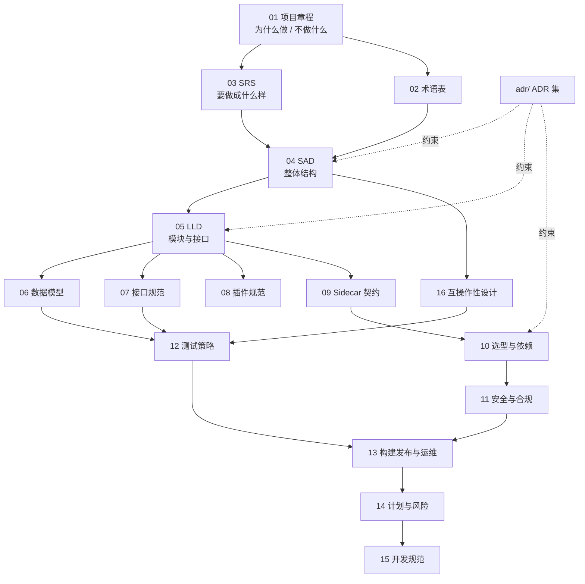

# 文档总览与文档控制

> 文档编号：UD-DOC-00 ｜ 版本：v0.6 ｜ 状态：**草案（P0 已通过有条件评审；ADR 集已批准，其余文档待逐篇评审）** ｜ 日期：2026-11-09 ｜ 维护责任：架构组

> **v0.6 变更**：P0 里程碑评审于 2026-11-09 「有条件通过」，ADR 0001–0020 批量转 `Accepted`（索引升 v0.3），OPEN-01 定档 MPL-2.0、OPEN-02 定档 Flutter，`v0.1.0` 附注标签已打，P1 已解锁（`14` §11）。§三 清单中「17」与「ADR 索引」状态改为已批准；其余规范性文档仍为草案，按里程碑逐篇评审，不因一次授权整批生效。侧栏链接与全部深链保持不变。
>
> **v0.5 变更**：新增 [17 P0 里程碑评审材料](17-P0里程碑评审材料.md)，集中呈现可复跑门禁证据、ADR 变更清单、OPEN-01/02 决策简报与评审签署表；新增 `make gates` 证据链（覆盖率 / CycloneDX SBOM / 许可证 / `govulncheck` / 吞吐基准 / 回滚演练）。Go 工具链因 `GO-2026-6809` 升至 1.27.3。侧栏链接与所有既有深链保持不变。
>
> **v0.4 变更**：文档门户新增 `#/home` 状态首页（默认落地页），以统计卡 + 状态徽章 + 分类卡片展示「待审核 / 已决定 / 持续维护 / 已废止 / 未标注」分布；状态由构建器从各文档版本头与 ADR 状态行自动解析，不维护第二份清单。侧栏链接与所有既有深链保持不变。
>
> **v0.3 变更**：P0 骨架（WBS 1–6）已完成编码，本仓库不再「只有文档」。新增根目录 [`CHANGELOG.md`](../CHANGELOG.md) 作为唯一的变更记录真值源并纳入文档门户；`03`–`07`、`10`–`15`、ADR 索引与 [ADR-0020](adr/ADR-0020-P0实现基线与范围声明.md) 均已按实现校准。阅读时请区分「目标规范」与「P0 现状」：各文档版本头下的实现校准段、以及 §七 的索引是入口。

本目录是本项目**唯一的规范性文档集合**。所有设计决策以 `adr/` 下的架构决策记录为唯一真值源；其余文档必须与已批准的 ADR 保持一致，冲突时以 ADR 为准并立即发起文档变更。

## 一、文档控制

| 项 | 规定 |
|---|---|
| 文档体系 | 编号 `UD-DOC-NN`；ADR 编号 `ADR-NNNN`；版本遵循 `vMAJOR.MINOR` |
| 状态机 | `草案 → 评审中 → 已批准 → 已废止`；只有「已批准」文档可作为实现与验收依据。**ADR 0001–0020 已于 2026-11-09 批量批准**，其余规范性文档仍为草案，按里程碑逐篇评审 |
| 变更触发 | 新增/修订 ADR、需求变更、依赖重大版本升级、评审缺陷、架构回归 |
| 变更流程 | 提 RFC/Issue → 影响分析（列出受影响文档编号）→ 评审 → 同步修改全部受影响文档 → 记录变更表 |
| 单一真值源 | 决策看 ADR；接口看 `07`；数据模型看 `06`；其余文档引用而不复制 |
| 评审周期 | 每里程碑结束强制评审一次；依赖清单 `10` 每季度复核 |
| 存放 | 全部 Markdown 随代码版本化，禁止只在聊天/网盘中留档 |
| 生成物 | `docs/_site/` 为构建产物，禁止手工编辑，由 `tools/build_docs.py` 生成 |

## 二、文档体系与阅读路径



**按角色阅读：**

| 角色 | 必读 | 选读 |
|---|---|---|
| 产品/项目管理 | 01、03、14、16 | 04、13 |
| 架构师 | 全部 | — |
| 后端 / Go 开发 | 02、04、05、06、07、08、09、15 | 10、12 |
| 客户端 / UI 开发 | 02、03、04、07、13 | 12 |
| 测试 / QA | 03、07、12、16、13 | 05、06 |
| 安全 / 法务 | 10、11、16、09 | 01 |
| 新成员入职 | 01 → 02 → 04 → adr/README | 其余按需 |

## 三、文档清单

| 编号 | 文档 | 状态 | 主要读者 | 摘要 |
|---|---|---|---|---|
| 00 | [文档总览](README.md) | 草案 | 全体 | 文档控制、体系、清单、阅读路径 |
| 01 | [项目章程](01-项目章程.md) | 草案 | 全体 | 愿景、目标、范围/非目标、成功指标、约束、里程碑 |
| 02 | [术语表](02-术语表.md) | 草案 | 全体 | 统一术语，消除协议/容器/后处理概念混用 |
| 03 | [需求规格说明书 SRS](03-需求规格说明书-SRS.md) | 草案 | 产品/QA/架构 | FR/NFR、用例、验收标准、需求追踪矩阵 |
| 04 | [架构设计说明书 SAD](04-架构设计说明书-SAD.md) | 草案 | 架构/开发 | 架构原则、C4 视图、统一流水线、单调度器论证、质量属性 |
| 05 | [详细设计说明书 LLD](05-详细设计说明书-LLD.md) | 草案 | 后端开发 | 包结构、核心 Go 接口、Task 状态机、分片与限流、错误模型 |
| 06 | [数据模型与存储设计](06-数据模型与存储设计.md) | 草案 | 后端/QA | ER、DDL、Resource JSON、状态持久化、迁移 |
| 07 | [接口规范 API](07-接口规范-API.md) | 草案 | 全端/QA | REST / WebSocket / CLI / 错误码 / aria2 RPC facade 子集 |
| 08 | [扩展与插件开发规范](08-扩展与插件开发规范.md) | 草案 | 后端/生态 | Resolver/Transport/PostProcessor 契约、goja/wazero、SSRF 能力裁剪 |
| 09 | [Sidecar 与外部依赖契约](09-Sidecar与外部依赖契约.md) | 草案 | 后端/运维 | 判定标准、清单、manifest、JSON-RPC、能力协商与降级、ffmpeg/yt-dlp 专项约束 |
| 10 | [技术选型与依赖清单](10-技术选型与依赖清单.md) | 草案 | 架构/法务 | 完整库表、许可证矩阵、被否决方案、版本与 SBOM 策略 |
| 11 | [安全与合规设计](11-安全与合规设计.md) | 草案 | 安全/法务/全体 | 威胁模型、SSRF、凭据、供应链、许可证与平台条款边界 |
| 12 | [测试策略与测试计划](12-测试策略与测试计划.md) | 草案 | QA/开发 | 分层测试、互操作回归套件、故障注入、性能基准、发布门禁 |
| 13 | [构建发布与运维](13-构建发布与运维.md) | 草案 | DevOps/开发 | 交叉编译矩阵、CI/CD、打包、配置、升级迁移、监控与 Runbook |
| 14 | [项目计划与风险管理](14-项目计划与风险管理.md) | 草案 | PM/架构 | WBS、P0–P3 里程碑、风险登记册、未决事项 |
| 15 | [开发规范与协作流程](15-开发规范与协作流程.md) | 草案 | 全体 | 编码规范、Git 流程、评审清单、变更管理、DoR/DoD |
| 16 | [互操作性与兼容性设计](16-互操作性与兼容性设计.md) | 草案 | 架构/QA/产品 | BT/BEP、tracker、eD2k 三层兼容性、身份与礼仪、PT 非承诺、文案口径 |
| 17 | [P0 里程碑评审材料](17-P0里程碑评审材料.md) | 已批准 | 评审组/PM/QA/安全/法务 | 客观门禁证据、覆盖率达标记录、风险登记册更新、ADR 变更清单、OPEN 决策简报、签署表 |
| — | [ADR 索引](adr/README.md) | 已批准 | 全体 | 全部架构决策记录（唯一决策真值源），含 0020 P0 实现基线 |
| — | [更新日志 CHANGELOG](../CHANGELOG.md) | 现行 | 全体 | Keep a Changelog 1.1.0 + SemVer 2.0.0；**每次代码变更必须先写这里**（`15` §10） |

> **状态口径**：ADR 0001–0020 已于 2026-11-09 批量转 `Accepted`，P0 里程碑评审「有条件通过」，`14` §3 的 P1 门禁已解除。但除「17」与 ADR 索引外，其余规范性文档仍为草案，按里程碑逐篇评审；各文档用「v0.2 实现校准」段标注与已批准 ADR 的差异。评审结论与签署见 [`17`](17-P0里程碑评审材料.md)。
>
> 上表的状态会自动汇总到门户首页 `#/home`；本表与版本头是状态的唯一来源，不要在门户或构建器中另写一份状态清单。

## 四、全局约定

1. **术语**：首次出现使用 `02-术语表.md` 中的标准译名；「协议」一词不得泛指链接封装格式或内容源解析器。
2. **能力边界词**：`支持` / `不承诺` / `不支持` 严格区分；产品文案只能引用 `01` 与 `16` 的口径。
3. **外部依赖**：任何依赖引入必须先过 `10` 的许可证检查与 `11` 的安全检查；GPL 组件不得进入传输热路径。
4. **接口变更**：`07` 为主；`06` 的字段变更必须同步 `07` 的 JSON 示例与 `12` 的回归用例。
5. **图**：统一用 Mermaid；构建门户时渲染，未渲染时保留代码块可读。
6. **决策**：任何与已批准 ADR 冲突的实现，视为缺陷，须走 ADR 修订而非就地改代码。

## 五、文档门户（docs-as-code）

`docs/_site/index.html` 是单文件、可离线浏览的门户，由 `tools/build_docs.py` 生成，**禁止手工编辑**。

```bash
python3 tools/build_docs.py           # 重建门户 + 校验
python3 tools/build_docs.py --check   # 只校验，不写文件（用于 CI 门禁）
```

| 约定 | 说明 |
|---|---|
| 构建依赖 | `python3 -m pip install markdown`；Mermaid 仅在运行时按需从 CDN 加载，离线时保留源码可读 |
| 首页 | `#/home` 为默认落地页，是构建器生成的**虚拟章节**（无对应 Markdown 源文件）：hero 统计卡、状态分布条、按状态/类型筛选与搜索、按分类的文档卡片网格、「从这里开始」快捷入口。左侧全部文档链接保持不变，点击卡片标题仍在页内阅读正文 |
| 状态来源 | 首页状态取自每份文档版本头的 `状态：` 与 ADR 的 `- **状态**：`，`docs/README.md` §三 清单表为兜底；只按括号前的**主状态词**规范化为 5 类（待审核 / 已决定 / 持续维护 / 已废止 / 未标注），括号内备注不会影响归类。卡片同时显示 `P0 已校准`（版本 ≥ v0.2）与 `P0 依据`（ADR-0020「前置 ADR」）标记。修改状态后重跑构建即自动更新 |
| URL 格式 | `#/<slug>`，例如 `#/home`、`#/doc-04`、`#/adr-0013`；带章节锚点时为 `#/<slug>~<scoped-heading-id>` |
| slug 规则 | **必须全 ASCII**：`home` / `readme` / `doc-01`…`doc-17` / `adr-index` / `adr-0001`…`adr-0020` / `changelog` / `root-readme`。浏览器会对 `location.hash` 中的非 ASCII 字符做百分号编码，中文 slug 会导致哈希与 `data-slug` 不匹配、跳转回首页 |
| 旧书签 | v0.1 的 `#doc-<中文旧 slug>` 由门户内的 `ALIASES` 表自动映射到新 slug，仍可直接打开 |
| 链接转换 | 构建时把 `.md` 链接与 `#章节` 锚点统一改写为门户哈希；标题 id 按文档加前缀（`h-<slug>--<tocid>`），避免跨文档 id 冲突 |
| 校验范围 | 源文档内部链接、生成 HTML 的哈希目标、导航项 ↔ 章节一一对应、首页章节存在且卡片数等于文档数、残留 `.md` 链接、无重复 id |

**约束**：新增文档必须同步加入 `tools/build_docs.py` 的 `GROUPS`（或在 `discover()` 的自动发现范围内），并跑一次 `--check`；任何 slug 变更都必须在 `ALIASES` 中补映射，否则旧链接失效。

根目录文件可用 `@root:<file>` 前缀登记进 `GROUPS`（例如 `@root:CHANGELOG.md`），由 `group_rel()` 解析为 ROOT 相对路径，slug 显式固定为 `changelog`。这样 CHANGELOG 既符合 Keep a Changelog 的工具约定（必须在根目录），又能在门户中被检索与跳转。

## 六、变更记录

| 版本 | 日期 | 变更 | 作者 |
|---|---|---|---|
| v0.1 | 2026-11-08 | 初版，依据 2026-11-08 架构讨论与七轮追问结论建立全套文档 | 架构组 |
| v0.2 | 2026-11-08 | 修复门户链接跳转（ASCII slug、哈希路由、锚点作用域）；补充文档门户规范 | 架构组 |
| v0.3 | 2026-11-08 | P0 实现落地后全量校准：`03`–`07`、`10`–`15`、ADR 索引与新增 ADR-0020；新增标准 CHANGELOG 并接入门户；补充 §七 实现基线索引 | 架构组 |
| v0.4 | 2026-11-09 | 门户新增 `#/home` 状态首页（统计卡 / 状态徽章 / 筛选 / 分类卡片），默认落地页改为首页；补充首页与状态口径规范、校验项 | 架构组 |
| v0.5 | 2026-11-09 | 新增 17 号评审材料并接入门户；同步 P0 评审门禁证据链与 Go 1.27.3 安全升级 | 架构组 |

## 七、P0 实现基线索引（代码 ↔ 文档）

| 我想核对…… | 去哪里 |
|---|---|
| 实际改了什么、修了哪些缺陷 | [`CHANGELOG.md`](../CHANGELOG.md) `0.1.0` 与 `[Unreleased]` |
| P0 评审要签什么、还差什么 | [`docs/17`](17-P0里程碑评审材料.md) §1、§5、§7、§9 |
| 哪些能力是「有意不做」、哪些是遗漏 | [ADR-0020](adr/ADR-0020-P0实现基线与范围声明.md) §「决策 3」与「后果」 |
| P0 验收逐条结果 | [`docs/14`](14-项目计划与风险管理.md) §9 |
| 接口签名的最终口径 | [`docs/05`](05-详细设计说明书-LLD.md) §2、§4、§12 |
| 位图编码与敏感数据规则 | [`docs/06`](06-数据模型与存储设计.md) §6、§10 |
| L0 接口实现矩阵与 CLI 子集 | [`docs/07`](07-接口规范-API.md) §3、§8 |
| 实际 pin 的依赖 | [`docs/10`](10-技术选型与依赖清单.md) §7 |
| 安全残余风险 | [`docs/11`](11-安全与合规设计.md) §10 |
| 已落地的测试用例与门禁 | [`docs/12`](12-测试策略与测试计划.md) §9 |
| 实际构建链与 CI | [`docs/13`](13-构建发布与运维.md) §12 |
| 架构约束的代码映射 | [`docs/04`](04-架构设计说明书-SAD.md) §11 |
| 变更日志规范与静态检查链 | [`docs/15`](15-开发规范与协作流程.md) §10、§11 |

**快速本地验证**：

```bash
make lint          # gofmt + go vet + tools/check_arch.py（6 守卫）
make test          # go test ./... -count=1
make build         # CGO_ENABLED=0 六平台，输出到 dist/
make docs          # 重建 docs/_site/index.html
python3 tools/build_docs.py --check   # 只校验链接，CI 用
```
