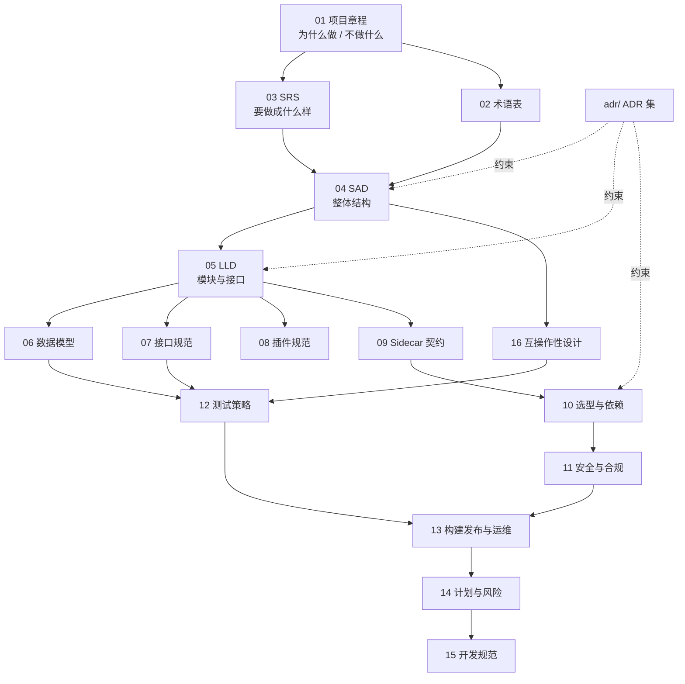

# 文档总览与文档控制

> 文档编号：UD-DOC-00 ｜ 版本：v1.6 ｜ 状态：**草案（P0 已通过有条件评审；ADR 0001–0020 已批准，ADR-0021 为待评审提案，其余文档待逐篇评审）** ｜ 日期：2026-11-14 ｜ 维护责任：架构组

> **v1.6 变更**（2026-11-14，代码↔文档一致性校准 + CI 结论补记；**纯文档 / 生成器校准，
> 不改产品范围**）：按 `15` §13 如实补记 `679a26e` run `43402970475` 与
> `c3fbc70` run `43567640194` 均 `quality: success`；一次被取代的 API 推送尝试
> run `43566313113` 为 `failure`（`actions/checkout` 无法完整拉取 API 生成的 commit，
> 已由真实 git 推送取代，非偶发 flake、非门禁回归），如实登记不隐藏。
> §三 严格门禁行追加两 run、当前态口径日期改 2026-11-14；§六 补本行；
> 同步 `13` v0.10 §4、根 `README.md` 当前态与 `CHANGELOG.md`。
> 门户生成器 `tools/build_docs.py` 把硬编码 `文档体系 v0.4` 徽章改为从本文件版本头
> 动态读取，导航契约注释改为 ADR 自动发现口径（实际 21 份 ADR），门户重建仍 42 篇 / 0 断链。
> **零产品代码改动**：门禁包仍 **16**、链接模块仍 **90**、L4 仍 **0/14**、
> `release_gate_met=false`、`nfr_perf_01.met=false`、序 6 仍开放；
> `17` / ADR-0020 已签署证据与 v1.1–v1.5 的时点数值不改写。
>
> **v1.5 变更**（2026-11-13，序 6 阻塞定档 + L4 实验室可执行化，序 6 仍不关闭）：
> 新增 [ADR-0021](adr/ADR-0021-L4门禁与P2P礼仪范围冲突裁决提案.md)（`Proposed`，未生效），
> 把序 6 阻塞的根因定档为「实现相对已批准 ADR-0004 / ADR-0017 与 `03` M 级需求的
> **未签署范围缩减（合规差距）**」，纠正此前「ADR-0004 不做种边界」的误归属，
> 并列出 A / B / C 三条须评审签署的裁决路径；0001–0020 仍全部 `Accepted`。
> §三 新增「阻塞定档」「L4 实验室链路」两行并改写 L4 行与「下一个工作包」行；
> 同步 `03` v0.8、`05` v0.7、`07` v0.5、`11` v1.0、`12` v1.3、`13` v0.9、
> `14` v1.4、`15` v0.5、`16` v0.8、ADR 索引 v0.4、ADR-0004 / ADR-0017 实现落地注、
> `config.example.yaml`、根 `README.md` 与 `CHANGELOG.md`；§六 补记 v1.3 / v1.4 漏记行。
> 门户生成器 `tools/build_docs.py` 修正过期横幅（改为按 ADR 头部动态汇总，
> 当前 **20 `Accepted` / 1 待评审**），门户重建 **42 篇 / 0 断链**。
> 新增 6 条 `TestPreflight*`，`internal/interop` 覆盖率 **87.9%**；门禁包仍 **16**、
> 链接模块仍 **90**，L4 仍 **0/14**、`release_gate_met=false`、`nfr_perf_01.met=false`。
> `17` / ADR-0020 已签署证据与 v1.1–v1.4 的时点数值不改写。
>
> **v1.4 变更**（2026-11-13，文档控制与 CI 证据补记、不改产品范围）：`9530c35` 的 CI
> run `43393512271` 因 WAL 偶发 `SQLITE_BUSY` 在 `cover` 步骤失败（**5 PASS / 0 WARN /
> 1 FAIL**）；修复提交 `ddda48d` 的 run `43399289527` 与文档复验提交 `8138c42` 的
> run `43400218985` 均为 **`quality: success`**。§三「当前态口径」严格门禁行改为
> 如实记录「曾失败 → 已修复 → 两次 CI 复验通过」，不再沿用「本机与 CI 一致」的
> 笼统表述。同步 `05` v0.6 / `06` v0.3 / `12` v1.2 / `13` v0.8 / `14` v1.3 /
> `15` v0.4、ADR-0015 实现落地注、根 `README.md` 与 `CHANGELOG.md`。
> **本次为纯文档变更**：门禁包仍 **16**、链接模块仍 **90**，L4 仍 **0/14**、
> 序 6 仍开放、`nfr_perf_01.met=false`。`17` / ADR-0020 已签署证据与
> v1.1–v1.3 的时点数值不改写。门户 `docs/_site/index.html` 已重建。
>
> **v1.3 变更**：P1 WBS 11 续包（仍不关闭序 6）。§三「当前态口径」更新外部证据为
> **BX-01..BX-04（aria2-next + 真实 libtorrent 2.1.1，4/4 PASS）**、新增「性能基准」行
> （`make perf` 1GiB 回环参考，`nfr_perf_01.met=false`）、L4 行补记
> **判据与 ADR-0004 产品边界的形式冲突（待评审）**；同步 `03` v0.7 §8 追踪矩阵、
> `05` v0.5 §1 当前态、`10` v0.9 §8.3、`11` v0.9 §7.1、`12` v1.1 §3.1/§3.1.1/§5、
> `13` v0.7 §3/§12、`14` v1.2 §11、`16` v0.7 §8、ADR-0004 实现落地段，以及根
> `README.md` / `CHANGELOG.md`。新增代码零依赖、门禁包数与链接模块数不变；
> `17` 与 ADR-0020 已签署证据原值不改。门户 `docs/_site/index.html` 已重建。
> **时点口径**：v1.2 说明中的 `BX-01 / BX-02` 为 **2026-11-11 时点值**，历史数值保留不改；
> 当前以本节表格（`BX-01..BX-04`、4/4 PASS）为唯一速查。
>
> **v1.2 变更**：P1 WBS 11（互操作套件 v1）落地，§三「当前态口径」更新为
> **16 个门禁包 / 90 个链接模块 / `make gates-strict` 6 PASS / 0 WARN / 0 FAIL /
> `make interop` 9 条本地用例全绿**，并新增「L4 发布门禁」行明确
> **BT-01..BT-14 全矩阵未执行、序 6 仍开放**（套件已交付 ≠ 矩阵已通过）。
> 同步 `03` v0.6 §8 追踪矩阵、`05` v0.4 §1 当前态、`07` v0.4 §8 CLI 矩阵、
> `10` v0.8 §8.3 零新增依赖说明、`11` v0.8 §10 残余风险、`12` v1.0 §3.1/§9、
> `13` v0.6 `make interop` 与证据链、`14` v1.1 §11 序 6、`16` v0.6 §6/§8 实现边界、
> ADR-0004 实现落地段，以及根 `README.md` / `CHANGELOG.md`。
> 同轮 `govulncheck` 新增可达的 `GO-2026-6859`，`go.mod` / CI 工具链由 1.27.3 升 **1.27.4**
> （模块依赖图不变，仍 90 个链接模块；`17` / ADR-0020 的 1.27.3 为 P0 时点值，不改写）。
> `17` 与 ADR-0020 仅补时点口径，**已签署的 P0 评审证据原值不改**。门户 `docs/_site/index.html` 已重建。
>
> **v1.1 变更**：P1 WBS 10（插件引擎 / 规则通道 v1）落地，§三「当前态口径」更新为
> **15 个门禁包 / 90 个链接模块 / `make gates-strict` 6 PASS / 0 WARN / 0 FAIL /
> 已交付 WBS 8/9/7/10 / 下一个工作包 = 序 6 / WBS 11 互操作套件 v1**；
> 同步 `03` v0.5 §8 追踪矩阵补记、`05` v0.3 包结构与 Resolver 链、`07` v0.3 CLI 子集、
> `08` v0.3 §10 实现落地、`10` v0.7 §8.2 goja 锁定依赖、`11` v0.7 §5 隔离矩阵、
> `12` v0.9 用例与阈值、`13` v0.5 插件配置、`14` v1.0 §11 序 5、`16` v0.5 实现边界、
> ADR-0014 实现落地段，以及根 `README.md` / `CHANGELOG.md`。
> `17` 与 ADR-0020 仅补时点口径，**已签署的 P0 评审证据原值不改**。门户 `docs/_site/index.html` 已重建。
>
> **v1.0 变更**：P1 WBS 7（BT / 磁力 Transport）落地，§三「当前态口径」更新为
> **14 个门禁包 / 86 个链接模块 / `make gates-strict` 6 PASS / 0 WARN / 0 FAIL / 已交付 WBS 8/9/7**；
> 同步 `03` v0.4 §8 追踪矩阵补记、`10` §4/§8.1 MPL 修改清单、`11` §7.1 BT 安全控制、
> `12` v0.8 测试用例与阈值、`14` §11 序 4、`16` §4、`README`、`CHANGELOG`。
> `17` 与 ADR-0020 仍保留 P0 评审证据原值不改。门户 `docs/_site/index.html` 已重建。
>
> **v0.9 变更**：仅文档口径校准，不改代码与已签署结论。§三 新增「当前态口径（唯一速查）」
> （13 个门禁包 / 16 个链接模块 / `make gates-strict` 6 PASS / 0 WARN）；
> `10` v0.5 把 §7 的「12 个链接模块」标注为 P0 时点值并补 WBS 9 后的 16 个；
> `13` v0.4 校正 CI 实际执行 `make gates-strict`（原文写 `make gates`）并补 SBOM 守卫描述；
> `12` v0.7 修正 v0.4 说明里对 §9 表「5 PASS / 1 WARN」的过期交叉引用；
> `14` v0.8 在 R-16 与 §10 补时点标注；`17` v0.3 与 ADR-0020 **只加时点口径声明，
> 保留 P0 评审证据原值不改**。根 `README.md` / `CHANGELOG.md` 同步。
> §三 清单表状态不变，侧栏链接与全部深链保持不变。
>
> **v0.8 变更**：P1 WBS 9（FTP / FTPS / SFTP Transport）落地，同步 `03` v0.3 §8 追踪矩阵、
> `10` v0.4 §8 依赖锁定表、`11` v0.5 §2/§3/§10、`12` v0.6 §3.3/§9、`14` v0.7 §11、
> `16` v0.3 §7/§8、ADR-0020 时点说明与根 `README.md` / `CHANGELOG.md`；
> 合入前另同步 `x/crypto` v0.54.0 → v0.58.0 的安全升级（`10` §8、`11` §10、
> `12` v0.6 说明 / §9、`14` v0.7 说明）与 `gates.py` 的 SBOM 陈旧二进制守卫；
> §六 变更记录补齐此前漏记的 v0.6 / v0.7 两行。§三 清单表状态不变（规范性文档仍为草案），
> 侧栏链接与全部深链保持不变；`16` §8 中被 WBS 8 同步弄成孤行的 DRM 表格行已归位。

> **v0.7 变更**：P1 WBS 8（链接封装解码 + Metalink 纯 Go 解析）落地，同步 `08` v0.2、
> `11` v0.4、`12` v0.5、`14` v0.6、`16` v0.2、`03` §8 追踪矩阵、ADR-0006/0007 实现落地段、
> ADR-0020 时点说明与根 `README.md` / `CHANGELOG.md`。§三 清单表状态不变（规范性文档仍为草案），
> 侧栏链接与全部深链保持不变。
>
> **v0.6 变更**：P0 里程碑评审于 2026-11-09 「有条件通过」，ADR 0001–0020 批量转 `Accepted`（索引升 v0.3），OPEN-01 定档 MPL-2.0、OPEN-02 定档 Flutter，`v0.1.0` 附注标签已打，P1 已解锁（`14` §11）。§三 清单中「17」与「ADR 索引」状态改为已批准；其余规范性文档仍为草案，按里程碑逐篇评审，不因一次授权整批生效。侧栏链接与全部深链保持不变。
>
> **v0.5 变更**：新增 [17 P0 里程碑评审材料](17-P0里程碑评审材料.md)，集中呈现可复跑门禁证据、ADR 变更清单、OPEN-01/02 决策简报与评审签署表；新增 `make gates` 证据链（覆盖率 / CycloneDX SBOM / 许可证 / `govulncheck` / 吞吐基准 / 回滚演练）。Go 工具链因 `GO-2026-6809` 升至 1.27.3。侧栏链接与所有既有深链保持不变。
>
> **v0.4 变更**：文档门户新增 `#/home` 状态首页（默认落地页），以统计卡 + 状态徽章 + 分类卡片展示「待审核 / 已决定 / 持续维护 / 已废止 / 未标注」分布；状态由构建器从各文档版本头与 ADR 状态行自动解析，不维护第二份清单。侧栏链接与所有既有深链保持不变。
>
> **v0.3 变更**：P0 骨架（WBS 1–6）已完成编码，本仓库不再「只有文档」。新增根目录 [`CHANGELOG.md`](../CHANGELOG.md) 作为唯一的变更记录真值源并纳入文档门户；`03`–`07`、`10`–`15`、ADR 索引与 [ADR-0020](adr/ADR-0020-P0实现基线与范围声明.md) 均已按实现校准。阅读时请区分「目标规范」与「P0 现状」：各文档版本头下的实现校准段、以及 §七 的索引是入口。

本目录是本项目**唯一的规范性文档集合**。所有设计决策以 `adr/` 下的架构决策记录为唯一真值源；其余文档必须与已批准的 ADR 保持一致，冲突时以 ADR 为准并立即发起文档变更。

## 一、文档控制

| 项 | 规定 |
|---|---|
| 文档体系 | 编号 `UD-DOC-NN`；ADR 编号 `ADR-NNNN`；版本遵循 `vMAJOR.MINOR` |
| 状态机 | `草案 → 评审中 → 已批准 → 已废止`；只有「已批准」文档可作为实现与验收依据。**ADR 0001–0020 已于 2026-11-09 批量批准**，其余规范性文档仍为草案，按里程碑逐篇评审 |
| 变更触发 | 新增/修订 ADR、需求变更、依赖重大版本升级、评审缺陷、架构回归 |
| 变更流程 | 提 RFC/Issue → 影响分析（列出受影响文档编号）→ 评审 → 同步修改全部受影响文档 → 记录变更表 |
| 单一真值源 | 决策看 ADR；接口看 `07`；数据模型看 `06`；其余文档引用而不复制 |
| 评审周期 | 每里程碑结束强制评审一次；依赖清单 `10` 每季度复核 |
| 存放 | 全部 Markdown 随代码版本化，禁止只在聊天/网盘中留档 |
| 生成物 | `docs/_site/` 为构建产物，禁止手工编辑，由 `tools/build_docs.py` 生成 |

## 二、文档体系与阅读路径



**按角色阅读：**

| 角色 | 必读 | 选读 |
|---|---|---|
| 产品/项目管理 | 01、03、14、16 | 04、13 |
| 架构师 | 全部 | — |
| 后端 / Go 开发 | 02、04、05、06、07、08、09、15 | 10、12 |
| 客户端 / UI 开发 | 02、03、04、07、13 | 12 |
| 测试 / QA | 03、07、12、16、13 | 05、06 |
| 安全 / 法务 | 10、11、16、09 | 01 |
| 新成员入职 | 01 → 02 → 04 → adr/README | 其余按需 |

## 三、文档清单

| 编号 | 文档 | 状态 | 主要读者 | 摘要 |
|---|---|---|---|---|
| 00 | [文档总览](README.md) | 草案 | 全体 | 文档控制、体系、清单、阅读路径 |
| 01 | [项目章程](01-项目章程.md) | 草案 | 全体 | 愿景、目标、范围/非目标、成功指标、约束、里程碑 |
| 02 | [术语表](02-术语表.md) | 草案 | 全体 | 统一术语，消除协议/容器/后处理概念混用 |
| 03 | [需求规格说明书 SRS](03-需求规格说明书-SRS.md) | 草案 | 产品/QA/架构 | FR/NFR、用例、验收标准、需求追踪矩阵 |
| 04 | [架构设计说明书 SAD](04-架构设计说明书-SAD.md) | 草案 | 架构/开发 | 架构原则、C4 视图、统一流水线、单调度器论证、质量属性 |
| 05 | [详细设计说明书 LLD](05-详细设计说明书-LLD.md) | 草案 | 后端开发 | 包结构、核心 Go 接口、Task 状态机、分片与限流、错误模型 |
| 06 | [数据模型与存储设计](06-数据模型与存储设计.md) | 草案 | 后端/QA | ER、DDL、Resource JSON、状态持久化、迁移 |
| 07 | [接口规范 API](07-接口规范-API.md) | 草案 | 全端/QA | REST / WebSocket / CLI / 错误码 / aria2 RPC facade 子集 |
| 08 | [扩展与插件开发规范](08-扩展与插件开发规范.md) | 草案 | 后端/生态 | Resolver/Transport/PostProcessor 契约、goja/wazero、SSRF 能力裁剪 |
| 09 | [Sidecar 与外部依赖契约](09-Sidecar与外部依赖契约.md) | 草案 | 后端/运维 | 判定标准、清单、manifest、JSON-RPC、能力协商与降级、ffmpeg/yt-dlp 专项约束 |
| 10 | [技术选型与依赖清单](10-技术选型与依赖清单.md) | 草案 | 架构/法务 | 完整库表、许可证矩阵、被否决方案、版本与 SBOM 策略 |
| 11 | [安全与合规设计](11-安全与合规设计.md) | 草案 | 安全/法务/全体 | 威胁模型、SSRF、凭据、供应链、许可证与平台条款边界 |
| 12 | [测试策略与测试计划](12-测试策略与测试计划.md) | 草案 | QA/开发 | 分层测试、互操作回归套件、故障注入、性能基准、发布门禁 |
| 13 | [构建发布与运维](13-构建发布与运维.md) | 草案 | DevOps/开发 | 交叉编译矩阵、CI/CD、打包、配置、升级迁移、监控与 Runbook |
| 14 | [项目计划与风险管理](14-项目计划与风险管理.md) | 草案 | PM/架构 | WBS、P0–P3 里程碑、风险登记册、未决事项 |
| 15 | [开发规范与协作流程](15-开发规范与协作流程.md) | 草案 | 全体 | 编码规范、Git 流程、评审清单、变更管理、DoR/DoD |
| 16 | [互操作性与兼容性设计](16-互操作性与兼容性设计.md) | 草案 | 架构/QA/产品 | BT/BEP、tracker、eD2k 三层兼容性、身份与礼仪、PT 非承诺、文案口径 |
| 17 | [P0 里程碑评审材料](17-P0里程碑评审材料.md) | 已批准 | 评审组/PM/QA/安全/法务 | 客观门禁证据、覆盖率达标记录、风险登记册更新、ADR 变更清单、OPEN 决策简报、签署表 |
| — | [ADR 索引](adr/README.md) | 已批准 | 全体 | 全部架构决策记录（唯一决策真值源），含 0020 P0 实现基线 |
| — | [更新日志 CHANGELOG](../CHANGELOG.md) | 现行 | 全体 | Keep a Changelog 1.1.0 + SemVer 2.0.0；**每次代码变更必须先写这里**（`15` §10） |

> **状态口径**：ADR 0001–0020 已于 2026-11-09 批量转 `Accepted`，P0 里程碑评审「有条件通过」，`14` §3 的 P1 门禁已解除。但除「17」与 ADR 索引外，其余规范性文档仍为草案，按里程碑逐篇评审；各文档用「v0.2 实现校准」段标注与已批准 ADR 的差异。评审结论与签署见 [`17`](17-P0里程碑评审材料.md)。
>
> 上表的状态会自动汇总到门户首页 `#/home`；本表与版本头是状态的唯一来源，不要在门户或构建器中另写一份状态清单。

**当前态口径（唯一速查，2026-11-14）**：下表描述**当前仓库**，须与 P0 评审时点快照区分；
进度真值源仍为 `CHANGELOG.md` 与 `14` §11。

| 项 | 当前值 | 权威来源 |
|---|---|---|
| 已交付 | P0 有条件通过（附加条件已关闭）、P1 WBS 8 / WBS 9 / WBS 7（BT / 磁力） / WBS 10（插件引擎）；**WBS 11 互操作套件 v1 已交付**（框架 + 自建 tracker + 9 条本地用例 + 证据链），但 L4 全矩阵未执行，序 6 **不关闭**；另以本机 **aria2-next 3.0.9**（MotrixNext）与真实 **libtorrent 2.1.1**（Python 绑定，可选外部工具）作真实做种方产出 **BX-01..BX-04 跨客户端证据**（sha256 校验通过），为**补充证据**不计入 L4 门禁 | `CHANGELOG.md`、`14` §11、`12` §3.1.1 |
| 受门禁包 | **16 个**（WBS 10 新增 `internal/plugin` 88.4%；WBS 11 新增 `internal/interop` 87.1%，本包复测 **87.9%**） | `tools/gates.py:THRESHOLDS`、`12` §9 |
| 链接模块 | **90 个**，0 copyleft / 0 未识别（含 `anacrolix/torrent` v1.62.0 与 `goja`；WBS 11 零新增依赖） | `dist/sbom.cdx.json`、`10` §8.1 / §8.2 |
| 严格门禁 | `make gates-strict` **6 PASS / 0 WARN / 0 FAIL**（本机；CI 于 2026-11-13 的 run `43393512271` 曾因 WAL 偶发 `SQLITE_BUSY` 在 `cover` 步骤 **5 PASS / 0 WARN / 1 FAIL**，已修复，CI run `43399289527`（代码修复）与 `43400218985`（文档复验）均 `quality: success`（严格门禁 6 PASS / 0 WARN / 0 FAIL）；后续 `679a26e` run `43402970475` 与 `c3fbc70` run `43567640194` 于 2026-11-14 核验亦均 `quality: success`，被取代的 API 推送尝试 run `43566313113` 为 `failure`（非 flake、非门禁回归，详见 v1.6 变更）） | `dist/gates.json`、`.github/workflows/ci.yml`、`13` §4 |
| 互操作套件 | `make interop` **23 例：9 PASS / 0 FAIL / 12 SKIPPED / 2 UNSUPPORTED**，证据 `dist/interop.json`；`dist/interop_external.json` 为 **BX-01..BX-04 真实跨客户端证据（2 引擎、4/4 PASS、sha256 校验）**，由 `make interop-external` 复跑并合并进 `dist/INTEROP.md` | `dist/INTEROP.md`、`dist/interop_external.json`、`12` §3.1.1 |
| **L4 发布门禁** | ❌ **未通过**：`BT-01..BT-14` 需真实 qBittorrent / Transmission、自建 tracker 二进制、抓包与千兆内网；`SKIPPED` / `UNSUPPORTED` 不计为 PASS。已用 **aria2-next**（不点名）与真实 **libtorrent 2.1.1**（点名于 `BT-03`，但仅单向回环）取得补充证据，**均不计入门禁**；阻塞已按 **ADR-0021（Proposed）** 定档：根因是实现相对 ADR-0004 / ADR-0017 与 `03` M 级需求的**未签署范围缩减**，判据冲突与实验室条件缺失并存，须评审裁决 | `dist/INTEROP.md`、`14` §11 序 6、`12` §3.1、ADR-0021 |
| 阻塞定档 | **ADR-0021**（`Proposed`，待评审、**未生效**）：A 补齐做种实现 / B 修订范围（须把 ADR-0004、ADR-0017 标 `Superseded` 并同步 `03` 等九处）/ C 保持开放，三条互斥路径及影响面清单；签署前不得改判据、不得把 `UNSUPPORTED` 记 PASS 或以豁免计入通过数 | `docs/adr/ADR-0021-…`、`12` §3.1.2、`15` §4 |
| L4 实验室链路 | `make l4-preflight` → `dist/l4_preflight.json` / `dist/L4_PREFLIGHT.md`（9 项前置条件清点，`l4_executed=false`、`release_gate_met=false` 硬不变量）；`l4-preflight-check` / `l4-run` 与示例 stub 配置只输出 `SKIPPED`，**不是 L4 执行证据**；三目标均不接入 CI | `12` §3.1.3、`13` §3/§12、`dist/L4_PREFLIGHT.md` |
| 性能基准 | `make perf` 产出 `dist/perf.json`：1GiB / 4 连接 / 256KiB 分片走真实 HTTP Range Transport，本机回环参考 **885.83 MB/s（1.156s）**；**`nfr_perf_01.met=false`**，回环不等于双机千兆内网达标；既有 32MiB 微基准仍为回归基线 | `dist/perf.json`、`12` §5 |
| 下一个工作包 | **先由评审按 ADR-0021 裁决**「补齐做种实现 / 修订范围 / 保持开放」并签署（不签署则序 6 永不关闭）；随后在隔离千兆内网执行 `BT-01..BT-14` 真实客户端矩阵（套件与 `make l4-preflight` / `make l4-run` 已就绪）、`chihaya` / `opentracker` 二进制与抓包，并执行 NFR-PERF-01 双机 1GiB ≥ 80MB/s 基准 | `14` §11、`16` §6、`12` §3.1.2 / §3.1.3 / §5、ADR-0021 |

> **禁止误读**：套件 v1 已交付、CI 会跑 `make interop`，只说明**可复跑的本地自动化部分是绿的**；
> `dist/INTEROP.md` 的 `release_gate_met: false` 才是发布结论。产品文案仍按 `16` §7
> 只写「兼容标准 BitTorrent 网络，可与主流客户端互通」，**不得**写「已与主流客户端实测互通」
> 「全矩阵通过」或「千兆内网性能达标」。`make interop-gate` 在门禁未满足时明确失败。
> **新增边界**：`libtorrent 2.1.1` 虽点名于 `BT-03`，但 BX-03 / BX-04 只是
> 「对方做种 → 我方下载」的单向回环证据，缺双向、抓包、隔离千兆内网与
> `chihaya` / `opentracker` 二进制，**不得**据此宣称 `BT-03` 通过；`dist/perf.json`
> 的回环 MB/s 也**不得**当作 NFR-PERF-01 达标（该文件固定 `nfr_perf_01.met=false`）。
> **ADR-0021 边界**：该记录是 `Proposed` **提案**，不是已批准决策、不构成实现依据；
> 各文档此前「ADR-0004 不做种边界」的措辞属误归属，已追加带日期的校准注，
> 历史版本说明中的数值保留不改。`make l4-preflight` 的 `PRESENT` 只表示工具可核验的
> 条件存在，**绝不等于 PASS**；示例 stub 配置只能产出 `SKIPPED`，
> `make l4-run` 用它必须保持 0/14 并明确失败。
>
> **时点区分**：`17`、ADR-0020 以及 `12` v0.4/v0.5 说明中的「10 个门禁包 /
> 12 个链接模块 / 5 PASS / 1 WARN / 4 PASS / 2 WARN」均为 **2026-11-09/10 P0 评审时点快照**，
> 作为已签署证据保留，**不得当作当前态引用**，也不得为了「统一数字」改写历史证据。
> WBS 7「14 / 86」、WBS 10「15 / 90」、WBS 11「16 / 90」按版本分层记录于
> `14` §10、`12` 各版说明与 `10` §7/§8，当前态以本节表格为唯一速查。

## 四、全局约定

1. **术语**：首次出现使用 `02-术语表.md` 中的标准译名；「协议」一词不得泛指链接封装格式或内容源解析器。
2. **能力边界词**：`支持` / `不承诺` / `不支持` 严格区分；产品文案只能引用 `01` 与 `16` 的口径。
3. **外部依赖**：任何依赖引入必须先过 `10` 的许可证检查与 `11` 的安全检查；GPL 组件不得进入传输热路径。
4. **接口变更**：`07` 为主；`06` 的字段变更必须同步 `07` 的 JSON 示例与 `12` 的回归用例。
5. **图**：统一用 Mermaid；构建门户时渲染，未渲染时保留代码块可读。
6. **决策**：任何与已批准 ADR 冲突的实现，视为缺陷，须走 ADR 修订而非就地改代码。

## 五、文档门户（docs-as-code）

`docs/_site/index.html` 是单文件、可离线浏览的门户，由 `tools/build_docs.py` 生成，**禁止手工编辑**。

```bash
python3 tools/build_docs.py           # 重建门户 + 校验
python3 tools/build_docs.py --check   # 只校验，不写文件（用于 CI 门禁）
```

| 约定 | 说明 |
|---|---|
| 构建依赖 | `python3 -m pip install markdown`；Mermaid 仅在运行时按需从 CDN 加载，离线时保留源码可读 |
| 首页 | `#/home` 为默认落地页，是构建器生成的**虚拟章节**（无对应 Markdown 源文件）：hero 统计卡、状态分布条、按状态/类型筛选与搜索、按分类的文档卡片网格、「从这里开始」快捷入口。左侧全部文档链接保持不变，点击卡片标题仍在页内阅读正文 |
| 状态来源 | 首页状态取自每份文档版本头的 `状态：` 与 ADR 的 `- **状态**：`，`docs/README.md` §三 清单表为兜底；只按括号前的**主状态词**规范化为 5 类（待审核 / 已决定 / 持续维护 / 已废止 / 未标注），括号内备注不会影响归类。卡片同时显示 `P0 已校准`（版本 ≥ v0.2）与 `P0 依据`（ADR-0020「前置 ADR」）标记。修改状态后重跑构建即自动更新 |
| URL 格式 | `#/<slug>`，例如 `#/home`、`#/doc-04`、`#/adr-0013`；带章节锚点时为 `#/<slug>~<scoped-heading-id>` |
| slug 规则 | **必须全 ASCII**：`home` / `readme` / `doc-01`…`doc-17` / `adr-index` / `adr-0001`…`adr-0020` / `changelog` / `root-readme`。浏览器会对 `location.hash` 中的非 ASCII 字符做百分号编码，中文 slug 会导致哈希与 `data-slug` 不匹配、跳转回首页 |
| 旧书签 | v0.1 的 `#doc-<中文旧 slug>` 由门户内的 `ALIASES` 表自动映射到新 slug，仍可直接打开 |
| 链接转换 | 构建时把 `.md` 链接与 `#章节` 锚点统一改写为门户哈希；标题 id 按文档加前缀（`h-<slug>--<tocid>`），避免跨文档 id 冲突 |
| 校验范围 | 源文档内部链接、生成 HTML 的哈希目标、导航项 ↔ 章节一一对应、首页章节存在且卡片数等于文档数、残留 `.md` 链接、无重复 id |

**约束**：新增文档必须同步加入 `tools/build_docs.py` 的 `GROUPS`（或在 `discover()` 的自动发现范围内），并跑一次 `--check`；任何 slug 变更都必须在 `ALIASES` 中补映射，否则旧链接失效。

根目录文件可用 `@root:<file>` 前缀登记进 `GROUPS`（例如 `@root:CHANGELOG.md`），由 `group_rel()` 解析为 ROOT 相对路径，slug 显式固定为 `changelog`。这样 CHANGELOG 既符合 Keep a Changelog 的工具约定（必须在根目录），又能在门户中被检索与跳转。

## 六、变更记录

| 版本 | 日期 | 变更 | 作者 |
|---|---|---|---|
| v0.1 | 2026-11-08 | 初版，依据 2026-11-08 架构讨论与七轮追问结论建立全套文档 | 架构组 |
| v0.2 | 2026-11-08 | 修复门户链接跳转（ASCII slug、哈希路由、锚点作用域）；补充文档门户规范 | 架构组 |
| v0.3 | 2026-11-08 | P0 实现落地后全量校准：`03`–`07`、`10`–`15`、ADR 索引与新增 ADR-0020；新增标准 CHANGELOG 并接入门户；补充 §七 实现基线索引 | 架构组 |
| v0.4 | 2026-11-09 | 门户新增 `#/home` 状态首页（统计卡 / 状态徽章 / 筛选 / 分类卡片），默认落地页改为首页；补充首页与状态口径规范、校验项 | 架构组 |
| v0.5 | 2026-11-09 | 新增 17 号评审材料并接入门户；同步 P0 评审门禁证据链与 Go 1.27.3 安全升级 | 架构组 |
| v0.6 | 2026-11-09 | P0 里程碑评审「有条件通过」：ADR 0001–0020 批量批准、OPEN-01/02 定档、`v0.1.0` 附注标签、P1 解锁 | 架构组 |
| v0.7 | 2026-11-10 | P1 WBS 8（链接封装解码 + Metalink 纯 Go 解析）落地，同步 6 篇规范文档与 ADR 实现落地段 | 架构组 |
| v0.8 | 2026-11-10 | P1 WBS 9（FTP / FTPS / SFTP Transport）落地，同步 6 篇规范文档、ADR-0020 与根文档；补齐漏记的 v0.6/v0.7 变更行 | 架构组 |
| v0.9 | 2026-11-10 | 文档口径校准：§三 新增「当前态口径（唯一速查）」，统一当前态为 13 个门禁包 / 16 个链接模块 / `make gates-strict` 6 PASS；`10` v0.5、`12` v0.7、`13` v0.4、`14` v0.8、`17` v0.3 与 ADR-0020 补时点标注，已签署评审证据不改写 | 架构组 |
| v1.0 | 2026-11-10 | P1 WBS 7（BT / 磁力 Transport + MPL-2.0 合规）落地：§三 当前态更新为 14 个门禁包 / 86 个链接模块 / 6 PASS / 0 WARN / 0 FAIL / 已交付 WBS 8/9/7；同步 `03` §8 追踪矩阵、`10` MPL 修改清单、`11` §7.1、`12` 阈值与用例、`14` §11、`16` §4；门户重建 | 架构组 |
| v1.1 | 2026-11-10 | P1 WBS 10（插件引擎 / 规则通道 v1）落地：§三 当前态更新为 15 个门禁包 / 90 个链接模块 / 6 PASS / 0 WARN / 0 FAIL / 已交付 WBS 8/9/7/10 / 下一个工作包 = 序 6；同步 `03`/`05`/`07`/`08`/`10`/`11`/`12`/`13`/`14`/`16`、ADR-0014 实现落地段与根文档；`17` 与 ADR-0020 仅补时点口径；门户重建 | 架构组 |
| v1.2 | 2026-11-11 | P1 WBS 11 互操作套件 v1 落地：§三 当前态更新为 16 个门禁包 / 90 个链接模块，新增「互操作套件」与「L4 发布门禁 ❌ 未通过」两行；明确套件已交付但序 6 因外部矩阵未执行仍开放；同轮修复两处 `-race` 竞态并因 `GO-2026-6859` 把 Go 工具链升 1.27.4；同步 `03`/`05`/`07`/`10`/`11`/`12`/`13`/`14`/`16`、ADR-0004 实现落地段与根文档；`17` 与 ADR-0020 仅补时点口径；门户重建 | 架构组 |
| v1.3 | 2026-11-13 | P1 WBS 11 续包（补记）：§三 更新为 `BX-01..BX-04` 4/4 PASS、新增「性能基准」行、L4 行登记判据冲突；同步 `03`/`05`/`10`/`11`/`12`/`13`/`14`/`16`、ADR-0004 实现落地段与根文档；门户重建 | 架构组 |
| v1.4 | 2026-11-13 | 文档控制与 CI 证据补记（补记）：§三 严格门禁行如实闭合「曾失败 → 已修复 → 两次 CI 复验通过」；`15` v0.4 新增 §13「CI 偶发失败处置」；同步 `05`/`06`/`12`/`13`/`14`、ADR-0015 实现落地注与根文档；门户重建 | 架构组 |
| v1.5 | 2026-11-13 | 序 6 阻塞定档 + L4 实验室可执行化：新增 ADR-0021（`Proposed`）、§三 新增「阻塞定档」「L4 实验室链路」两行；同步 `03`/`05`/`07`/`11`/`12`/`13`/`14`/`15`/`16`、ADR 索引 v0.4、ADR-0004/0017 实现落地注、`config.example.yaml`、根文档；修正门户生成器过期横幅并改为按 ADR 头部动态汇总；门户重建 42 篇 | 架构组 |
| v1.6 | 2026-11-14 | 代码↔文档一致性校准 + CI 结论补记（纯文档/生成器校准）：§三 严格门禁行追加 `679a26e` run `43402970475` / `c3fbc70` run `43567640194` 均 `quality: success` 与被取代推送的 run `43566313113` `failure`（非 flake）；门户生成器硬编码 `文档体系 v0.4` 徽章改为从本文件版本头动态读取、导航契约注释改为 ADR 自动发现口径；同步 `13` v0.10、根文档与 `CHANGELOG`；门户重建仍 42 篇 | 架构组 |

## 七、P0 实现基线索引（代码 ↔ 文档）

| 我想核对…… | 去哪里 |
|---|---|
| 实际改了什么、修了哪些缺陷 | [`CHANGELOG.md`](../CHANGELOG.md) `0.1.0` 与 `[Unreleased]` |
| P0 评审要签什么、还差什么 | [`docs/17`](17-P0里程碑评审材料.md) §1、§5、§7、§9 |
| 哪些能力是「有意不做」、哪些是遗漏 | [ADR-0020](adr/ADR-0020-P0实现基线与范围声明.md) §「决策 3」与「后果」 |
| P0 验收逐条结果 | [`docs/14`](14-项目计划与风险管理.md) §9 |
| 接口签名的最终口径 | [`docs/05`](05-详细设计说明书-LLD.md) §2、§4、§12 |
| 位图编码与敏感数据规则 | [`docs/06`](06-数据模型与存储设计.md) §6、§10 |
| L0 接口实现矩阵与 CLI 子集 | [`docs/07`](07-接口规范-API.md) §3、§8 |
| 实际 pin 的依赖 | [`docs/10`](10-技术选型与依赖清单.md) §7 |
| 安全残余风险 | [`docs/11`](11-安全与合规设计.md) §10 |
| 已落地的测试用例与门禁 | [`docs/12`](12-测试策略与测试计划.md) §9 |
| 实际构建链与 CI | [`docs/13`](13-构建发布与运维.md) §12 |
| 架构约束的代码映射 | [`docs/04`](04-架构设计说明书-SAD.md) §11 |
| 变更日志规范与静态检查链 | [`docs/15`](15-开发规范与协作流程.md) §10、§11 |

**快速本地验证**：

```bash
make lint          # gofmt + go vet + tools/check_arch.py（6 守卫）
make test          # go test ./... -count=1
make build         # CGO_ENABLED=0 六平台，输出到 dist/
make interop       # WBS 11 互操作套件 v1 -> dist/interop.json + dist/INTEROP.md
make interop-gate  # L4 发布门禁（外部矩阵未执行时明确失败，不接入 CI）
make docs          # 重建 docs/_site/index.html
python3 tools/build_docs.py --check   # 只校验链接，CI 用
```
