# 架构决策记录（ADR）索引

> 文档编号：UD-ADR-00 ｜ 版本：v0.3 ｜ 日期：2026-11-09 ｜ 维护：架构组

ADR 是本项目**架构决策的唯一真值源**。任何与已接受 ADR 冲突的实现视为缺陷；要改变结论必须提交新 ADR 并把旧记录标为 `Superseded`，不得就地修改历史记录或只在聊天里达成共识。

## 状态定义

| 状态 | 含义 |
|---|---|
| `Proposed` | 提出，待评审 |
| `Accepted` | 已接受，作为实现与评审依据 |
| `Deprecated` | 不再推荐，但尚未被替代 |
| `Superseded by ADR-XXXX` | 已被新决策取代 |

> **2026-11-09 P0 里程碑评审批量决议**：0001–0020 全部由 `Proposed` 转为 `Accepted`。依据 `docs/17` §1 的「有条件通过」结论与 §7 的变更清单，项目发起人（用户）一次性全权批准并代行架构师逐篇确认；`docs/README.md` §三 中本索引状态同步为「已批准」。此前「代码已按 Proposed ADR 先行构建骨架」的例外自此消除，满足 `15` §4「只有已批准 ADR 可作为实现依据」。覆盖率债等附加条件见 `17` §1，不影响 ADR 生效。

## 记录模板（`ADR-0000-模板.md`）

```
# ADR-NNNN 标题
- 状态 / 日期 / 决策者 / 关联需求与文档
## 背景（问题、约束、已核实事实）
## 决策（一句话结论 + 具体规定）
## 备选方案（含否决理由）
## 后果（正面 / 负面 / 后续动作）
## 合规与验证（如何证明决策被遵守）
```

## 索引

| 编号 | 标题 | 状态 | 影响文档 |
|---|---|---|---|
| [0001](ADR-0001-核心语言选择Go.md) | 核心语言选择 Go，坚持纯 Go 单二进制 | Accepted | 01、04、10、13 |
| [0002](ADR-0002-统一流水线与单调度器.md) | 采用 Resolver→Resource→Transport 统一流水线与单调度器 | Accepted | 03、04、05、07 |
| [0003](ADR-0003-完全移除aria2二进制.md) | 完全移除 aria2 二进制，只保留其 wire protocol 规范 | Accepted | 04、07、10 |
| [0004](ADR-0004-BT引擎选用anacrolix-torrent.md) | BT 引擎进程内自研，不外包给 aria2 | Accepted | 04、10、16 |
| [0005](ADR-0005-ed2k引擎选用goed2k.md) | ed2k 采用 goed2k（MIT，纯 Go） | Accepted | 10、16、12 |
| [0006](ADR-0006-Metalink纯Go解析.md) | Metalink 自写纯 Go 解析，撤回 libmetalink | Accepted | 08、10 |
| [0007](ADR-0007-迅雷链接仅解码不支持P2SP.md) | 迅雷链接仅解码，不做 P2SP | Accepted | 01、03、16 |
| [0008](ADR-0008-Sidecar边界与最小集合.md) | Sidecar 判定标准与零 sidecar 基线 | Accepted | 04、09、13 |
| [0009](ADR-0009-Telegram改用gotd-td.md) | Telegram 改 gotd/td 纯 Go，移除 Telethon | Accepted | 09、10 |
| [0010](ADR-0010-视频站双层解析策略.md) | 视频站双层：lux 进程内 + yt-dlp 仅吐 JSON | Accepted | 04、09 |
| [0011](ADR-0011-ffmpeg降级为可选后处理插件.md) | ffmpeg 降级为桌面可选 Transcode 插件 | Accepted | 09、11、13 |
| [0012](ADR-0012-PostProcessor本地文件契约.md) | PostProcessor 输入本地路径、输出 .part + 原子提交 | Accepted | 05、09、13 |
| [0013](ADR-0013-Resource协议身份字段一次性建模.md) | Resource 在 P0 一次性纳入多文件与协议身份字段 | Accepted | 05、06、07、14 |
| [0014](ADR-0014-插件引擎goja起步.md) | 插件引擎 goja 起步，wazero/Extism 可选硬隔离 | Accepted | 08、11 |
| [0015](ADR-0015-SQLite与系统钥匙串.md) | SQLite(modernc) + 系统钥匙串 | Accepted | 06、11 |
| [0016](ADR-0016-Daemon加可替换UI.md) | 核心为 daemon，UI 用 Flutter/Tauri 且可替换 | Accepted | 04、07、13 |
| [0017](ADR-0017-P2P诚实身份与PT非承诺.md) | P2P 保持诚实 PeerID，不承诺私有 tracker 准入 | Accepted | 11、16 |
| [0018](ADR-0018-微信能力隔离为可选插件.md) | 微信能力单独分发、默认不安装 | Accepted | 09、11、14 |
| [0019](ADR-0019-P0不实现aria2-RPC兼容层.md) | RPC 兼容分 L0/L1/L2 三档，P0/P1 停在 L0 | Accepted | 07、14 |
| [0020](ADR-0020-P0实现基线与范围声明.md) | 声明 P0 实现基线、三处规范修正与范围外能力清单 | Accepted | 03–07、10–15、CHANGELOG |

## 决策演进时间线

```mermaid
graph LR
    A["v1 初版<br/>Go 核心 + 6 sidecar<br/>BT 自研 / aria2 兜底 FTP·Metalink"] -->|"追问：为何不把 BT 也交 aria2"| B["v2<br/>单调度器原则确立<br/>aria2 降级为解析器/接口层"]
    B -->|"追问：还需要 aria2 吗"| C["v3<br/>完全删除 aria2 程序<br/>保留协议规范"]
    C -->|"追问：能否全 Go / ffmpeg 是否必需"| D["v4<br/>Telegram 纯 Go 化<br/>ffmpeg 降为可选"]
    D -->|"追问：只下载要不要 ffmpeg"| E["v5<br/>Remux 内置 / Transcode 可选<br/>PostProcessor 契约定死"]
    E -->|"追问：ffmpeg 跨平台代价"| F["v6<br/>ffmpeg 限定桌面插件<br/>移动端禁用"]
    F -->|"追问：与现有网络兼容性"| G["v7<br/>三层判据<br/>Resource 协议身份字段"]
    G -->|"P0 编码完成<br/>规范与实现对齐"| H["ADR-0020<br/>实现基线与范围声明"]
```



## 关联文档

`04-架构设计说明书-SAD.md` §10 给出架构决策点到 ADR 的映射；`14-项目计划与风险管理.md` §5 记录由这些决策引出的风险、§9 记录 P0 验收结果；`15-开发规范与协作流程.md` §4 规定 ADR 的变更流程、§10 规定变更日志规范；`ADR-0020` §「合规与验证」给出 P0 的落地检查清单。

> **状态变更已完成（2026-11-09）**：本表 0001–0020 已全部由 `Proposed` 转为 `Accepted`，依据 [`17`](../17-P0里程碑评审材料.md) §1/§7 的「有条件通过」结论与批量决议；本索引同步升 v0.3，文档门户由 `make docs` 重建并更新首页「已决定」计数。`14` §3 的 P1 门禁随之解除，排期见 `14` §11。
